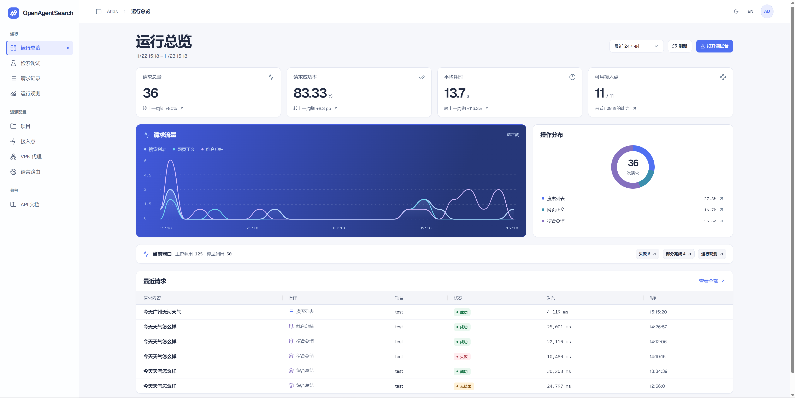
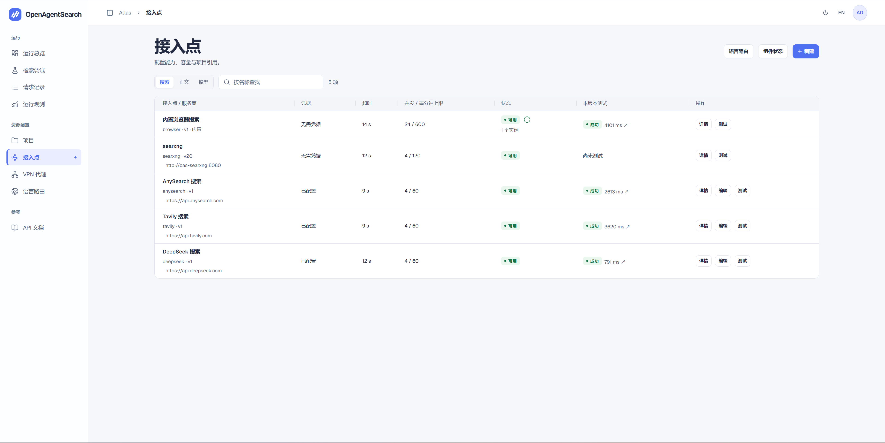
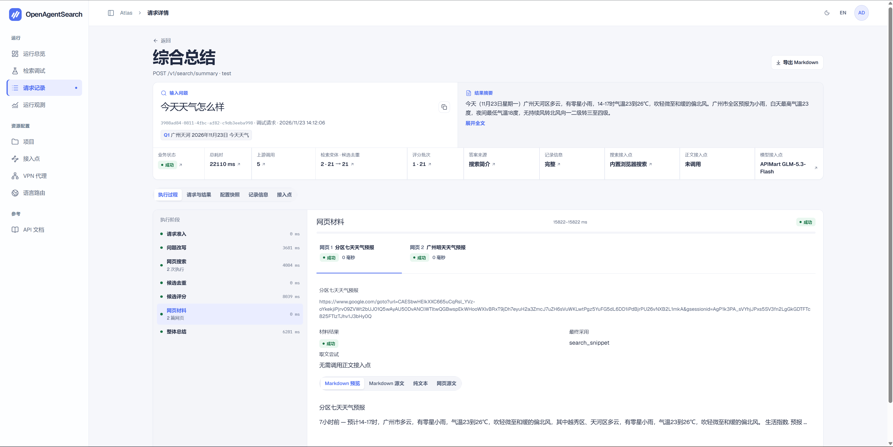

# OpenAgentSearch

<div align="center">

[](https://github.com/Minecodex/OpenAgentSearch/releases)


**为 AI 应用和 Agent 提供网页检索、正文提取与带引用的回答。**

[控制台](#atlas-控制台) · [业务 API](#业务-api) · [快速部署](#快速部署) · [本地开发与测试](#本地开发与测试) · [文档](docs/README.md)

</div>

## Atlas 控制台

Atlas 将搜索服务的日常操作集中在一个工作台，支持中文、英文以及浅色、深色主题。运行总览显示请求量、成功率、耗时和按接口划分的流量。打开最近一次请求，可以继续查看它使用了哪些来源。



### 项目与接入点

每个项目有独立的业务 Key。为项目选择搜索池、正文池和生成模型，再按语言设置首选搜索池。同一个服务商的搜索和正文能力可以分别绑定。项目页还提供可复制的 API 调用示例。


接入点页管理服务地址、凭据、并发和速率限制。可使用内置 Firefox，或接入 Tavily、AnySearch、DeepSeek、SearXNG 和 Crawl4AI 等服务。综合总结使用项目配置的 OpenAI 兼容模型。Firefox 提供稳定的搜索和正文接入点，增加就绪副本即可扩容。



### 请求记录与追踪

在请求记录中按项目、接口、状态或时间筛选。排查一次慢请求时，可以从列表进入详情，查看各阶段耗时、调用的接入点和返回的材料。


综合总结的详情保留原问题、改写词、候选网页、评分、分段摘要与最终引用。可以从答案中的引用回看对应网页的归档材料，也可以导出本次请求的 Markdown 报告。请求历史默认保留 7 天，可在管理台调整。



## 业务 API

三个同步接口使用同一个项目 Key，通过 `Authorization: Bearer <PROJECT_KEY>` 鉴权。

| 接口 | 必填输入 | 返回内容 |
| --- | --- | --- |
| `POST /v1/search/list` | `query` | 按排名返回标题、简介和 URL。内置引擎有卡片或带来源的 AI 回答时一并返回 |
| `POST /v1/search/content` | `url` | 同一网页的 Markdown、纯文本、字符数和截断信息 |
| `POST /v1/search/summary` | `query` | 带引用的回答、选用的来源、评分和分段摘要。可传入地区和当前时间以解释相对地点与日期 |

例如，设置 `OAS_PROJECT_KEY` 后，以下命令通过本地转发的服务检索三个网页。

```sh
curl -sS http://localhost:8080/v1/search/list \
  -H "Authorization: Bearer ${OAS_PROJECT_KEY}" \
  -H 'Content-Type: application/json' \
  -d '{"query":"雨量计如何测量降水？","language":"zh","count":3}'
```

`language` 指定搜索路由及总结语言，`Accept-Language` 选择错误和警告的语言。参数范围、响应示例和错误码见[业务 API 指南](docs/plan1/02-business-api.md)和[业务 OpenAPI](docs/plan1/contracts/business.openapi.yaml)。

## 快速部署

准备一个有可用 StorageClass 的 Kubernetes 集群，以及已配置 kubeconfig 的 `kubectl` 和 Helm 3。应用镜像面向 `linux/amd64` 节点。

1. 从发行页下载本机平台的 `oasctl` 压缩包、同版本 Helm Chart 和 `SHA256SUMS`。对照校验和后解压 CLI，Chart 保持为 `.tgz` 文件。[GitHub Releases](https://github.com/Minecodex/OpenAgentSearch/releases)
2. 在当前目录准备 UTF-8 文件 `initial-password.txt`，写入自选的管理员初始口令，至少 8 个字符。以下命令使用当前 Kubernetes 上下文，安装到 `search` 命名空间。
3. 安装完成后运行诊断，开启端口转发，在浏览器打开 `http://localhost:8080`，使用 `operator` 和自选口令登录。

```sh
./oasctl --version
./oasctl install --namespace search --release oas --chart ./openagentsearch-0.0.1-beta.tgz \
  --admin-username operator --admin-password-file ./initial-password.txt
./oasctl status --namespace search --release oas
./oasctl doctor --namespace search --release oas
kubectl -n search port-forward service/oas-web 8080:80
```

Linux 和 macOS 提供 AMD64、ARM64 的 `.tar.gz`，Windows 提供 AMD64 的 `.zip`。在 PowerShell 中使用 `.\oasctl.exe`，把上面的 `install` 参数写在同一行。首次安装会生成数据库口令、主加密密钥和执行器令牌。登录后为项目选择搜索和正文接入点，保存创建时显示的项目 Key，即可调用业务 API。调用综合总结还需绑定生成模型。

### 使用域名或调整配置

将站点配置保存为 `site-values.yaml`，安装时添加 `--values site-values.yaml`。下例使用已有的 Ingress Controller 和 TLS Secret 对外提供 HTTPS，并将 Firefox 扩展到两个副本。

```yaml
publicOrigin: https://search.example.com
ingress:
  enabled: true
  className: nginx
  host: search.example.com
  tlsSecretName: search-tls
browser:
  replicas: 2
  slots: 6
```

可分别设置 `searxng.enabled` 和 `crawl4ai.enabled` 启用配套搜索或正文服务。通过 `oasctl upgrade` 应用变更，使用与安装时相同的命名空间和 release 名称，并传入目标 Chart 和 values。私有仓库可覆盖 `images.api`、`images.web`、`images.browser` 的仓库与标签。[完整配置](deploy/helm/openagentsearch/values.yaml) · [安装、升级与诊断](docs/plan1/12-oasctl-and-helm.md)

## 架构与镜像

| 组件 | 职责 | 镜像 |
| --- | --- | --- |
| Rust API | 业务与管理接口、项目鉴权、路由调度、引用生成和请求历史 | [kakj/openagentsearch-api](https://hub.docker.com/r/kakj/openagentsearch-api) |
| Atlas Web | React、TypeScript 与 HeroUI 控制台，Nginx 将 API 请求转发到同源后端 | [kakj/openagentsearch-web](https://hub.docker.com/r/kakj/openagentsearch-web) |
| Firefox 执行器 | 执行内置搜索、加载网页正文，支持按项目分配 SOCKS5 或 HTTPS 代理 | [kakj/openagentsearch-browser](https://hub.docker.com/r/kakj/openagentsearch-browser) |
| PostgreSQL | 保存项目配置、加密凭据、请求证据和统计，使用持久卷 | Chart 配置的 PostgreSQL 镜像 |

## 本地开发与测试

源码开发使用 Rust 1.97、Node.js 24 和 PostgreSQL 18。在运行环境中设置数据库连接、64 位十六进制主密钥和独立的执行器令牌。使用 Vite 时将 `OAS_PUBLIC_ORIGIN` 设为 `http://localhost:5173`，前端将 API 请求转发至 `127.0.0.1:8080`。[环境变量模板](.env.example)

```sh
# 终端一
cargo run --locked -p oas-server

# 终端二
npm --prefix web ci
npm --prefix web run dev
```

```sh
cargo fmt --all --check
cargo clippy --locked --workspace --all-targets -- -D warnings
cargo test --locked --workspace
npm --prefix web test
npm --prefix web run build
python -m pip install -r tests/requirements.txt
node tests/local.mjs
```

Docker 端到端套件启动独立的 PostgreSQL、API、Web 和 Firefox，使用测试网页与模型夹具验证请求、引用、代理和界面交互，退出时回收本轮资源。需要 Chrome 或 Chromium，可通过 `PLAYWRIGHT_CHROMIUM_EXECUTABLE` 指定路径。集群安装、升级、扩缩容与故障恢复的运行方式见[验收矩阵](docs/plan1/09-rust-and-acceptance.md)和[逐项验收说明](docs/plan1/13-acceptance-subitems.md)。

## 文档

| 主题 | 入口 |
| --- | --- |
| 服务边界与部署拓扑 | [系统架构](docs/plan1/01-system.md) · [文档索引](docs/README.md) |
| 检索、评分和引用 | [搜索与内容流水线](docs/plan1/03-search-pipeline.md) |
| 服务商、路由和浏览器 | [路由与接入点](docs/plan1/04-routing-and-providers.md) · [浏览器与代理池](docs/plan1/07-browser-proxies.md) |
| 配置、请求历史与回放 | [控制面与存储](docs/plan1/05-control-and-storage.md) · [运行观测](docs/plan1/06-observability.md) · [管理 OpenAPI](docs/plan1/contracts/management.openapi.yaml) |
