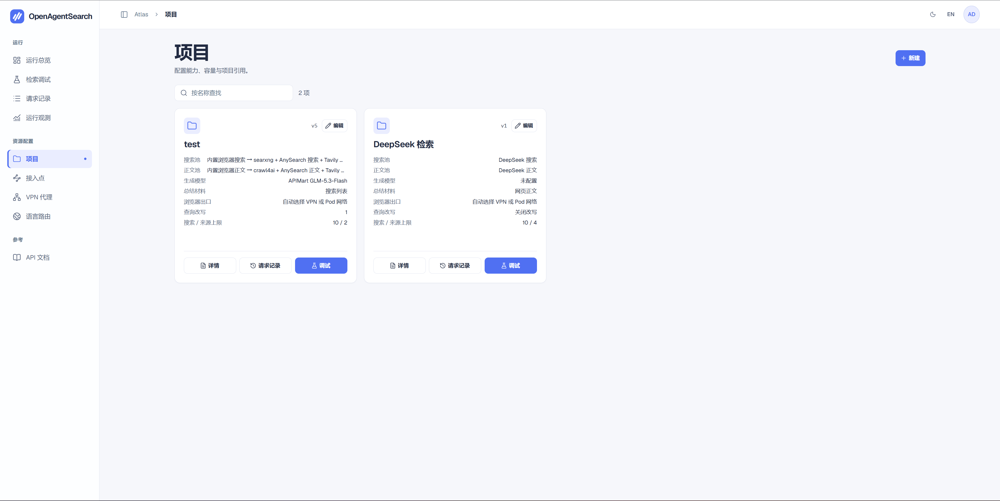
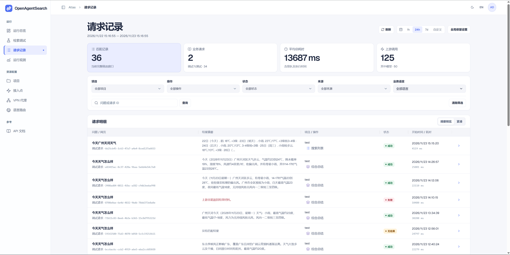

# OpenAgentSearch

<div align="center">

[](https://github.com/Minecodex/OpenAgentSearch/releases)
[](LICENSE)


**为 AI 应用和 Agent 提供网页检索、正文提取与带引用的回答。**

[控制台](#atlas-控制台) · [业务 API](#业务-api) · [搜索缓存](#搜索缓存) · [快速部署](#快速部署) · [本地开发与测试](#本地开发与测试) · [文档](docs/README.md)

</div>

## Atlas 控制台

Atlas 将搜索服务的日常操作集中在一个工作台，支持中文、英文以及浅色、深色主题。运行总览显示请求量、成功率、耗时和按接口划分的流量。打开最近一次请求，可以继续查看它使用了哪些来源。


### 项目与接入点

每个项目有独立的业务 Key。为项目选择搜索池、正文池和生成模型，再按语言设置首选搜索池。同一个服务商的搜索和正文能力可以分别绑定。项目页还提供可复制的 API 调用示例。



接入点页管理服务地址、凭据、并发和速率限制。可使用内置 Firefox，或接入 Tavily、AnySearch、DeepSeek、SearXNG 和 Crawl4AI 等服务。综合总结使用项目配置的 OpenAI 兼容模型。Firefox 提供稳定的搜索和正文接入点，增加就绪副本即可扩容。


### 请求记录与追踪

在请求记录中按项目、接口、状态或时间筛选。排查一次慢请求时，可以从列表进入详情，查看各阶段耗时、调用的接入点和返回的材料。



综合总结的详情保留原问题、改写词、候选网页、评分、分段摘要与最终引用。可以从答案中的引用回看对应网页的归档材料，也可以导出本次请求的 Markdown 报告。请求历史默认保留 7 天，可在管理台调整。


## 业务 API

三个同步接口使用同一个项目 Key，通过 `Authorization: Bearer <PROJECT_KEY>` 鉴权。

| 接口 | 必填输入 | 返回内容 |
| --- | --- | --- |
| `POST /v1/search/list` | `query` | 按排名返回标题、简介和 URL。内置引擎有卡片或带来源的 AI 回答时一并返回 |
| `POST /v1/search/content` | `url` | 同一网页的 Markdown、纯文本、字符数和截断信息 |
| `POST /v1/search/summary` | `query` | 带引用的回答、选用的来源、评分和分段摘要。可传入地区和当前时间以解释相对地点与日期 |

例如，设置 `OAS_PROJECT_KEY` 后，以下命令通过本地转发的服务检索三个网页。

```sh
curl -sS http://localhost:8080/v1/search/list \
  -H "Authorization: Bearer ${OAS_PROJECT_KEY}" \
  -H 'Content-Type: application/json' \
  -d '{"query":"雨量计如何测量降水？","language":"zh","count":3}'
```

`language` 指定搜索路由及总结语言，`Accept-Language` 选择错误和警告的语言。参数范围、响应示例和错误码见[业务 API 指南](docs/plan1/02-business-api.md)和[业务 OpenAPI](docs/plan1/contracts/business.openapi.yaml)。

## 搜索缓存

缓存按项目启用，默认关闭。开启后，三个业务 API 沿用原有参数。`/v1/search/list` 可复用历史搜索结果，`/v1/search/content` 可按 URL 复用完整正文。`/v1/search/summary` 可复用列表、正文和页级简介，再围绕本次问题评分、选材并生成带引用的回答。[启用步骤](#启用搜索缓存)

原问和每个实际执行的改写查询分别查缓存。只有当前项目有权使用、仍在有效期内，且语言、地区和时间等条件相容的列表快照才参与复用。

| 列表检索命中情况 | 本次如何处理 |
| --- | --- |
| 仅命中原问 | 复用该问句的有效快照，候选网页去重、排序后交付。 |
| 命中两个或更多合格的历史问题 | 选取其中两个，合并候选网页后去重、排序。 |
| 仅命中一个近义问题 | 先使用它的候选网页，后台再用内置浏览器搜索本次问句。 |
| 没有合格快照 | 按项目配置的搜索池实时检索，符合条件的结果写入缓存。 |

列表缓存查找默认限时 **2 秒**。超时或依赖故障时，系统会在剩余预算内尝试读取原问的有效快照，无法复用时按项目路由实时搜索。

列表快照的默认有效期是 **30 分钟**，完整正文是 **6 小时**，均从实际采集时间起算。普通列表至少取得 5 个不同的有效页面才入库，即使本次只要求返回 1 条，也按原始结果判断。带有效引用的完整引擎 AI 回答可单独入库。正文缺失或过期时按项目路由取文，后台按需为返回或选用的网页补齐正文和简介。[快照准入规则](docs/plan2/README.md#admission)

近义问题有两种匹配策略。

- **`v1`（默认）** 用 BM25 和向量召回候选，按余弦相似度筛选近义问题，默认阈值为 `0.92`。
- **`v2`** 融合两路排名，再由独立匹配器判断已有网页能否回答本次问题。材料被判为可复用、得分达到该语言经审计的阈值才会近义命中。尚无合格阈值的语言只允许精确复用。[复核与语言校准](docs/plan2/06-verified-reuse.md)

在 Atlas 的 **缓存管理** 查看库存、列表和正文命中率、后台补搜及热点刷新任务。要核实某次命中，打开 **请求记录 → 执行过程 → 缓存检索**，可以按原问或改写查看命中来源、采集时间、网页标题、网址和简介。[控制台与指标口径](docs/plan2/03-cache-console.md)

## 快速部署

准备一个有可用 StorageClass 的 Kubernetes 集群，以及已配置 kubeconfig 的 `kubectl` 和 Helm 3。应用镜像面向 `linux/amd64` 节点。

1. 从发行页下载本机平台的 `oasctl` 压缩包、同版本 Helm Chart 和 `SHA256SUMS`。对照校验和后解压 CLI，Chart 保持为 `.tgz` 文件。[GitHub Releases](https://github.com/Minecodex/OpenAgentSearch/releases)
2. 在当前目录准备 UTF-8 文件 `initial-password.txt`，写入自选的管理员初始口令，至少 8 个字符。以下命令使用当前 Kubernetes 上下文，安装到 `search` 命名空间。
3. 安装完成后运行诊断，开启端口转发，在浏览器打开 `http://localhost:8080`，使用 `operator` 和自选口令登录。

```sh
./oasctl --version
./oasctl install --namespace search --release oas --chart ./openagentsearch-0.0.1-beta.tgz \
  --admin-username operator --admin-password-file ./initial-password.txt
./oasctl status --namespace search --release oas
./oasctl doctor --namespace search --release oas
kubectl -n search port-forward service/oas-web 8080:80
```

Linux 和 macOS 提供 AMD64、ARM64 的 `.tar.gz`，Windows 提供 AMD64 的 `.zip`。在 PowerShell 中使用 `.\oasctl.exe`，把上面的 `install` 参数写在同一行。首次安装会生成数据库口令、主加密密钥和执行器令牌。登录后为项目选择搜索和正文接入点，保存创建时显示的项目 Key，即可调用业务 API。调用综合总结还需绑定生成模型。

### 使用域名或调整配置

将站点配置保存为 `site-values.yaml`，安装时添加 `--values site-values.yaml`。下例使用已有的 Ingress Controller 和 TLS Secret 对外提供 HTTPS，并将 Firefox 扩展到两个副本。

```yaml
publicOrigin: https://search.example.com
ingress:
  enabled: true
  className: nginx
  host: search.example.com
  tlsSecretName: search-tls
browser:
  replicas: 2
  slots: 6
```

可分别设置 `searxng.enabled` 和 `crawl4ai.enabled` 启用配套搜索或正文服务。通过 `oasctl upgrade` 应用变更，使用与安装时相同的命名空间和 release 名称，并传入目标 Chart 和 values。私有仓库可覆盖 `images.api`、`images.web`、`images.browser` 的仓库与标签。[完整配置](deploy/helm/openagentsearch/values.yaml) · [安装、升级与诊断](docs/plan1/12-oasctl-and-helm.md)

### 启用搜索缓存

Helm 默认关闭缓存。可用 `helm show values <chart>` 确认发行包包含 `cache` 配置，再选择配套镜像。使用 `oasctl` 从源码部署时，将 `--chart` 指向 `./deploy/helm/openagentsearch`，并让 `images.api`、`images.web`、`images.browser` 指向同一源码版本构建的镜像。[应用镜像构建文件](deploy/Dockerfile)

准备一个兼容 `POST /v1/embeddings` 的向量服务，与项目用于总结的生成模型分开配置。将以下示例合入 `site-values.yaml`，用实际的服务地址、模型名、输出维度和模型版本替换示例值。启用后，Chart 默认部署带持久卷的 Qdrant、Valkey 和 SeaweedFS，也支持连接已有服务。

```yaml
cache:
  enabled: true
  handler: v1
  embedding:
    baseUrl: http://embedding:8080/v1
    model: multilingual-e5-small
    dimensions: 384
    version: "1"
```

向量服务需要鉴权时，通过 `cache.embedding.existingSecret` 和 `cache.embedding.secretKey` 引用 Kubernetes Secret。如果从缺少 `cache` 配置的旧 Chart 升级，使用 `helm upgrade` 的 `--reset-then-reuse-values` 和 `--values site-values.yaml` 合并新默认值与站点配置。[配置与外部依赖](docs/plan2/05-runtime.md)

使用 `v2` 时，将 `cache.handler` 设为 `v2`，在 `cache.matcher.profile` 中填写校准配置的 SHA-256 指纹。外部匹配器使用 `cache.matcher.url` 指定完整的 `/v1/cache/match` 地址。由 Chart 部署匹配器时，启用 `cache.matcher.enabled`，在 `cache.matcher.image` 中指定镜像，并通过 `cache.matcher.existingClaim` 只读挂载预置模型及配置的 PVC。切换策略版本会启用新的缓存空间。[匹配器部署](docs/plan2/06-verified-reuse.md#运行与版本切换)

应用配置后，在 Atlas 的 **项目 → 创建或编辑项目 → 缓存设置** 中打开 **启用搜索缓存** 并保存。新请求随即采用该项目的设置。后台补搜、补正文及生成页级简介会使用浏览器或模型配额，可在 **缓存管理** 调整后台并发。

## 架构与镜像

| 组件 | 职责 | 镜像 |
| --- | --- | --- |
| Rust API | 业务与管理接口、项目鉴权、路由调度、引用生成和请求历史 | [kakj/openagentsearch-api](https://hub.docker.com/r/kakj/openagentsearch-api) |
| Atlas Web | React、TypeScript 与 HeroUI 控制台，Nginx 将 API 请求转发到同源后端 | [kakj/openagentsearch-web](https://hub.docker.com/r/kakj/openagentsearch-web) |
| Firefox 执行器 | 执行内置搜索、加载网页正文，支持按项目分配 SOCKS5 或 HTTPS 代理 | [kakj/openagentsearch-browser](https://hub.docker.com/r/kakj/openagentsearch-browser) |
| PostgreSQL | 使用持久卷保存项目配置、加密凭据、请求证据、统计、缓存快照和后台任务 | Chart 配置的 PostgreSQL 镜像 |
| 缓存存储（可选） | Qdrant 检索历史问题，Valkey 保存热点计数的副本，S3 兼容对象存储保存网页正文 | Chart 可部署 Qdrant、Valkey 和 SeaweedFS |
| 缓存向量服务 | 将查询和候选网页编码为向量，用于召回和排序 | 部署方提供兼容 `/v1/embeddings` 的服务 |
| v2 缓存匹配器（可选） | 复核历史网页材料，按语言阈值判断能否复用 | [匹配器 Dockerfile](apps/cache-matcher/Dockerfile) |

## 本地开发与测试

源码开发使用 Rust 1.97、Node.js 24 和 PostgreSQL 18。在运行环境中设置数据库连接、64 位十六进制主密钥和独立的执行器令牌。使用 Vite 时将 `OAS_PUBLIC_ORIGIN` 设为 `http://localhost:5173`，前端将 API 请求转发至 `127.0.0.1:8080`。[环境变量模板](.env.example)

```sh
# 终端一
cargo run --locked -p oas-server

# 终端二
npm --prefix web ci
npm --prefix web run dev
```

```sh
cargo fmt --all --check
cargo clippy --locked --workspace --all-targets -- -D warnings
cargo test --locked --workspace
npm --prefix web test
npm --prefix web run build
python -m pip install -r tests/requirements.txt
node tests/local.mjs
```

Docker 端到端套件启动独立的 PostgreSQL、API、Web 和 Firefox，使用测试网页与模型夹具验证请求、引用、代理和界面交互，退出时回收本轮资源。需要 Chrome 或 Chromium，可通过 `PLAYWRIGHT_CHROMIUM_EXECUTABLE` 指定路径。集群安装、升级、扩缩容与故障恢复的运行方式见[验收矩阵](docs/plan1/09-rust-and-acceptance.md)和[逐项验收说明](docs/plan1/13-acceptance-subitems.md)。

## 文档

| 主题 | 入口 |
| --- | --- |
| 服务边界与部署拓扑 | [系统架构](docs/plan1/01-system.md) · [文档索引](docs/README.md) |
| 检索、评分和引用 | [搜索与内容流水线](docs/plan1/03-search-pipeline.md) |
| 搜索缓存与后台任务 | [缓存主流程](docs/plan2/README.md) · [运行配置](docs/plan2/05-runtime.md) · [缓存管理](docs/plan2/03-cache-console.md) |
| 服务商、路由和浏览器 | [路由与接入点](docs/plan1/04-routing-and-providers.md) · [浏览器与代理池](docs/plan1/07-browser-proxies.md) |
| 配置、请求历史与回放 | [控制面与存储](docs/plan1/05-control-and-storage.md) · [运行观测](docs/plan1/06-observability.md) · [管理 OpenAPI](docs/plan1/contracts/management.openapi.yaml) |

## 开源协议

OpenAgentSearch 采用 Apache License 2.0（`Apache-2.0`）。仓库、CLI 发行包、Helm Chart 和应用镜像均附带协议全文。[项目许可证](LICENSE)

随附字体和前端组件保留各自的版权与许可声明。[第三方声明](docs/plan1/demo/assets/THIRD_PARTY_NOTICES.txt)
