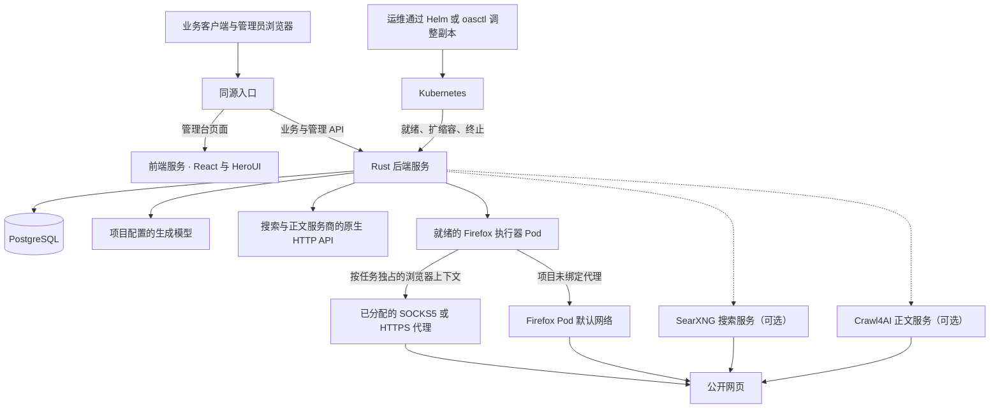
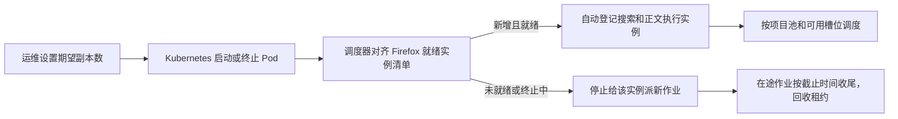
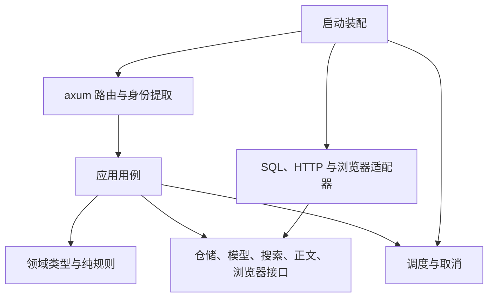
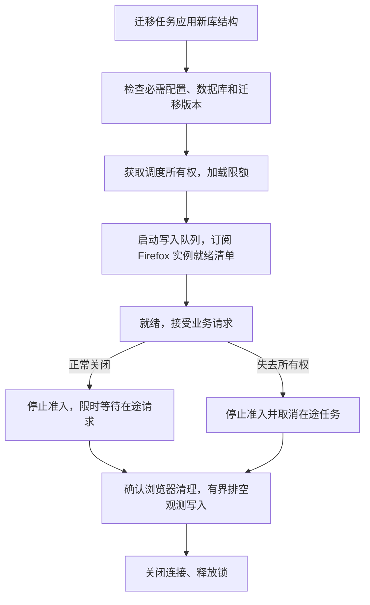

# 01 系统架构

一个项目定义业务密钥、可用搜索源、正文读取能力、模型、限额和浏览器代理池。三个业务入口共享鉴权、快照、执行预算和观测。只有整体总结用例需要生成模型。管理台通过独立的会话和管理 API 配置系统。

## 部署与信任边界

PostgreSQL 保存项目配置、凭据密文、请求证据和调用统计。基础 Helm 安装部署前端服务、Rust API、PostgreSQL 和 Firefox 执行器。前端与 API 独立部署，通过同一站点对外提供服务。Rust 直接请求配置的原生上游。项目绑定代理池时 Firefox 走分配到的 SOCKS5/HTTPS 代理，未绑定时使用 Pod 默认网络。[安装与升级](12-oasctl-and-helm.md)

### 内置浏览器接入点自动注册

系统在初始化时提供「内置浏览器搜索」和「内置浏览器正文」两个稳定的接入点 ID。项目和语言路由始终引用能力 ID。每个就绪的 Firefox Pod 自动为两个能力提供执行实例。运维把副本从 2 调到 3，第三个 Pod 就绪后，已绑定能力的项目自动使用新增容量。每个能力在项目池中仍只占一个成员位置。调度器从有空闲槽位的就绪 Pod 中轮询派发新任务。滚动升级和缩容均保留项目引用，缩到零只影响当时可用性。运行观测记录每次实际承接任务的 Pod 名称和 UID。

内置列表搜索依据实际出口的连通结果选择 Google 或百度。每条启用的 VPN 单独采样，所有 Firefox Pod 的默认网络共用一份样本，由一个就绪 Pod 代表检测。后台每 30 分钟用 curl 访问 `https://google.com/`，完成首次检测的出口才可承接内置搜索。内置正文用 Firefox 读取调用方给出的网页 URL。[出口与引擎选择](07-browser-proxies.md#dispatch)

首版通过当前 release 所在命名空间中 Firefox Service 的 EndpointSlice 发现实例。启动先读取全量清单，再监听变化；监听中断后重新对账。按 Pod UID 去重，只有 Ready 且未进入终止的 Pod 才接新作业。期望 3 个副本、实际就绪 2 个时，可调度的是 2 个 Pod。同一 Pod 的搜索和正文共用槽位。滚动替换保留在途作业的原始身份，历史记录可以追溯实际执行的实例。就绪副本为零时，项目按既定池规则尝试其余可用成员。[Kubernetes EndpointSlice](https://kubernetes.io/docs/concepts/services-networking/endpoint-slices/) · [租约与回收](07-browser-proxies.md#dispatch)

### Helm 可选组件

| Helm values | 默认值 | 启用时提供的能力 |
| --- | --- | --- |
| `searxng.enabled` | `false` | 在集群内部署 SearXNG，供项目选择为搜索列表来源 |
| `crawl4ai.enabled` | `false` | 在集群内部署 Crawl4AI，供项目选择为网页正文来源 |

两个布尔值相互独立，首次安装和后续升级均可配置。仅需 SearXNG 时只设置 `searxng.enabled=true`，仅需 Crawl4AI 时只设置 `crawl4ai.enabled=true`。未启用的组件不创建对应工作负载或 Service，其缺席不影响基础服务就绪。管理员已配置的外部接入点按各自的配置参与选择。

### 组件职责

| 组件 | 负责的事实 | 所有权 |
| --- | --- | --- |
| HTTP 边界 | 身份、命令是否合法、何时断连、返回什么 HTTP 状态 | 请求 ID、绝对截止、取消通知 |
| 项目与配置仓储 | 项目可以使用哪些资源、当前版本及限制 | PostgreSQL 事务与不可变快照 |
| 搜索、读取、总结用例 | 如何从查询得到候选，从网页得到材料，从材料得到带引用的回答 | 单次业务请求 |
| 调度器 | 全局/接入点容量、代理并发和浏览器槽位是否足够 | 单一调度所有者、有界队列和租约 |
| 适配器 | 厂商请求、返回结构、网页抽取、模型输出验证 | 类型化能力接口 |
| 请求记录与统计 | 实际执行的阶段、答案引用和跨请求指标 | 有界写入队列与持久化任务 |

## Rust 模块与依赖

依赖接口定义在使用者一侧。`ProjectSnapshot` 保存项目版本和所引用的资源版本，领域对象持有配置 ID，凭据由出站组件在派发时取得。`RequestContext` 含请求 ID、项目、单调时钟截止和取消令牌。`SearchHit` 包含规范 URL、标题、简介、原始排名和命中变体。`Article` 持有可确定渲染的标题、段落、列表、链接和代码块。`Evidence` 用来源 ID、段 ID、字符范围关联摘要与页面。API DTO 与数据库行分别定义。

服务首版由一个调度实例管理业务名额。使用 PostgreSQL 会话级 advisory lock 确认所有者。独立浏览器执行器只消费已授予的作业。这个选择使跨项目共享端点和代理配额有清晰的原子边界。部署多个调度副本前需把配额、租约续期和故障接管一起设计。

## 启动与关闭

`GET /health/live` 检查进程能否响应。`GET /health/ready` 以必需数据库和调度所有权为准，返回 `ready` 或 HTTP 503 的 `not_ready`。搜索源、正文服务、浏览器和观测队列分别报告状态。业务用例检查自己依赖的能力。数据持久化使用 UTC，耗时与预算使用单调时钟。

综合总结进入用例时固定项目配置和调用方给出的改写上下文。调度截止和统计窗口使用执行时钟，改写中的相对日期使用调用方保留偏移的时间字符串。两者独立进入各自的处理阶段。[改写上下文字段](02-business-api.md#rewrite-context)
