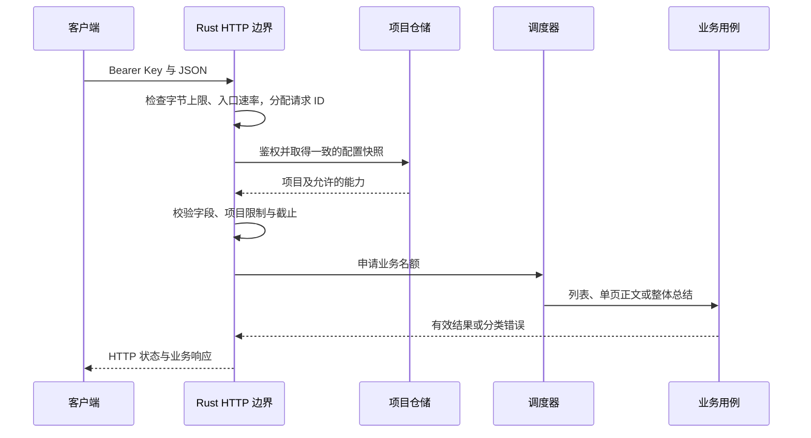
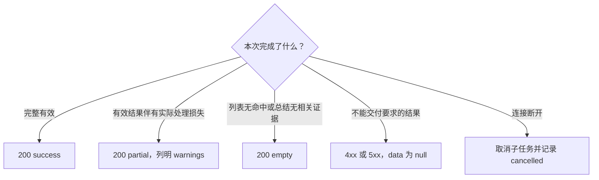

# 02 业务 HTTP 契约

| 接口 | 必填输入 | 可选输入 | 结果 |
| --- | --- | --- | --- |
| `POST /v1/search/list` | `query` | `language, time_range, count` | 保持排名的 `items[{url,title,snippet}]` |
| `POST /v1/search/content` | **单个 `url`** | `max_chars` | 同页的 `markdown` 和 `text`、标题、请求 URL、已确认时的 `final_url`、截断信息 |
| `POST /v1/search/summary` | `query` | `language, time_range, source_count, max_chars, region, current_time` | 整体 `summary`、各来源的评分与分段摘要、`citations` |

三个接口使用项目级 `Authorization: Bearer <project_key>`，请求体为 JSON。项目确定可用的搜索、正文和模型接入点及浏览器出口。API 不接收上游凭据或代理地址。字段、可空值与各终态在独立的机器可读契约中定义。[业务 OpenAPI](contracts/business.openapi.yaml)

<a id="entry"></a>

## 请求入口与返回条件



请求拒绝重复 JSON 键、多余字段、非有限数、错误内容类型和空白查询。正整数字段按整数词法读取。首版应用输入上限为 64 KiB，`query` 最多 2048 个字符。错误和警告根据 `Accept-Language` 选择中文或英文，缺省中文。`language` 是检索和生成任务使用的语言标签，省略时取项目默认语言。项目初始支持 `zh/en`，部署可配置更多受支持标签。正文始终保留网页原文。

`time_range` 省略表示不限时间。显式 `day/month/year` 代表相对请求开始时刻的最近 1/30/365 天，仅具有相应筛选能力的来源参与搜索。从起始池向后检查，支持该语言的来源都不支持显式时间范围时返回 `TIME_RANGE_UNSUPPORTED`。有符合能力的来源但都处于风控隔离时返回 `SERVICE_UNAVAILABLE`。[语言匹配与池顺序](04-routing-and-providers.md#routing)

`count` 的项目初值/硬上限为 10，`source_count` 初值 4 且不得超过项目列表上限。正文字数上限初值 40,000，总结字数上限初值 1,200。省略时按当前快照取值，显式超过项目限制用 `LIMIT_EXCEEDED` 给出 `field,limit,received`。字符计数以 Unicode 标量为单位。

<a id="rewrite-context"></a>

## 调用方提供的改写上下文

`POST /v1/search/summary` 与管理调试的 `POST /admin/v1/projects/{id}/debug/summary` 使用同一请求体。两个可选字段各自独立，最小请求仍是 `{"query":"附近今天有哪些降水观测？"}`。只有综合总结包含查询改写阶段。

| 字段 | 格式 | 改写时如何使用 |
| --- | --- | --- |
| `region` | 自由文本，例如 `上海市浦东新区`。原值为 1–128 个 Unicode 字符，至少包含一个非空白字符，拒绝控制字符。传入模型前去除首尾空白 | 帮助理解“附近”“当地”等指代。问题已经明确地点时，以问题为准 |
| `current_time` | 带偏移的 RFC 3339 时间戳，例如 `2026-05-01T00:30:00+08:00`。`Z` 表示用 UTC 解读 | 按原字符串中的当地日期和偏移解释“今天”“昨天”“本周”等表达 |

时间写作 `YYYY-MM-DDTHH:mm:ss[.小数秒]Z` 或 `YYYY-MM-DDTHH:mm:ss[.小数秒]±HH:mm`。方括号标示可选部分。年份为 0001–9999，日期须存在，使用大写 `T/Z`、00–59 秒和可选的 1–9 位小数秒。数字偏移支持半小时、四十五分钟等偏移。调用方希望按当地日历解释问题时应保留当地偏移。单个偏移足以表示该时刻的当地时间，跨季节推算夏令时规则则需要另有命名时区，本接口仅取所传时刻作为改写参照。[RFC 3339 第 5.6 节](https://www.rfc-editor.org/rfc/rfc3339#section-5.6)

例如，同一瞬间可以写成 `2026-05-01T00:30:00+08:00` 或 `2026-04-30T16:30:00Z`。对“今天”而言，前者的参照日期是 5 月 1 日，后者是 4 月 30 日。`time_range` 的检索窗口仍以服务收到请求的时间为准。

省略某个字段时，服务省略对应的模型数据和提示指令，不从服务器时钟、界面时区、IP 或代理出口补值。若显式传 `null`、空白地区、无偏移的时间、未知偏移 `-00:00` 或无效日期，返回 HTTP 400、`INVALID_ARGUMENT` 和 `details.field`。入参校验也适用于关闭改写的项目。[提示词组合规则](03-search-pipeline.md#rewrite-prompt)

## 可以直接使用的请求与响应

以下三个样例围绕同一篇测量说明。成功响应的统一外壳为 `{request_id,status,data,warnings,error}`，样例中的地址和内容均为示例。

**搜索列表。** 客户端提交问题，服务只检索和去重。列表调用不产生模型或正文提取任务。

```json
{"query":"翻斗式雨量计原理","language":"zh","count":2}
```

```json
{"request_id":"r-list","status":"success","data":{"items":[{"url":"https://example.org/gauge","title":"雨量计","snippet":"翻斗动作会触发一次计数。"}]},"warnings":[],"error":null}
```

**搜索正文。** 只传网页 URL 即可。`markdown` 保留正文结构，`text` 是同一内容的纯文本。`data.url` 原样保留请求中的地址。上游明确给出最终地址或 Firefox 能确认最后访问的地址时，另给 `data.final_url`，无法确认时省略这个字段。即使两者相同也要有确认依据。两种格式的原始与返回长度独立记录。

```json
{"url":"https://example.org/gauge"}
```

```json
{"request_id":"r-content","status":"success","data":{"url":"https://example.org/gauge","final_url":"https://example.org/articles/rain-gauge","title":"雨量计","markdown":"**翻斗**计数。","text":"翻斗计数。","truncated":false,"lengths":{"markdown":{"original":9,"retained":9},"text":{"original":5,"retained":5}}},"warnings":[],"error":null}
```

**打分、分段总结与整体总结。** 三个处理阶段在一个请求内完成。`sources[].segments` 展示每段摘要，`citations` 将整体回答关联到此次实际使用的段。

```json
{"query":"翻斗式雨量计如何记录降水？","language":"zh","source_count":2,"max_chars":300,"region":"上海市浦东新区","current_time":"2026-05-01T00:30:00+08:00"}
```

```json
{"request_id":"r-summary","status":"success","data":{"summary":"每次翻斗动作对应一个校准的降水增量。","sources":[{"id":"s1","url":"https://example.org/gauge","title":"雨量计","score":91,"kind":"body","segments":[{"id":"p1","summary":"仪器将每次翻斗动作计入累计降水量。"}]}],"citations":[{"source_id":"s1","segment_id":"p1"}]},"warnings":[],"error":null}
```

## 空结果、部分结果和错误



合法空列表为 `items:[]`。总结正常无证据时返回 `summary:"", sources:[], citations:[]`。单页没有有效正文返回 502。仅因字数限制截断正文时仍可成功，并附 `content_truncated`。上游全部失败与合法空搜索有不同语义。调试端可以用请求 ID 查到阶段原因。

| HTTP | 稳定代码 | 举例 |
| --- | --- | --- |
| 400 | `INVALID_ARGUMENT, LIMIT_EXCEEDED, LANGUAGE_UNSUPPORTED, TIME_RANGE_UNSUPPORTED, URL_NOT_ALLOWED` | 动态上限、字段组合、语言、时间能力、访问目标无效 |
| 401 / 413 | `UNAUTHORIZED / PAYLOAD_TOO_LARGE` | 无效项目 Key 或超出输入字节限制 |
| 429 | `RATE_LIMITED, CAPACITY_EXHAUSTED` | 入口速率或有界队列不足，可附 `Retry-After` |
| 502 | `SEARCH_FAILED, CONTENT_UNAVAILABLE, MODEL_FAILED, ACCESS_DENIED` | 上游协议错误、正文不可用、模型不能完成、目标明确拒绝访问 |
| 503 / 504 / 500 | `SERVICE_UNAVAILABLE, PROXY_UNAVAILABLE / DEADLINE_EXCEEDED / INTERNAL_ERROR` | 依赖或代理不可用、总时限耗尽、未预期的错误 |

客户端按稳定 `code` 分支，`message` 用于展示，`details` 只含公开字段。成功时 `error=null`，错误时 `data=null`。
