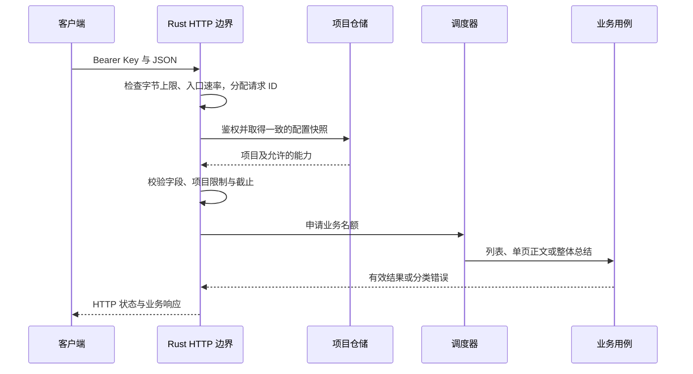
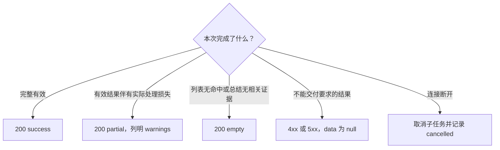

# 02 业务 HTTP 契约

| 接口 | 必填输入 | 可选输入 | 结果 |
| --- | --- | --- | --- |
| `POST /v1/search/list` | `query` | `language, time_range, count` | 保持排名的 items 与可选的引擎 AI 卡片 engine_answer |
| `POST /v1/search/content` | **单个 `url`** | `max_chars` | 同页的 `markdown` 和 `text`、标题、请求 URL、已确认时的 `final_url`、截断信息 |
| `POST /v1/search/summary` | `query` | `language, time_range, source_count, max_chars, region, current_time` | 整体 `summary`、各来源的评分与分段摘要、`citations` |

三个接口使用项目级 `Authorization: Bearer <project_key>`，请求体为 JSON。项目确定可用的搜索、正文和模型接入点及浏览器出口。API 不接收上游凭据或代理地址。字段、可空值与各终态在独立的机器可读契约中定义。[业务 OpenAPI](contracts/business.openapi.yaml)

## 参数与调用方式

请求头必须包含项目密钥和 JSON 媒体类型。可选字段省略即可，显式 null 和未知字段会报错。请求字段按下面的操作分别发送。Accept-Language 控制错误与警告文案，language 控制业务语言。

### 网页列表

检索并去重，返回网页列表，可携带内置引擎 AI 卡。使用项目搜索池。同步请求总时限 15 秒。

| 参数 | 必填 | 类型 | 用途、默认值与限额 |
| --- | --- | --- | --- |
| query | 是 | string | 要检索的自然语言问题，1–2048 个 Unicode 字符，至少含一个非空白字符。保留明确的地点和时间。 |
| language | 否 | string | 业务语言标签，如 zh、en、ja、fr 或 zh-TW。决定语言优先路由的起始搜索池，并指导总结输出语言。省略时从第一池开始，总结使用问题语言。Accept-Language 单独控制错误文案。 |
| time_range | 否 | string | 结果发布时间筛选，以请求到达时刻为基准。day 最近 24 小时，month 最近 30 天，year 最近 365 天。省略时不限时间。只派发给支持该窗口的来源。current_time 单独作为问题改写参照。 |
| count | 否 | integer | 最多返回的结果数，整数 1–10 且不得超过项目 search_limit。省略使用项目值，初始为 10。实际命中数可以更少。 |

```sh
curl -X POST "https://your-search-host/v1/search/list" \\
  -H "Authorization: Bearer <PROJECT_KEY>" \\
  -H "Content-Type: application/json" \\
  -H "Accept-Language: zh-CN" \\
  --data-raw '{"query": "雨量计如何测量降水？", "language": "zh", "time_range": "month", "count": 5}'
```

列表可附带内置浏览器的 `cards` 普通卡片材料（天气、换算、表格等），每项含 engine、实际搜索页 url、title 和 content，与需要完成及引用证据的 `engine_answer` AI 回答分开。只有卡片而没有链接时也是成功结果；`items` 保持链接结果语义。卡片以 MutationObserver 和语义稳定条件判定，最早正常返回窗口为提交后 4 秒，最长不超过 7 秒及剩余调用预算。

### 单网页正文

读取单个网页，一次提取同时返回 Markdown 与纯文本。使用项目正文池。同步请求总时限 15 秒。

| 参数 | 必填 | 类型 | 用途、默认值与限额 |
| --- | --- | --- | --- |
| url | 是 | string | 要提取的单个公开 HTTP(S) 网页 URL。目标与重定向均须通过访问校验，禁止 URL 内凭据与内网地址。 |
| max_chars | 否 | integer | 正文字符上限，正整数且不得超过项目 body_limit。省略使用项目值，初始为 40000。同时限制 Markdown 和纯文本并保留相同内容前缀，截断时附警告。 |

```sh
curl -X POST "https://your-search-host/v1/search/content" \\
  -H "Authorization: Bearer <PROJECT_KEY>" \\
  -H "Content-Type: application/json" \\
  -H "Accept-Language: zh-CN" \\
  --data-raw '{"url": "https://www.iana.org/help/example-domains", "max_chars": 3000}'
```

### 综合总结

按项目配置改写、检索、去重、评分、取文并总结。按模型上下文选择一次生成或分批。需要配置模型。项目可通过 `search_original_query` 关闭原问题搜索，只检索改写查询；原问题仍用于评分及总结。没有可用改写时返回 `QUERY_REWRITE_FAILED`。同步请求总时限 45 秒。

| 参数 | 必填 | 类型 | 用途、默认值与限额 |
| --- | --- | --- | --- |
| query | 是 | string | 要检索的自然语言问题，1–2048 个 Unicode 字符，至少含一个非空白字符。保留明确的地点和时间。 |
| language | 否 | string | 业务语言标签，如 zh、en、ja、fr 或 zh-TW。决定语言优先路由的起始搜索池，并指导总结输出语言。省略时从第一池开始，总结使用问题语言。Accept-Language 单独控制错误文案。 |
| time_range | 否 | string | 结果发布时间筛选，以请求到达时刻为基准。day 最近 24 小时，month 最近 30 天，year 最近 365 天。省略时不限时间。只派发给支持该窗口的来源。current_time 单独作为问题改写参照。 |
| source_count | 否 | integer | 最多参与回答的去重来源数，整数 1–10 且不得超过项目 source_limit。省略使用项目值，初始为 4。先打分过滤再选择来源。 |
| max_chars | 否 | integer | 整体回答 summary 的字符上限，正整数且不得超过项目 summary_limit。省略使用项目值，初始为 1200。原文材料长度由项目 body_limit 单独决定。 |
| region | 否 | string | 调用方地区，如广州市天河区，1–128 个 Unicode 字符。用于补全附近、当地等指代。省略时不猜地点，仍执行启用的改写。问题中的明确地点优先。 |
| current_time | 否 | string | 带偏移的 RFC 3339 当地时间，如 2026-11-22T10:30:00+08:00。按其日期解释今天、昨天。省略使用服务本地时间，Helm 默认 Asia/Shanghai。问题中的明确日期优先。 |

```sh
curl -X POST "https://your-search-host/v1/search/summary" \\
  -H "Authorization: Bearer <PROJECT_KEY>" \\
  -H "Content-Type: application/json" \\
  -H "Accept-Language: zh-CN" \\
  --data-raw '{"query": "今天附近有哪些降水观测？", "language": "zh", "time_range": "day", "source_count": 2, "max_chars": 600, "region": "广州市天河区", "current_time": "2026-11-22T10:30:00+08:00"}'
```

### 返回字段

每次请求返回 request_id、status、data、warnings 和 error。成功时 error 为 null，失败时 data 为 null。warnings 列出可处理的损失或截断。客户端按 error.code 分支，按 request_id 查阅诊断。

**列表结果 data**

| 字段 | 用途 |
| --- | --- |
| engine_answer | 可选的内置引擎 AI 回答，普通列表同时保留。 |
| items | URL 去重后保持检索顺序的结果列表。 |

**正文结果 data**

| 字段 | 用途 |
| --- | --- |
| url | 原样保留请求地址。 |
| final_url | 确认的最终地址，无法确认时省略。 |
| title | 提取到的网页标题。 |
| markdown | 保留段落、列表及表格结构的 Markdown 正文。 |
| text | 与 Markdown 对应的同一正文前缀的纯文本。 |
| truncated | 是否因 max_chars 截断。 |
| lengths | Markdown 和纯文本的原始与保留字符数。 |

**总结结果 data**

| 字段 | 用途 |
| --- | --- |
| summary | 根据入选证据生成的整体回答。 |
| sources | 实际参与的来源、评分和段摘要。 |
| citations | 指向本响应实际段落的引用。 |

总结 sources 数组包含 id、url、title、score、kind 和 segments。score 为 0–100 的相关分数，kind 为 body 或 snippet。segments 每项包含 id 和 summary。citations 中 source_id 与 segment_id 必须指向本次返回的来源与段。各 ID 仅在本请求内关联。

<a id="entry"></a>

## 请求入口与返回条件



请求拒绝重复 JSON 键、多余字段、非有限数、错误内容类型和空白查询。正整数字段按整数词法读取。首版应用输入上限为 64 KiB，`query` 最多 2048 个字符。错误和警告根据 `Accept-Language` 选择中文或英文，缺省中文。`language` 是检索和生成任务使用的语言标签，可传有效语言标签。省略时搜索从第一池开始，综合总结沿用问题语言。业务语言优先映射统一在语言路由管理。正文始终保留网页原文。

`time_range` 省略表示不限时间。显式 `day/month/year` 代表相对请求开始时刻的最近 1/30/365 天，仅具有相应筛选能力的来源参与搜索。从起始池向后检查，所有候选来源均不支持显式时间范围时返回 `TIME_RANGE_UNSUPPORTED`。有符合能力的来源但都处于风控隔离时返回 `SERVICE_UNAVAILABLE`。[语言匹配与池顺序](04-routing-and-providers.md#routing)

`count` 的项目初值/硬上限为 10，`source_count` 初值 4 且不得超过项目列表上限。正文字数上限初值 40,000，总结字数上限初值 1,200。省略时按当前快照取值，显式超过项目限制用 `LIMIT_EXCEEDED` 给出 `field,limit,received`。字符计数以 Unicode 标量为单位。

<a id="rewrite-context"></a>

## 调用方提供的改写上下文

`POST /v1/search/summary` 与管理调试的 `POST /admin/v1/projects/{id}/debug/summary` 使用同一请求体。两个可选字段各自独立，最小请求仍是 `{"query":"附近今天有哪些降水观测？"}`。只有综合总结包含查询改写阶段。

| 字段 | 格式 | 改写时如何使用 |
| --- | --- | --- |
| `region` | 自由文本，例如 `上海市浦东新区`。原值为 1–128 个 Unicode 字符，至少包含一个非空白字符，拒绝控制字符。传入模型前去除首尾空白 | 帮助理解“附近”“当地”等指代。问题已经明确地点时，以问题为准 |
| `current_time` | 带偏移的 RFC 3339 时间戳，例如 `2026-05-01T00:30:00+08:00`。`Z` 表示用 UTC 解读 | 按原字符串中的当地日期和偏移解释“今天”“昨天”“本周”等表达 |

时间写作 `YYYY-MM-DDTHH:mm:ss[.小数秒]Z` 或 `YYYY-MM-DDTHH:mm:ss[.小数秒]±HH:mm`。方括号标示可选部分。年份为 0001–9999，日期须存在，使用大写 `T/Z`、00–59 秒和可选的 1–9 位小数秒。数字偏移支持半小时、四十五分钟等偏移。调用方希望按当地日历解释问题时应保留当地偏移。单个偏移足以表示该时刻的当地时间，跨季节推算夏令时规则则需要另有命名时区，本接口仅取所传时刻作为改写参照。[RFC 3339 第 5.6 节](https://www.rfc-editor.org/rfc/rfc3339#section-5.6)

例如，同一瞬间可以写成 `2026-05-01T00:30:00+08:00` 或 `2026-04-30T16:30:00Z`。对“今天”而言，前者的参照日期是 5 月 1 日，后者是 4 月 30 日。`time_range` 的检索窗口仍以服务收到请求的时间为准。

省略时间时使用 API 服务本地时间，Helm 支持通过 timeZone 设置时区，默认 Asia/Shanghai。缺少地区时保留未确定的地点。两项均省略仍可改写。若显式传 `null`、空白地区、无偏移的时间、未知偏移 `-00:00` 或无效日期，返回 HTTP 400、`INVALID_ARGUMENT` 和 `details.field`。入参校验也适用于关闭改写的项目。[提示词组合规则](03-search-pipeline.md#rewrite-prompt)

## 可以直接使用的请求与响应

以下三个样例围绕同一篇测量说明。成功响应的统一外壳为 `{request_id,status,data,warnings,error}`，样例中的地址和内容均为示例。

**搜索列表。** 客户端提交问题，服务只检索和去重。列表调用不产生模型或正文提取任务。

```json
{"query":"翻斗式雨量计原理","language":"zh","count":2}
```

```json
{"request_id":"r-list","status":"success","data":{"items":[{"url":"https://example.org/gauge","title":"雨量计","snippet":"翻斗动作会触发一次计数。"}]},"warnings":[],"error":null}
```

**搜索正文。** 只传网页 URL 即可。`markdown` 保留正文结构，`text` 是同一内容的纯文本。`data.url` 原样保留请求中的地址。上游明确给出最终地址或 Firefox 能确认最后访问的地址时，另给 `data.final_url`，无法确认时省略这个字段。即使两者相同也要有确认依据。两种格式的原始与返回长度独立记录。

```json
{"url":"https://example.org/gauge"}
```

```json
{"request_id":"r-content","status":"success","data":{"url":"https://example.org/gauge","final_url":"https://example.org/articles/rain-gauge","title":"雨量计","markdown":"**翻斗**计数。","text":"翻斗计数。","truncated":false,"lengths":{"markdown":{"original":9,"retained":9},"text":{"original":5,"retained":5}}},"warnings":[],"error":null}
```

**评分与上下文自适应总结。** 材料放得下时一次生成，超限时分批提炼后综合。`sources[].segments` 展示每段摘要，`citations` 将整体回答关联到此次实际使用的段。

```json
{"query":"翻斗式雨量计如何记录降水？","language":"zh","source_count":2,"max_chars":300,"region":"上海市浦东新区","current_time":"2026-05-01T00:30:00+08:00"}
```

```json
{"request_id":"r-summary","status":"success","data":{"summary":"每次翻斗动作对应一个校准的降水增量。","sources":[{"id":"s1","url":"https://example.org/gauge","title":"雨量计","score":91,"kind":"body","segments":[{"id":"p1","summary":"仪器将每次翻斗动作计入累计降水量。"}]}],"citations":[{"source_id":"s1","segment_id":"p1"}]},"warnings":[],"error":null}
```

## 空结果、部分结果和错误



合法空列表为 `items:[]`。总结正常无证据时返回 `summary:"", sources:[], citations:[]`。单页没有有效正文返回 502。仅因字数限制截断正文时仍可成功，并附 `content_truncated`。上游全部失败与合法空搜索有不同语义。调试端可以用请求 ID 查到阶段原因。

| HTTP | 稳定代码 | 举例 |
| --- | --- | --- |
| 400 | `INVALID_ARGUMENT, LIMIT_EXCEEDED, QUERY_UNSUPPORTED, TIME_RANGE_UNSUPPORTED, URL_NOT_ALLOWED` | 动态上限、字段组合、语言、时间能力、访问目标无效 |
| 401 / 413 | `UNAUTHORIZED / PAYLOAD_TOO_LARGE` | 无效项目 Key 或超出输入字节限制 |
| 429 | `RATE_LIMITED, CAPACITY_EXHAUSTED` | 入口速率或有界队列不足，可附 `Retry-After` |
| 502 | `SEARCH_FAILED, CONTENT_UNAVAILABLE, MODEL_FAILED, QUERY_REWRITE_FAILED, ACCESS_DENIED` | 上游协议错误、正文不可用、模型不能完成、仅改写搜索无可用查询、目标明确拒绝访问 |
| 503 / 504 / 500 | `SERVICE_UNAVAILABLE, PROXY_UNAVAILABLE, ORIGIN_RETRY_LATER / DEADLINE_EXCEEDED / INTERNAL_ERROR` | 依赖或代理不可用、总时限耗尽、未预期的错误 |

客户端按稳定 `code` 分支，`message` 用于展示，`details` 只含公开字段。成功时 `error=null`，错误时 `data=null`。

若极小的 `max_chars` 无法同时保留非空 Markdown 与纯文本，正文接口返回 HTTP 400 `CONTENT_LIMIT_TOO_SMALL`，字段为 `max_chars`；不返回空字符串成功。项目的正文上限不足以保留总结材料时同样给出可定位的 `body_limit` 原因。

## 项目选择搜索列表总结

管理员可在项目中设置 summary_snippets_only，默认 false。开启后，summary 操作完成改写、搜索、去重和评分，直接用入选标题和简介生成总结，保留 sources 与 citations。该模式可不配置正文池，搜索随附正文也跳过。来源 kind 为 snippet，主动使用列表材料可以返回 success；仅在发生实际搜索损失、截断等情况时返回 partial。未取得相关列表材料时可返回 empty。列表与单 URL 正文操作继续遵循各自契约。
