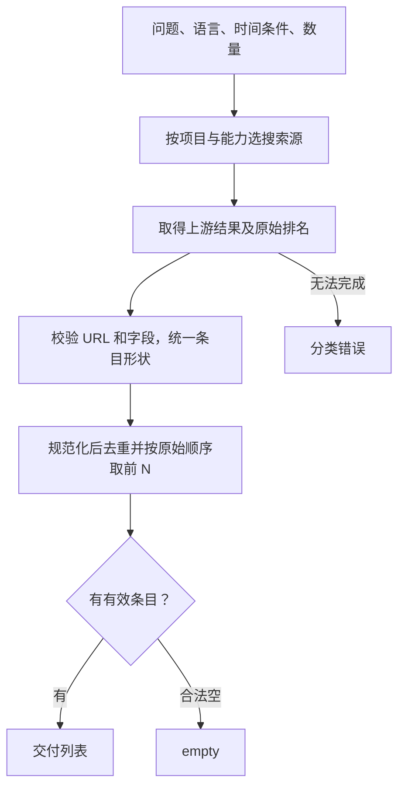
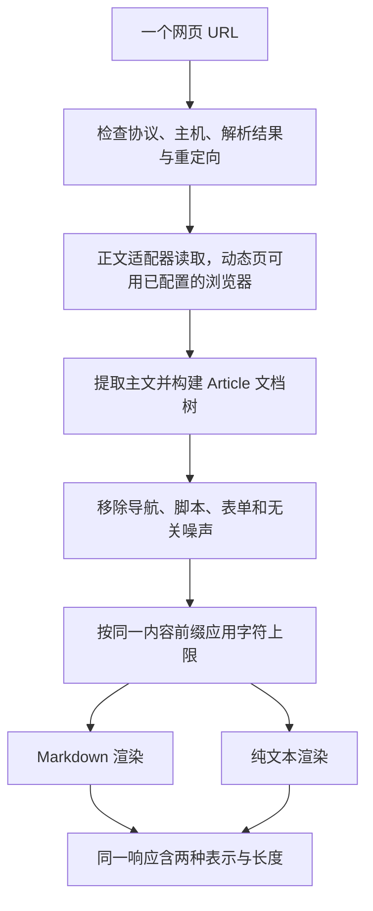
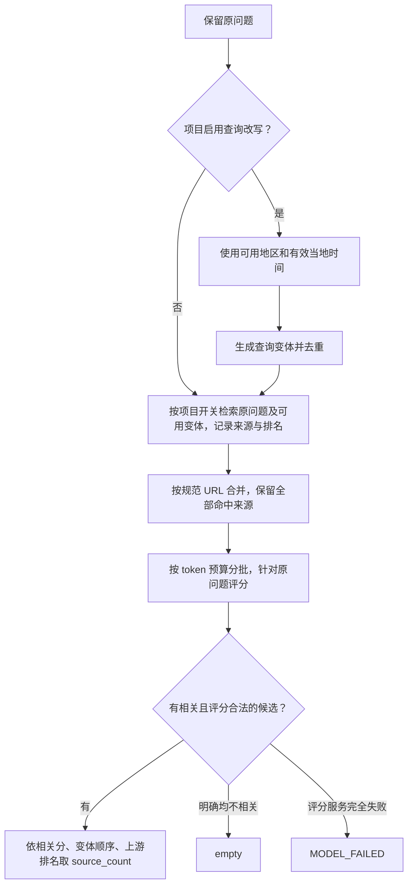
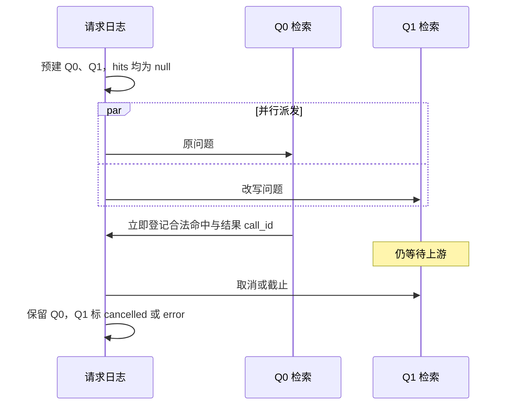

# 03 搜索与内容流水线

三个用例复用搜索、正文和调度接口。搜索列表交付搜索项，内置浏览器还可携带普通搜索卡片材料和已完成的引擎 AI 回答。搜索正文只读取传入的一个网页。综合总结才把候选评分、按上下文规划的总结和引用串成一条可追溯的链。

## 列表检索

每次列表搜索使用原始问题。URL 比较时统一协议和主机大小写、移除片段与默认端口，保留路径和查询串，空路径统一为 `/`。同一规范 URL 首次出现的条目确定显示顺序。缺标题或简介可给空字符串。单条畸形可跳过并在有有效条目时给 `partial`，全是畸形数据计为协议失败。正常命中数少于请求数量仍可成功。具备能力的 HTTP 搜索源和浏览器搜索源都实现 `SearchProvider`。

## 单 URL 提取与双格式渲染

读取只要求一个 `url`，响应保留该原始地址。Firefox 或正文服务能确认最终地址时单独记录 `final_url`；只返回标题和正文的服务可以成功交付内容并省略 `final_url`。直接访问网页时校验每次 HTTP(S) 跳转及其实际访问目标。每次读取使用同一请求预算和授权出口。HTML 抽取出标题、段落、列表、表格、引用、链接及代码块。接入点若直接供给 Markdown，先解析成相同文档树。纯文本通过遍历语义节点得到，保留段落和代码的可读换行。去除 Markdown 符号的正则无法正确处理嵌套链接和代码，不作为转换实现。

先计算两种完整表示的字符长度，再取两种表示均不超过 `max_chars` 的最长公共内容前缀。先保留完整块，最后一块可按字符截短并闭合 Markdown 格式。单个装饰结构本身已经超限时，将该片段简化为转义后的行内文本。正文空、只有导航或目标拒绝访问时不给伪造正文。纯文本和 Markdown 在同一次提取中生成，页面无需二次加载。

## 综合总结的查询与打分

项目可配置 0–3 个额外变体，`search_original_query` 默认开启。关闭后综合总结只检索改写查询，`rewrite_count` 必须至少为 1；原问题仍用于评分和总结。原问题固定为 Q0，改写查询从 Q1 开始，关闭 Q0 不会重新编号。改写失败或没有可用改写时，仅在原问题参与搜索的情况下回退并记录损失；否则返回双语 `QUERY_REWRITE_FAILED`，不发送搜索。扇出共享截止时间，部分分支失败时仍可使用其他命中。候选有请求内稳定 ID，记录 `variant_id`、`call_id` 和源排名。多条命中共享 URL 时优先用原问题命中的显示信息，随后按变体顺序和源排名决胜。集成搜索源若同时返回网页材料，也要参加统一的本地评分。内置浏览器的普通卡片按实际搜索页 URL 合并为行内材料候选，经原问题评分后再选择；选中后复用已取得的语义材料，避免重新访问搜索页。

评分模型输入原问题、有效地区及时间、候选 ID、标题、简介，输出每个 ID 的 `relevant` 布尔值与 0–100 的整数 `score`。模型输出中重复、未知、缺失或类型错误的项不能进入选择集。批量输入超限时拆批，单条可缩短简介。模型格式错误只纠正尚未取得合法结果的项，至多一次。剩余未知项与明确不相关分开记录。已接纳相关项按分数降序，平分优先原问题、较早变体、上游排名及候选 ID。选择名单在取正文前冻结。例如，两条 URL 分别得 91 和 84，即使其中一条也被另一个变体命中，仍只计这两个来源。

### 改写提示词的组合

请求开始时固定参考时间。调用方提供 current_time 时保留其日期及 UTC 偏移，省略时使用 API 服务的本地时间 local_time。有 region 时用它补全隐含地点，缺少地区时要求模型保留“附近”“当地”等指代。两项均省略仍按项目配置生成额外查询，明确给出的地点及日期优先。

改写、评分及综合采用相同的时空参照。模型消息采用自然语言拼接：系统消息依次说明任务、输出契约、当前地区、参考时间与时区、数量或字符上限，以及分块候选或材料；用户消息只包含原问题，不再把整份任务输入 JSON 交给模型解读。rewrite_count 为零表示显式关闭额外变体。普通列表保持原问题，time_range 独立决定检索窗口。[接口字段](02-business-api.md#rewrite-context)

## 按上下文规划总结

材料阶段按评分顺序收集证据，保留来源 ID、URL、文本范围和项目字符上限。

项目的 summary_snippets_only 默认关闭。开启后使用所选搜索项的标题和简介作为材料，跳过正文接入点及搜索随附正文。支持开关的集成搜索协议同时关闭正文请求参数。返回来源的 kind 为 snippet，候选材料标记 search_snippet，主动选择这种模式不会产生降级警告。标题或简介单独存在时仍可使用；两者都为空时该候选没有材料，正常无证据时返回 empty。body_limit 限制保留的搜索文本，截断仍计为材料损失。

关闭时按原有流程获取正文。正文失败且 allow_snippets 开启时可降级使用简介，记录实际材料损失。

1. 对全部入选原文、提示词、原问题、时空参照、引用 ID 和纠错提示计算输入 token。配置总上下文时，预留输出额度后的剩余空间与模型输入上限共同决定预算。
2. 完整请求放得下时，一次调用生成整合回答、每篇材料的相关性和短摘要、原文引用。材料均不相关时返回空结果。
3. 否则按实际预算切分过长原文，并跨来源组批。每个来源最多 16 段，最多 4 个并发批次。根据各批的相关段摘要进行最终综合，仍超限时最多在来源内压缩两轮。
4. 校验每段归属、引用和输出字数。每个引用均指向返回的来源和段。部分材料损失时标记 partial，全部分析失败则返回相应错误。

## 阶段预算、并发与完整输入

总结总截止为入口时刻加 45 秒。改写最多使用开始该阶段时剩余时间的六分之一，评分最多使用剩余时间的三分之一；改写超时后仅在项目允许原问题搜索时回退，否则明确失败。评分阶段截止时保留已经取得的合法评分。取文与段分析在总截止前预留 `min(模型单次超时, 剩余时间 / 3)`，压缩再为综合保留 `min(模型单次超时, 剩余时间 / 2)`。最终综合仍使用入口的绝对截止，阶段重试和排队都不重置计时。阶段预算用尽记录 `STAGE_BUDGET_EXCEEDED`，总截止和显式取消分别保留各自的错误码。

检索变体和来源读取各最多并行 4 个；所有来源共用本请求的 4 个段分析名额。模型接入点在请求内先入先出，在不同请求之间轮转，长文后续段不能持续插入其他已等待请求之前。并行阶段写入同一份请求日志，已完成的调用、材料和段落即时登记；后续超时或取消不会抹去已完成部分。来源 ID 在取文前按选中顺序固定，返回顺序与并发完成顺序无关。

每条内置浏览器查询、每篇网页读取分别取得独立作业和槽位，同一请求不再共用浏览器操作锁。一个逻辑查询切换 Google／百度时保留其作业及出口；不同查询和来源可在授权出口和剩余容量内并行。逻辑调用结束即归还作业，执行器保留健康的常驻标签供后续任务复用，模型评分或总结期间不占用空闲浏览器槽位。资源只够一个作业时，同请求的其他分支在共同截止内等待已有分支归还；尚无本请求作业时仍使用三秒资源排队上限。未确认清理的作业保留租约进入回收，禁止本请求继续新建作业。

提示词构造、分批规划、派发前检查和实际发送共用一个原生聊天请求构造器。输入计数包括系统指令、角色、实际渲染的自然语言上下文与材料及聊天模板开销，并在规划时容纳一次纠正指令；输出另由 `max_output_tokens` 限制。评分优先分批，单项仍放不下时缩短简介再缩短标题，保留原问题。切段对每个最终输入重新检查 token，压缩保留原段引用集合。超限在本地拒绝，不占已发送调用量或 RPM。完整规范文本和 `segment_version` 随材料保存，字符范围使用 Unicode 标量半开区间。

## 并发检索的增量证据

创建检索任务时按 Q0、Q1…冻结变体列表，每个变体先以 `pending`、`hits: null` 登记。真正发送后关联每次 `call_id`，合法响应返回后立即规范化并把该变体命中写入共享日志，同时固定实际结果的 `result_call_id`。失败或取消只改变未完成变体的状态，不删除已经收到的命中。全部任务收尾时按变体及原排名稳定合并，完成顺序不影响候选、来源和引用编号。

`hits: []` 表示确知零命中，`hits: null` 表示没有收到合法结果。执行概览的 `raw_candidates`、`unique_candidates` 在任一实际派发变体未完成时为 `null`，并用 `known_raw_candidates`、`known_unique_candidates` 呈现已取得部分的下界；`completed_variants`、`incomplete_variants` 说明完整度。管理台显示「至少 N／部分检索未完成」，不能把未知当零。仅计划但没有发出的变体不增加上游调用量。逐次搜索调用的评估只统计由其实际返回的候选，未评分与无候选分别表达。

## 模型提示词与有效改写

改写、评分、单段及批量段分析、来源压缩、原文整合及摘要整合共用自然语言消息构造器。提示词版本为 6，输出继续遵循原有 JSON 协议。参考时间保留调用方的当地日期、UTC 偏移和星期；未提供时使用请求开始时固定的服务时间。依赖地点的查询必须使用已知地区补全，依赖相对时间的查询至少一条写出绝对日期，显式地点日期优先。未知地点和日期不猜测，不给无关问题强加时空条件，改写不能原样返回原问题。评分与总结逐条核对事实的适用范围：发布机构、检索地点或抓取时间不能代替事实本身的地点日期；省级背景、其他城市数值及已结束的预报不能外推为用户当地当日的结论。无法确认范围的具体事实不作为相关证据。

参考信息、候选、来源及段落以成对标记组织，标识先于内容，输入中的尖括号和标记字符转义，单行元数据的换行编码为字面量；网页文本和地区仅作为数据，不能结束自己的块或变成任务指令。段落的原引用标识显式列出，压缩后仍只能引用原段落。预算预检、分批、压缩和实际派发均计算相同的最终消息，包含纠正提示的实际开销。

改写网络调用成功与生成有效查询分开记录。诊断标明请求数、有效数、每条改写是否重复原文、重复其他改写、无效或超限；只有接纳的查询分配 Q1 起的编号。无有效改写但允许原问题时，阶段记为 partial，继续 Q0 并给出双语 query_rewrite_fallback 警告；已有完整答案的响应变为 partial，合法空结果保留 empty 并附警告。禁止原问题时仍返回 QUERY_REWRITE_FAILED，不静默恢复 Q0。模型调用失败保留其原失败状态。

原文整合中，若所有已知段落都合法标为不相关且引用数组为空，按无证据处理并清空非证据性的说明文字，返回 empty。模型原始回复完整保留，阶段诊断标明 no_relevant_passages。未知标识、遗漏段落、相关段落缺少有效引用或伪造引用仍按格式与引用错误处理。
