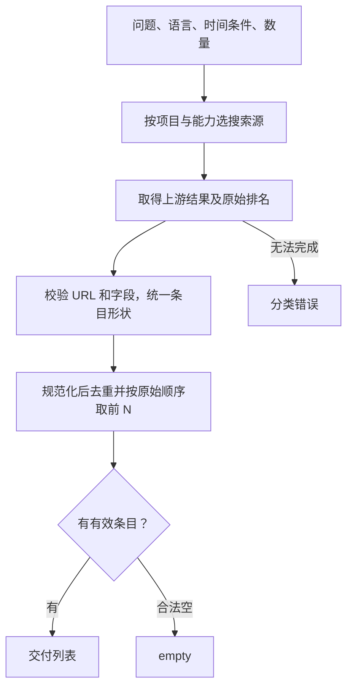
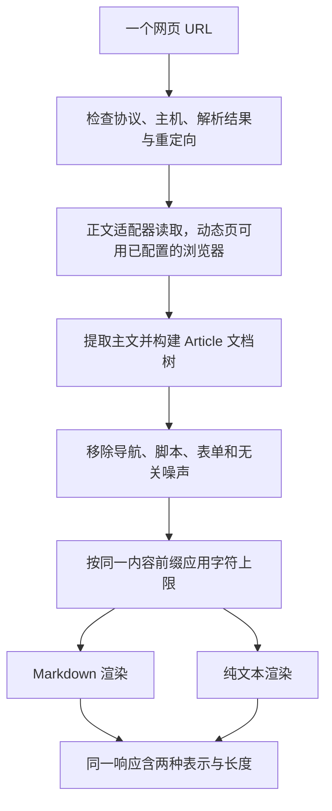
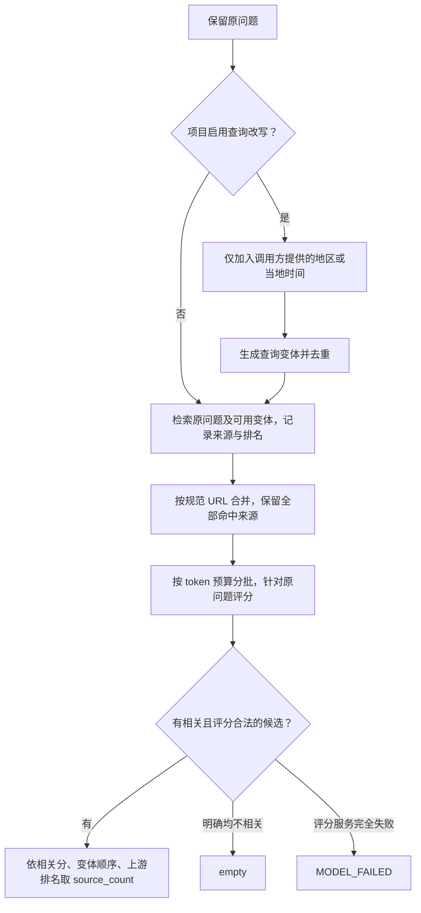
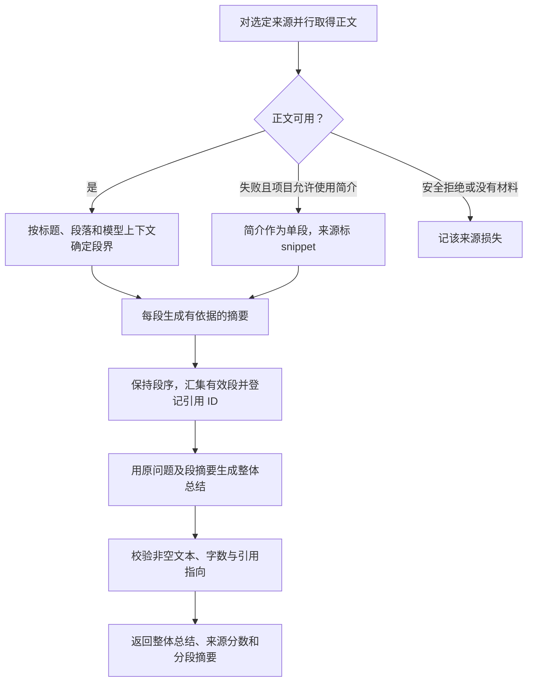

# 03 搜索与内容流水线

三个用例复用搜索、正文和调度接口。搜索列表只交付搜索项。搜索正文只读取传入的一个网页。综合总结才把候选评分、逐段摘要和最终综合串成一条可追溯的链。

## 列表检索

每次列表搜索使用原始问题。URL 比较时统一协议和主机大小写、移除片段与默认端口，保留路径和查询串，空路径统一为 `/`。同一规范 URL 首次出现的条目确定显示顺序。缺标题或简介可给空字符串。单条畸形可跳过并在有有效条目时给 `partial`，全是畸形数据计为协议失败。正常命中数少于请求数量仍可成功。具备能力的 HTTP 搜索源和浏览器搜索源都实现 `SearchProvider`。

## 单 URL 提取与双格式渲染

读取只要求一个 `url`，响应保留该原始地址。Firefox 或正文服务能确认最终地址时单独记录 `final_url`；只返回标题和正文的服务可以成功交付内容并省略 `final_url`。直接访问网页时校验每次 HTTP(S) 跳转及其实际访问目标。每次读取使用同一请求预算和授权出口。HTML 抽取出标题、段落、列表、表格、引用、链接及代码块。接入点若直接供给 Markdown，先解析成相同文档树。纯文本通过遍历语义节点得到，保留段落和代码的可读换行。去除 Markdown 符号的正则无法正确处理嵌套链接和代码，不作为转换实现。

先计算两种完整表示的字符长度，再取两种表示均不超过 `max_chars` 的最长公共内容前缀。先保留完整块，最后一块可按字符截短并闭合 Markdown 格式。单个装饰结构本身已经超限时，将该片段简化为转义后的行内文本。正文空、只有导航或目标拒绝访问时不给伪造正文。纯文本和 Markdown 在同一次提取中生成，页面无需二次加载。

## 综合总结的查询与打分

项目可配置 0–3 个额外变体，始终保留原问题。改写失败退回原问题并记录原因。扇出共享截止时间，部分分支失败时仍可使用其他命中。候选有请求内稳定 ID，记录 `variant_id`、`call_id` 和源排名。多条命中共享 URL 时优先用原问题命中的显示信息，随后按变体顺序和源排名决胜。集成搜索源若同时返回网页材料，也要参加统一的本地评分。

评分模型输入原问题、候选 ID、标题、简介，输出每个 ID 的 `relevant` 布尔值与 0–100 的整数 `score`。模型输出中重复、未知、缺失或类型错误的项不能进入选择集。批量输入超限时拆批，单条可缩短简介。模型格式错误只纠正尚未取得合法结果的项，至多一次。剩余未知项与明确不相关分开记录。已接纳相关项按分数降序，平分优先原问题、较早变体、上游排名及候选 ID。选择名单在取正文前冻结。例如，两条 URL 分别得 91 和 84，即使其中一条也被另一个变体命中，仍只计这两个来源。

### 改写提示词的组合

已校验的上下文与原问题一起固定在本次请求中。基础提示要求保留用户原意、语言及显式限定。模型的用户消息使用 JSON 序列化原问题和可用字段，地区字符串始终是数据。每个可选提示片段只随自己的字段加入，省略时也省去标题、空键和占位文字。

| 请求携带的字段 | 额外提示片段 | 例子 |
| --- | --- | --- |
| 均省略 | 无 | 允许基于原问题改写，保留无法确定的“附近”“今天” |
| 只有 `region` | 地区 | “附近的雨量站”可用所传地区具体化，时间表达保留原意 |
| 只有 `current_time` | 当地时间 | 用时间戳中写明的当地日期解释“昨天”，地区继续未知 |
| 两者均有 | 地区、当地时间 | “附近今天的降雨”可同时限定地点和日期 |

例如，问题为“附近今天的降雨如何”，地区为“上海”，时间为 `2026-05-01T00:30:00+08:00`，可以生成“上海 2026 年 5 月 1 日 降雨观测”。如果问题已经指定“北京 4 月 28 日”，保留这两个显式条件。`rewrite_count=0` 时只走原问题，不构造改写提示词。改写重试复用同一份上下文。评分、分段摘要、整体总结、代理选择和观测时间分桶各自沿用本阶段的输入。[字段校验](02-business-api.md#rewrite-context)

## 从正文分段到整体回答

1. 每篇正文复用单 URL 的 `Article` 提取器，或使用已有的同 URL 参考正文。默认只接受正文。项目启用 `allow_snippets` 后，一般网页提取失败可用该候选简介并标为 `partial`。显式访问拒绝和不安全目标不得转成该页证据。
2. 单篇短文产生一个段。长文优先按标题和段落切分，再将超大块按 token 边界切开，保存文内顺序和字符范围。使用模型声明的 tokenizer 和聊天模板计数，给指令及输出留空间。每个来源最多处理 16 段。超出保留范围时记录 `segments_truncated`。
3. 段摘要必须属于已分配的 `source_id/segment_id`，可明确拒绝不相关材料。单段失败可保留同页其他有效段，并标明损失。只接纳有可读文本的段，最终结果维持来源选择顺序和页内段序。
4. 最终模型仅接收原问题、各段摘要和允许的引用 ID。集合放不下时在同来源内先压缩，压缩结果继承实际引用集合，每轮都须减少 token，最多两轮。输出必须有整体总结和一个或多个可解析到返回段的引用。非法引用允许一次有时限的格式纠正。
5. 有可靠结果并发生实际材料损失返回 `partial`。搜索或段分析正常完成却无相关证据返回 `empty`。上游或模型故障导致所有可用证据丢失则返回对应错误。最终综合未完成时不把中间段摘要充当整体总结。

模型协议、切段策略和提示词都要有版本号。一次请求固定项目语言和执行截止时间，执行时钟只用于调度与耗时。网页文本只作为待分析材料，不能更改用例的权限、可用工具或访问范围。
