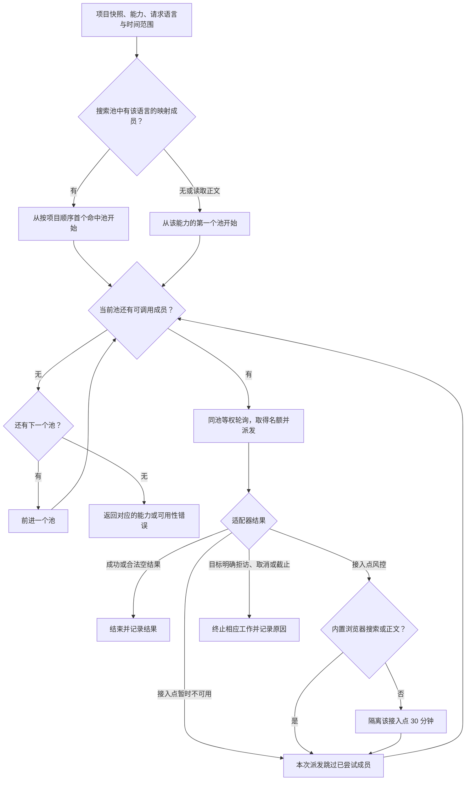
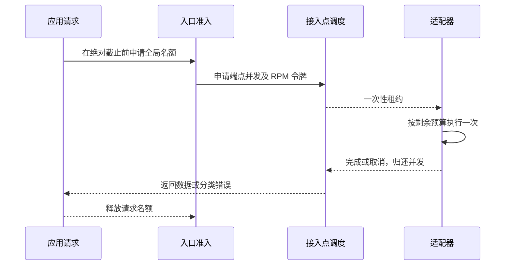
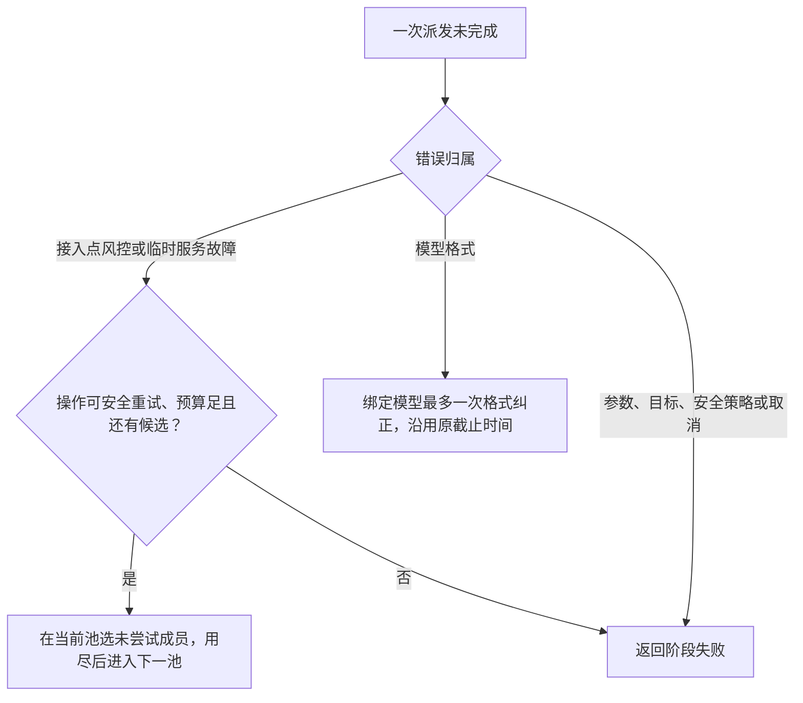

# 04 调度与适配器

接入点是项目可引用的调用能力。原生服务接入点绑定服务实例、凭据引用、超时和容量；内置浏览器能力 ID 独立于实际承接的 Firefox Pod。一个项目配置搜索池、正文池、生成模型及可选浏览器代理池。多个项目引用同一接入点时共用真实容量。

项目选择器按 Helm 启用状态提供套件内的 SearXNG 搜索接入点和 Crawl4AI 正文接入点。新建项目只从可用选项中预选。升级关闭某一组件后，已有项目保留该引用并显示不可用，路由器可继续选择项目池内其余符合条件的接入点。

接入点由能力 `kind`、服务商 `provider` 和执行协议 `adapter` 共同标识。内置搜索和内置正文来自就绪的 Firefox 执行器 Pod。其余搜索、正文适配器由 Rust 直接访问对应服务的原生 HTTP API。生成模型使用项目指定的 OpenAI 兼容模型接口。控制台只对可手工配置的服务收集基址、凭据和限额。随 Helm 管理和单独部署的 SearXNG、Crawl4AI 都沿用各自服务的原生协议。[能力与服务商目录](contracts/endpoint-provider.schema.yaml) · [浏览器实例发现](01-system.md#browser-discovery)

## 能力匹配与池内选择

1. **选起始池。** 搜索使用调用方显式指定的语言，缺省从第一池开始。语言标签规范化后，先匹配完整标签，再逐级匹配较通用的标签，例如 `fr-CA`、`fr`。按项目池序查找第一个包含该语言映射成员的池，直接从该池开始。匹配只看项目成员与已配置的映射，即使映射成员正被隔离，也从它所在的池检查同级成员。多个池命中时取最靠前的一个。没有命中从第一池开始。正文始终从第一正文池开始。
2. **同池负载均衡。** 同一池内，满足本次能力条件、已启用、未隔离且能取得名额的成员等权轮询。显式时间窗口与服务商的问题长度上限属于搜索硬条件。映射成员只决定起始池，池内其他符合条件的成员有相同派发机会。游标在实际派发时推进，预览和查看请求记录都不会消耗轮次。
3. **风控隔离。** 适配器明确报告接入点自身受到风控时，从信号发生时起将该接入点移出负载均衡 30 分钟。隔离按接入点 ID 在引用它的项目间共享。并发回执取较晚的到期时间，到期自动恢复候选资格。普通超时、排队、空结果和低相关率都不会触发这段隔离。
4. **池间降级。** 当前池仍有可调用成员，就留在该池。全池无法调用，才按项目顺序逐池向后尝试，直到取得结果、池用尽或请求截止。语言命中第二池时，降级从第三池继续。每次新派发按自己的起始池重新判断。
5. **内置浏览器。** `browser_search` 和 `browser_reader` 与各自池中的其他成员同样轮询，既可接手前一池的请求，也可在自身不可用时交给同池或后续池。内置搜索首选 Google 时先尝试百度。引擎用尽或正文访问受到风控时结束本次成员尝试，下一次派发仍可选中。目标网页明确拒访时结束对该目标的访问。

例如，三个搜索池依次为 `[A] → [B, C] → [内置浏览器]`，英文规则命中 B。即使 A 可用，英文请求也从第二池开始，B、C 平级轮询。B 在 12:00 触发风控，第二池仍可由 C 单独承接。若 C 也无法调用，则转入第三池。12:30 起，若 B 满足本次请求的能力和容量要求，它重新参加第二池轮询。

运行观测只读取调度器已产生的调用记录。耗时、成功率、评分和趋势可以解释一次调用的表现，调度器的输入只来自项目配置、当前容量和适配器结果。[运行观测](06-observability.md)

| 接口 | 适配器应提供的输入输出 | 能力依据 |
| --- | --- | --- |
| `SearchProvider` | `query, language, time_range, limit → hits`。每项有 URL、标题、简介、上游排名，可带内嵌网页材料 | 接受各业务语言的原始问题。按服务商原生参数判断时间窗口和最大数量。可实现 HTTP 搜索服务、集成来源或浏览器搜索 |
| `ContentReader` | `url, deadline → Article`。保留请求 URL，能确认时另给最终 URL，并报告内容格式和提取原因 | 声明支持 HTML/Markdown、是否需要动态渲染、跳转与内容上限。HTTP 正文服务和浏览器均输出同一文章模型 |
| `GenerationModel` | `task, messages, output_schema, budget → structured_output` | 声明模型标识、模板、tokenizer、输入/输出 token 上限和结构化输出能力 |
| `BrowserExecutor` | `job, egress, deadlines → hits/article` | 出口为已分配代理或 Pod 默认网络。已执行作业保留同一实例、出口和上下文 |

HTTP 适配器只负责协议映射、超时、体积限制和故障归类。回答来源、是否回退简介、如何组织最终证据由用例负责。增加适配器时提供最小成功、合法空、非成功业务状态、畸形响应、超时和并发取消的测试夹具，均使用合成数据。

`browser_search` 只有一个稳定的能力 ID。内置搜索从项目允许且已有有效检测结果的出口中选择。后台每 30 分钟分别检测每条启用的 VPN，并由一个就绪 Firefox Pod 检测集体共用的默认网络。已测不可达直接用百度（`baidu`）。已测可达首选 Google（`google`），实际搜索遇到风控、目标或结果页故障或超时，同一作业在同一出口切换到百度。两次尝试各自记录端点调用和耗时。待首次检测的出口暂不参与搜索，浏览器暂时无合格出口时按既定项目池顺序继续选择。请求语言决定项目搜索的起始池。若选中的引擎缺少本次显式时间等硬能力，按池规则尝试其他合格成员，保留调用方条件。`browser_reader` 直接读取给定网页，跳过引擎检测。[浏览器调度](07-browser-proxies.md#dispatch)

## 第三方原生 HTTP 协议

服务商确定方法、路径、鉴权、请求体和响应字段。部署配置提供服务基址及凭据，适配器将上游结果转换为 `SearchHit` 或 `Article`。下表列出上游路径；调用方始终使用本项目的三个业务接口。

| 服务商 | 搜索列表 | 单 URL 正文 | 适配要点 |
| --- | --- | --- | --- |
| Tavily | `POST /search`，发送 `query,max_results`，读取 `results[]` | `POST /extract`，`urls` 仅传本次 URL，读取成功项的 `raw_content` | 使用 Bearer 凭据，区分提取成功项与 `failed_results`。[Search](https://docs.tavily.com/documentation/api-reference/endpoint/search) · [Extract](https://docs.tavily.com/documentation/api-reference/endpoint/extract) |
| AnySearch | `POST /v1/search`，读取 `data.results[]` 的标题、URL、简介及可选内容 | `POST /v1/extract`，提交 `url`，读取 `data.title, data.content` | 校验业务结果及数据结构。提取响应的 `data.url` 表示提交的原地址。[Search](https://www.anysearch.com/docs/api-endpoints/v1-search) · [Extract](https://www.anysearch.com/docs/api-endpoints/v1-extract) |
| DeepSeek | `POST /v1/tools/search`，发送 `query,count`，按需用 `need_content` 取随附材料 | `POST /v1/tools/fetch`，提交 `url`，读取 `title,content`，正文为 Markdown | 两个工具接口使用 Bearer 凭据。搜索问题上限为 128 个 Unicode 字符，当前原生请求没有日/月/年筛选字段。这两项能力限制在派发前检查。[原生 Search 与 Fetch](https://api-docs.deepseek.com/guides/search/) · [搜索请求字段](https://api-docs.deepseek.com/api/search/) |
| SearXNG | `GET /search`，传 `q,format=json`，按实例能力加入 `language,time_range,engines` | — | 实例需启用 JSON 输出；时间过滤以其已启用引擎实际支持的范围为准。[Search API](https://docs.searxng.org/dev/search_api.html) |
| Crawl4AI | — | 自托管服务的同步 `POST /crawl`，`urls` 数组只含一个地址 | 校验该 URL 对应结果的成功状态后取正文，按部署的原生鉴权配置访问。[自托管 API](https://docs.crawl4ai.com/core/self-hosting/) |

只有内置浏览器任务申请 Firefox 槽位，项目绑定代理池时同时申请代理租约。厂商同时提供搜索和正文时，两个能力可以分开绑定。搜索随附材料进入与其他候选相同的评分与证据流程。超出某个上游的查询长度或时间能力时跳过该成员，保留调用方的原问题和显式条件。单纯的 HTTP 错误码不足以把目标拒访认定为整个接入点遭遇风控。[项目池选路](#routing)

### DeepSeek 搜索和正文配置

在接入点的「搜索」分类选择 `DeepSeek`，创建 `http_search`。勾选「请求随附网页材料」时采用 `integrated_search` 并发送 `need_content=true`。在「正文」分类选择 `DeepSeek`，创建 `http_reader`。两个接入点均接受 `https://api.deepseek.com` 或 `https://api.deepseek.com/v1` 作为服务基址，也接受末尾斜线。调用路径统一为 `/v1/tools/search` 和 `/v1/tools/fetch`，版本前缀只拼接一次。凭据分别通过接入点的 API Key 字段保存，出站使用 Bearer 认证。

项目把它们分别加入搜索池和正文池后，列表返回原生 `results[]` 中的标题、链接和简介。正文将原生 `content` 按 Markdown 解析，再生成同一份材料的 Markdown 与纯文本。原生 Fetch 没有最终地址时省略 `final_url`。搜索词最多 128 个 Unicode 字符，界面应选不限时间。带日、月、年范围的请求继续按项目池选择其他支持该条件的搜索源。[原生搜索](https://api-docs.deepseek.com/zh-cn/api/search/) · [原生正文](https://api-docs.deepseek.com/zh-cn/api/fetch/)

## 总预算和资源次序

| 项目 | 首版设计值 | 时钟与行为 |
| --- | --- | --- |
| 列表、单 URL 正文、综合总结 | 15 秒、15 秒、45 秒 | 自到达 HTTP 边界起算，含鉴权、排队、网络、模型和结果校验 |
| 全局业务准入 | 并发 24，等待队列 48，最多等 3 秒 | 所有项目共享 FIFO。入口速率与并发分开配置 |
| 端点资源 | `max_concurrency`、`rpm`、`timeout_ms` 按实例设置 | 取得并发和令牌后才派发，等待计入业务预算。单次超时不超过剩余预算 |
| 模型与长文 | 每请求最多并行 4 个段任务 | 腾出最终综合所需时间。开始取材料时，末段预留 `min(模型单次超时, 剩余预算/3)` |
| 浏览器 | 全局上下文槽位、可选的代理并发 | 绑定代理时同时预留槽位与代理容量，未绑定仅预留槽位。子阶段只可收紧业务截止 |

例如，综合请求的 45 秒预算已用 15 秒，模型单次超时 8 秒，则材料阶段至多再用 22 秒，末段留 8 秒。并行处理四篇不会产生四份 45 秒。调度器按各请求轮流授予段任务，让一篇长文无法独占整个模型队列。

## 失败、重试与取消

搜索或取文的一次逻辑调用对每个成员最多尝试一次，所有尝试共用原截止时间。已知隔离和能力不匹配的成员直接跳过。接入点功能测试只调用被测成员一次。尊重上游限流的退避要求。任务一旦向目标提交浏览器访问，保持所选出口。明确站点拒绝终止该目标的处理。取消信号传到所有派生任务，由资源所有者确认实际操作已退出后再归还名额。记录排队时长、执行时长、是否真正发送及失败分类，供统计与排错使用。

SearXNG 返回的 `unresponsive_engines` 属于当前调用的上游结果。只有失败引擎且没有结果时按调用失败处理；已有结果但部分引擎失败时保留候选并标记材料不完整。未配置 engines 时省略该查询参数，沿用实例自己的引擎配置。

### 业务语言目录与时间范围

管理台的语言路由、调试与记录筛选共用一份可搜索目录。目录覆盖 Google 搜索设置的显示语言、结果语言，以及其 185 个可选国家和地区在 CLDR 中标记为官方、地区官方或事实官方的语言。合并通用标签、规范化别名并去重后共 248 项。名称按界面语言本地化，可输入名称、英文名称或语言代码。调用方仍可提交目录以外的有效语言标签。界面本地化采用中文和英文。[Google 搜索语言和地区设置](https://www.google.com/preferences?lang=1) · [Unicode CLDR 地区语言资料](https://github.com/unicode-org/cldr-json/blob/48.0.0/cldr-json/cldr-core/supplemental/territoryInfo.json)

时间范围由搜索请求的 `time_range` 决定。省略时按普通搜索派发。传入 `day/month/year` 时，Tavily 和 SearXNG 使用原生 `time_range`。内置 Firefox 依据实际引擎生成 Google 的 `tbs` 或百度的 `gpc`。切换引擎时保留该条件。当前 AnySearch 通用搜索和 DeepSeek 工具适配器会跳过带时间范围的请求。所有候选均无法满足时返回 `TIME_RANGE_UNSUPPORTED`。[Tavily Search](https://docs.tavily.com/documentation/api-reference/endpoint/search) · [SearXNG Search API](https://docs.searxng.org/dev/search_api.html) · [AnySearch 通用搜索](https://www.anysearch.com/docs/api-endpoints/v1-search)

## Google 搜索故障后的出口选择

网络可达探测与实际搜索状态分别保存。Google 在一个出口上的实际查询出现风控、超时、引擎或结果解析故障时，当前作业尝试百度，并按出口 ID 和配置版本记录十分钟冷却。冷却状态存于 PostgreSQL，所有 Pod 和后续请求共享。冷却期间直接选百度，在请求记录中标明原因与重试时间。到期后新请求恢复按连通样本尝试 Google，更换出口版本不沿用旧故障。预热使用同一份选择。合法空列表、缺少 AI 卡、取消、访问策略和代理故障各按自身语义处理。
