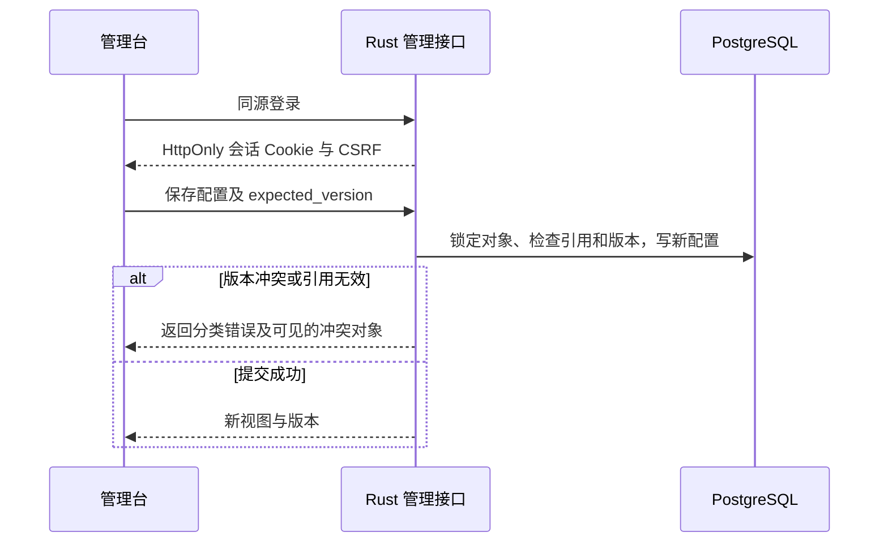
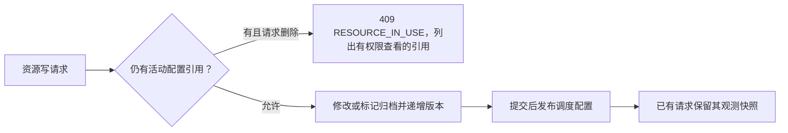
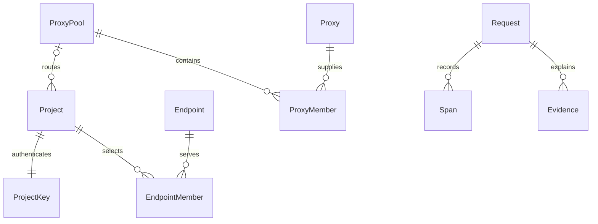

# 05 控制面与数据模型

管理员用同源会话配置项目、接入点和 VPN 代理资源。业务 Key 只授予相应项目的三个搜索操作。PostgreSQL 分表保存配置、凭据、请求记录和统计。租约由 Rust 调度器持有，持久版本用于判定迟到写入是否仍有效。

## 管理 API 清单

路径均相对于 `/admin/v1`。列表采用 `{items,next_cursor}`，常规响应复用 `request_id/status/data/warnings/error` 外壳。创建资源用 201。配置更新用 `expected_version`，不匹配返回 `409 VERSION_CONFLICT`。[管理数据字典与请求样例](contracts/control-data.md)

| 操作路径 | 方法 | 行为 |
| --- | --- | --- |
| `/session` | POST / GET / DELETE | 登录、读取当前会话与 CSRF、注销 |
| `/settings/retention` | GET / PUT | 读取或修改全局唯一的历史保留天数，覆盖所有项目的完整材料、请求明细、调用和统计。默认 7 天，变更只适用于新记录。保存须提供正整数天数和 `expected_version`，版本不一致返回 409 |
| `/projects`，`/projects/{id}` | GET、POST / GET、PUT | 分页、创建、读取及替换项目配置。创建返回项目和一次可见的业务 Key |
| `/projects/{id}/key` | POST | 原子轮换凭据，返回新 Key 与新项目版本 |
| `/endpoints`，`/endpoints/{id}` | GET、POST / GET、PUT、DELETE | 列表包括系统发现的 Firefox 能力。创建与变更面向手工配置的接入点。内置浏览器实例的生命周期由 Kubernetes 副本管理。仍被引用的端点不能删除 |
| `/endpoints/{id}/test` | POST | 对已保存版本执行最小能力请求，保存结果及诊断 ID |
| `/language-routes` | GET / PUT | 读取或版本化替换全局语言优先映射，只能引用搜索端点 |
| `/proxies`，`/proxies/{id}` | GET、POST / GET、PUT、DELETE | 管理 SOCKS5/HTTPS 代理、凭据操作、容量与启用状态 |
| `/proxies/{id}/test` | POST | 通过代理访问运维配置的测试目标，返回分阶段耗时与失败原因 |
| `/proxy-pools`，`/proxy-pools/{id}` | GET、POST / GET、PUT、DELETE | 管理代理池成员及权重，删除前校验项目引用 |
| `/projects/{id}/debug/list`、`/projects/{id}/debug/content`、`/projects/{id}/debug/summary` | POST | 管理员按项目调试同三个业务用例，复用公共请求/响应 schema 与资源配额 |
| `/requests`、`/requests/aggregates` | GET | 按开始时间、项目、操作、状态、关键词查请求，或计算完整窗口的合计 |
| `/requests/{id}`、`/requests/{id}/evidence`、`/requests/{id}/spans/{span_id}`、`/requests/{id}/export` | GET | 请求概况、来源与分段引用、单步载荷、完整脱敏记录 |
| `/requests/{id}/replay/{material_id}/layout` | GET | 校验请求及材料归属，从归档读取含样式和资源的静态布局 JSON，供历史回放 iframe 按需加载 |
| `/endpoint-calls`、`/endpoint-calls/{id}`、`/endpoint-statistics` | GET | 查看上游尝试、单条详情及窗口聚合。来源可分业务、调试及端点测试 |

探针为 `GET /health/live` 与 `GET /health/ready`。探针只展示必要状态，运维控制可见范围。业务调用方不管理代理，也不能在请求中提交任意代理选项。

管理端获得一份完整测试诊断时返回 HTTP 200，`data.status` 表示资源测试的 `success/error`，`reason` 给出可本地化的原因。管理身份无效、资源不存在或连测试都无法调度时，使用相应 HTTP 错误和统一错误外壳。DELETE 资源操作通过 `expected_version` 查询参数确认所见版本。

接入点的能力、服务商和执行协议在创建时确定。保存和读回校验三者的组合，执行快照保留当时的服务商。修改超时、选项或凭据会递增版本，当前版本的测试状态恢复为待测。测试回执携带发起时的资源版本，较早发起的测试不能覆盖新回执。语言映射按整份资源替换，项目池保存顺序，语言映射的成员作为集合处理。项目允许暂时缺少一类能力，在调试时单独报告受影响的操作。[表单与保存规则](11-atlas-frontend-reference.md#configuration)

## 管理身份、配置与凭据轮换

首次初始化管理员由部署注入账号和口令，服务保存带盐口令哈希。会话使用随机令牌，库内存摘要和到期时间，Cookie 设置 `HttpOnly/SameSite=Strict`，HTTPS 下启用 `Secure`。登录及管理写校验 Origin，登录后的所有写操作还校验 CSRF。口令、会话、项目 Key 和代理口令均不得写入普通日志。

项目 Key 以高熵随机值签发，库内保存摘要和显示前缀。创建或轮换时只交付一次明文。端点与代理凭据需要出站使用，采用认证加密，记录加密密钥版本，主密钥由部署注入。更新凭据使用 `keep/replace/clear` 操作，视图只返回 `has_secret`。凭据版本加入资源配置版本，停用或轮换后新派发立即采用新配置。

业务鉴权与读取项目/资源引用在同一短事务完成。配置用乐观版本控制，并在写入时锁定被引用对象，避免删除与新增引用并发穿透。外部 HTTP 或浏览器动作发生在数据库事务之外。提交结果不明确时重新读取权威版本，写请求不自动重放。代理停用优先于已取得的项目快照，派发前须重新检查。

## 主持久模型

| 表族 | 主键、关系与约束 |
| --- | --- |
| `administrators, admin_sessions` | 管理员 ID 与会话摘要，索引到期时间，注销立即失效 |
| `history_retention` | 整套部署保存一条全局配置，包含保留天数和设置版本，初始为 7 天。管理员更新时校验乐观版本，提交后的新请求采用新版本。 |
| `projects, project_keys` | 项目 UUID。每项目一个当前有效 Key，摘要唯一。含默认语言、允许语言、结果数、材料数、字数、摘要策略、模型与浏览器代理池引用 |
| `endpoints, project_endpoint_members, endpoint_tests, language_routes` | 系统初始化时幂等建立两个稳定浏览器能力 ID，Pod 就绪变化只更新运行时实例清单。 成员以 `(project_id,kind,endpoint_id)` 唯一，`(project_id,kind,pool_no,position)` 唯一。限制端点类型与能力。测试按发起时间及资源版本条件写回 |
| `endpoint_risk_cooldowns` | 以接入点 ID 为主键。调度所有者收到接入点风控信号时，以原子更新保留较晚的 `blocked_until`。接管时加载未到期的记录，以 UTC 截止时间恢复资格。内置浏览器免写此表。 |
| `proxies, proxy_pools, proxy_pool_members, proxy_tests` | 每个代理有协议、主机、端口、密文、容量、启停和版本。池内成员唯一，权重为正整数。代理健康样本只属于测试或真实执行时的版本 |
| Google 连通样本 | 每条 VPN 按 `(proxy_id,proxy_version)` 关联样本。每套安装只维护一份 `default_network` 样本，所有 Firefox Pod 共用，采样 Pod 的 UID 保存为来源。后台每 1800 秒刷新，按当前配置和检测轮次拒收迟到回执。内置搜索派发时冻结已完成的样本，首次结果待定的出口不获搜索租约。 |
| `requests, request_spans, request_evidence` | 创建请求或独立测试记录的事务读取已提交的全局设置，在主记录冻结 `retention_days,retention_version,expires_at`，按 `expires_at` 索引回收。子表按 `(request_id,span_id)` 与 `(request_id,source_id,segment_id)` 索引。保留阶段、来源、材料范围、模型版本和引用。完整网页、布局及其资源、逐次模型输入输出关联请求、阶段和调用。以 `(request_id,material_id)` 定位一份材料，按需授权读取。原文、布局数据和依赖资源随所属请求一并到期回收。记录保留状态与缺失原因。到期条件覆盖读路径和清理任务 |
| `endpoint_calls, endpoint_stats_hour, endpoint_stats_day` | `call_id` 唯一，每个贡献沿用所属请求的 `expires_at`。按 `(bucket_at,dimension_hash,retention_version)` 分桶并记录贡献的到期范围。混合到期的桶按有效明细汇总；清理后原子重建汇总及边界。保留端点版本、来源、操作、有效语言和时间条件 |

配置对象都有 `created_at,updated_at,version`。列表使用稳定时间键和 UUID 的游标，默认 20、最大 100。游标绑定筛选条件与时间窗。请求/统计时间窗口统一采用 UTC 半开区间 `[from,to)`。历史请求展示当时的显示名称和版本，归档配置不破坏历史解释。
