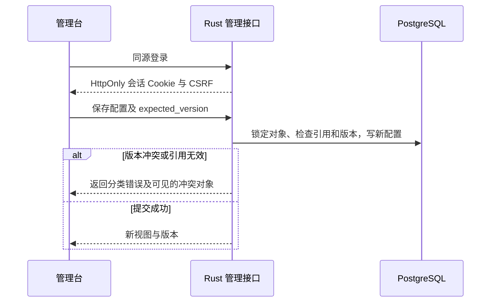
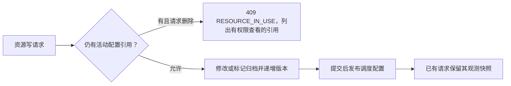
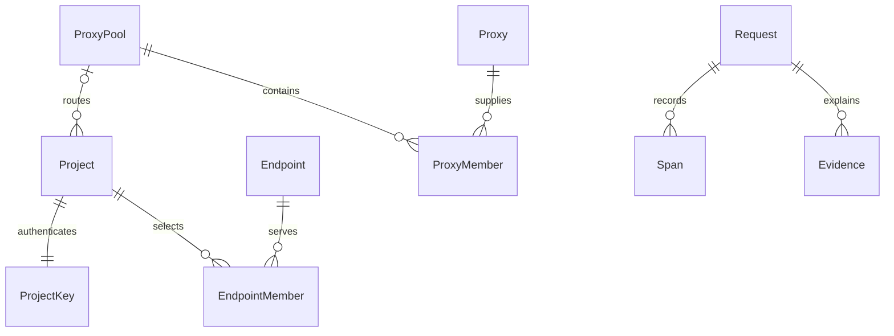

# 05 控制面与数据模型

管理员用同源会话配置项目、接入点和 VPN 代理资源。业务 Key 只授予相应项目的三个搜索操作。PostgreSQL 分表保存配置、凭据、请求记录和统计。租约由 Rust 调度器持有，持久版本用于判定迟到写入是否仍有效。

## 管理 API 清单

路径均相对于 `/admin/v1`。列表采用 `{items,next_cursor}`，常规响应复用 `request_id/status/data/warnings/error` 外壳。创建资源用 201。配置更新用 `expected_version`，不匹配返回 `409 VERSION_CONFLICT`。[管理数据字典与请求样例](contracts/control-data.md)

| 操作路径 | 方法 | 行为 |
| --- | --- | --- |
| `/session` | POST / GET / DELETE | 登录、读取当前会话与 CSRF、注销 |
| `/settings/retention` | GET / PUT | 读取或修改全局唯一的历史保留天数，覆盖所有项目的完整材料、请求明细、调用和统计。默认 7 天，变更只适用于新记录。保存须提供正整数天数和 `expected_version`，版本不一致返回 409 |
| `/projects`，`/projects/{id}` | GET、POST / GET、PUT | 分页、创建、读取及替换项目配置。创建返回项目和一次可见的业务 Key |
| `/projects/{id}/key` | POST | 原子轮换凭据，返回新 Key 与新项目版本 |
| `/endpoints`，`/endpoints/{id}` | GET、POST / GET、PUT、DELETE | 列表包括系统发现的 Firefox 能力。创建与变更面向手工配置的接入点。内置浏览器实例的生命周期由 Kubernetes 副本管理。仍被引用的端点不能删除 |
| `/endpoints/{id}/test` | POST | 对已保存版本执行最小能力请求，保存结果及诊断 ID |
| `/language-routes` | GET / PUT | 读取或版本化替换全局语言优先映射，只能引用搜索端点 |
| `/proxies`，`/proxies/{id}` | GET、POST / GET、PUT、DELETE | 管理 SOCKS5/HTTPS 代理、凭据操作、容量与启用状态 |
| `/proxies/{id}/test` | POST | 通过代理访问运维配置的测试目标，返回分阶段耗时与失败原因 |
| `/proxy-pools`，`/proxy-pools/{id}` | GET、POST / GET、PUT、DELETE | 管理代理池成员及权重，删除前校验项目引用 |
| `/projects/{id}/debug/list`、`/projects/{id}/debug/content`、`/projects/{id}/debug/summary` | POST | 管理员按项目调试同三个业务用例，复用公共请求/响应 schema 与资源配额 |
| `/requests`、`/requests/aggregates` | GET | 按开始时间、项目、操作、状态、关键词查请求，或计算完整窗口的合计 |
| `/requests/{id}`、`/requests/{id}/evidence`、`/requests/{id}/spans/{span_id}`、`/requests/{id}/export` | GET | 请求概况、来源与分段引用、单步载荷、完整脱敏记录 |
| `/requests/{id}/replay/{material_id}/layout` | GET | 校验请求及材料归属，从归档读取含样式和资源的静态布局 JSON，供历史回放 iframe 按需加载 |
| `/endpoint-calls`、`/endpoint-calls/{id}`、`/endpoint-statistics` | GET | 查看上游尝试、单条详情及窗口聚合。来源可分业务、调试及端点测试 |

探针为 `GET /health/live` 与 `GET /health/ready`。探针只展示必要状态，运维控制可见范围。业务调用方不管理代理，也不能在请求中提交任意代理选项。

管理端获得一份完整测试诊断时返回 HTTP 200，`data.status` 表示资源测试的 `success/error`，`reason` 给出可本地化的原因。管理身份无效、资源不存在或连测试都无法调度时，使用相应 HTTP 错误和统一错误外壳。DELETE 资源操作通过 `expected_version` 查询参数确认所见版本。

接入点的能力、服务商和执行协议在创建时确定。保存和读回校验三者的组合，执行快照保留当时的服务商。修改超时、选项或凭据会递增版本，当前版本的测试状态恢复为待测。测试回执携带发起时的资源版本，较早发起的测试不能覆盖新回执。语言映射按整份资源替换，项目池保存顺序，语言映射的成员作为集合处理。项目允许暂时缺少一类能力，在调试时单独报告受影响的操作。[表单与保存规则](11-atlas-frontend-reference.md#configuration)

## 管理身份、配置与凭据轮换

首次初始化管理员由部署注入账号和口令，服务保存带盐口令哈希。会话使用随机令牌，库内存摘要和到期时间，Cookie 设置 `HttpOnly/SameSite=Strict`，HTTPS 下启用 `Secure`。登录及管理写校验 Origin，登录后的所有写操作还校验 CSRF。口令、会话、项目 Key 和代理口令均不得写入普通日志。

项目 Key 以高熵随机值签发，库内保存摘要和显示前缀。创建或轮换时只交付一次明文。端点与代理凭据需要出站使用，采用 AES-256-GCM 认证加密，`resources.secret_key_version` 记录密钥代次，当前为 1，主密钥由部署注入并在普通升级中保留。更新凭据使用 `keep/replace/clear` 操作，视图只返回 `has_secret`。凭据版本加入资源配置版本，停用或轮换后新派发立即采用新配置。

业务鉴权与读取项目/资源引用在同一短事务完成。配置用乐观版本控制，并在写入时锁定被引用对象，避免删除与新增引用并发穿透。外部 HTTP 或浏览器动作发生在数据库事务之外。提交结果不明确时重新读取权威版本，写请求不自动重放。代理停用优先于已取得的项目快照，派发前须重新检查。

## 主持久模型

| 表族 | 主键、关系与约束 |
| --- | --- |
| `administrators, sessions` | 管理员账号与口令哈希、会话令牌摘要、CSRF 和到期时间；注销立即删除当前会话 |
| `settings` | `retention` 保存全局保留天数及版本，初始为 7 天；`language-routes` 保存语言映射。两者分别检查乐观版本。 |
| `resources, project_keys` | `resources.kind=projects/endpoints/proxies/proxy-pools`，配置存在 JSONB body，另列 UUID、版本、归档、密文和创建/更新时间。每项目一个当前有效 Key，摘要唯一。项目 JSONB 保留有序能力池、限额及模型和代理池引用 |
| `resource_links` 与端点 body | 引用边由 `(owner_id,target_id,role)` 唯一约束保护。项目内同一能力成员不得重复，JSONB 数组固定池和成员位置。系统初始化幂等建立两个稳定浏览器能力 ID，Pod 变化只更新运行清单。测试回执按发起时间及资源版本条件写入 `last_test` |
| `endpoint_risk_cooldowns` | 以接入点 ID 为主键。调度所有者收到接入点风控信号时，以原子更新保留较晚的 `blocked_until`。接管时加载未到期的记录，以 UTC 截止时间恢复资格。内置浏览器免写此表。 |
| 代理配置及运行字段 | `resources` 保存协议、容量、启停及配置版本，健康字段带独立修订号；池成员 UUID 唯一，权重为 1–100 的整数。密文单独存储，测试和健康更新均校验对应版本 |
| `probes` | 每条 VPN 关联代理版本，每套安装一份 `default_network`，采样 Pod UID 保留为来源。数据库序列为发布轮次提供单调代次。后台每 1800 秒刷新，首次结果待定的出口不获搜索租约 |
| `browser_jobs` | 浏览器任务、实际 Pod、owner、出口身份及 opening/open 状态。重启后用于回收尚未确认关闭的上下文和保留租约；不恢复页面会话 |
| `requests, materials` | 请求行冻结 `retention_days,retention_version,expires_at`，record 保存小型列表字段，payload JSONB 保存配置、请求响应、Span 与证据。`materials` 以 `(request_id,material_id)` 定位完整网页、规范正文、布局资源与模型往返，并通过外键级联回收。详情仅投影阶段元数据，证据与单步载荷分别按需读取，到期检查覆盖详情、调用、回放及导出 |
| `endpoint_calls, endpoint_stats_hour, endpoint_stats_day` | `call_id` 唯一，每个贡献继承请求的 `expires_at`。按 `(bucket_at,dimension_hash,retention_version)` 分桶并维护到期范围。完整有效桶与边缘明细在同一读取快照中组合，部分到期桶回查有效明细，完全到期桶删除。保留端点版本、来源、操作与有效语言维度 |

配置对象都有 `created_at,updated_at,version`。列表使用稳定时间键和 UUID 的游标，默认 20、最大 100。游标绑定筛选条件与时间窗。请求/统计时间窗口统一采用 UTC 半开区间 `[from,to)`。历史请求展示当时的显示名称和版本，归档配置不破坏历史解释。

请求和调用列表在 PostgreSQL 中按 `(时间,UUID)` 做键集分页，查询 `limit+1` 行，不先加载全窗口再切页。游标同时冻结窗口并绑定筛选，改条件后使用旧游标返回字段错误。按请求 ID 查看历史调用时覆盖该请求的整个保留范围。全局请求聚合与接入点统计采用流式或桶读取，内存按统计组和最多 500 个时间点增长。

## 管理员初始化与口令生命周期

初始账号默认 `admin / admin123`，可在 `oasctl install` 或 Helm values 中指定。后端与 CLI 共用用户名、口令校验规则，初始化口令至少 8 个 Unicode 字符。空库初始化采用事务锁，只有管理员表为空时才插入第一名管理员。启动配置只参与首次初始化，重启和升级不覆盖已有口令或添加另一名初始化管理员。

口令使用随机盐的 Argon2id 散列保存。显式维护重置在一个事务内更新散列并删除该管理员的全部会话；签发会话前再次锁定并核对已验证的散列，避免并发旧密码登录在重置后签发新会话。登录 HTTP 请求及响应契约沿用现有 `/session`，维护命令与 Secret 同步方式见 [安装运维](./12-oasctl-and-helm.md#初始管理员与显式口令重置)。

浏览器引擎搜索状态由 browser_engine_health 保存，主键为出口 ID 与配置版本，字段包括失败代码和重试时间。十分钟冷却用于同一出口在 Pod 与请求间共享的初始引擎选择，独立于三十分钟网络连通采样和接入点风控隔离。
