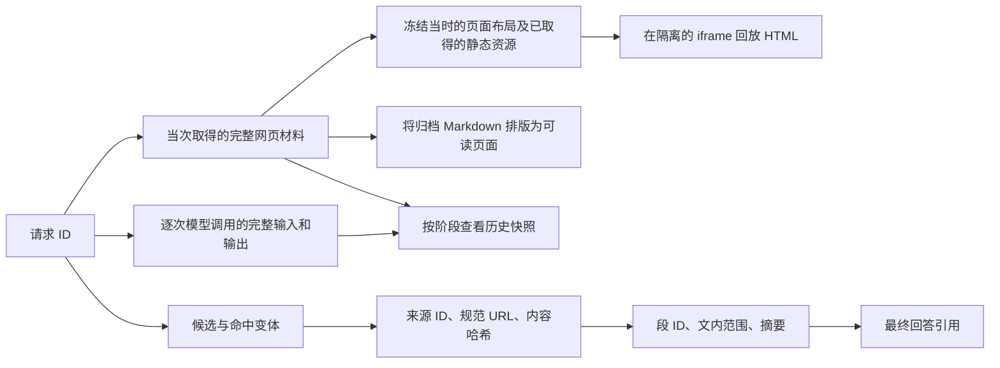
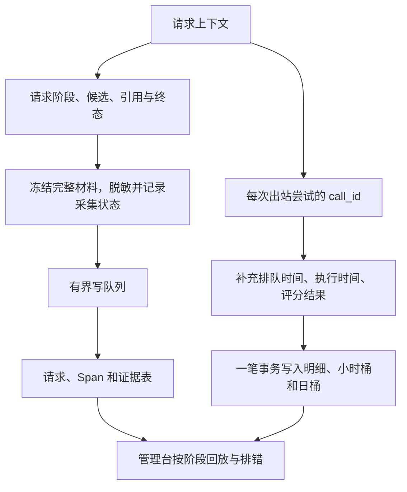

# 06 请求记录与观测

每次业务调用创建独立的请求记录。请求记录解释此次结果使用了哪些材料，调用明细统计实际派发的上游尝试。两者按请求 ID 关联。

## 材料与保留

默认保存每次实际取得的完整网页材料，以及每次模型调用实际发送的完整输入、收到的完整输出。Firefox 取文保存当次提取所用的页面 HTML。原生服务提供 HTML、Markdown 或纯文本时，保存收到的原格式全文。业务响应的 `max_chars` 只限制交付给调用方的字符数，历史材料保存取得时的版本。模型快照包含实际使用的提示、消息、参数及回复。改写、评分、段摘要、综合和纠正重试分别关联各自的 `call_id`。

例如，周一执行的总结，管理员在周五可以查看当时的网页原貌、评分时实际提交的消息和输出、最后回答及引用。列表提供短预览，进入单步后才加载对应材料。回放读取已保存的快照，网页或模型后来发生变化也不会改写历史。身份令牌、Cookie、上游密钥与代理口令在持久化前脱敏。

所有项目共用一份全局保留设置，默认 **7 天**。管理员在 Atlas 的「请求记录 → 全局保留设置」修改天数，`GET/PUT /admin/v1/settings/retention` 以 `expected_version` 防止并发覆盖。新值只适用于保存后新建的请求和独立测试记录。

每条请求创建时固定全局设置的版本和天数，并写入 `expires_at = started_at + retention_days × 24 小时`（UTC）。网页全文、布局和静态资源、Markdown、模型输入输出、请求与调用明细，以及它们对统计的贡献，均继承所属请求的到期时刻。请求运行中修改设置或稍后才写入证据，也沿用创建时的期限。缩短和延长天数都保留已有记录原定的到期时间。

例如，按 7 天策略保存的请求已经过了 4 天，此时改为 3 天，旧请求还有 3 天可查看和回放，新请求自各自开始时起保留 3 天。一次查询使用同一读取时刻，只返回 `expires_at` 严格晚于该时刻的记录。到点即停止服务端读取和导出，后台可分批回收。采集时只取得部分内容或写入失败的材料标为不完整。

### 历史网页原貌和 Markdown

| 当时保存的材料 | 管理员看到的内容 |
| --- | --- |
| Firefox 已渲染页面 | 「网页原貌」在 iframe 中显示当时的版式，包括已取得的样式、图片和字体。按采集时视口排版，窄屏可滚动查看。另可查看网页原文、提取出的 Markdown 和纯文本。 |
| 原生接入点返回的 HTML | 用收到的 HTML 和实际取得的静态资源生成同样的隔离预览。缺少样式或图片时显示「布局资源不完整」，保留仍可显示的内容。 |
| Markdown 或纯文本 | Markdown 默认渲染为可读的标题、段落、表格、列表和代码块，可切换源文；纯文本保留换行。仅有 Markdown 时直接打开 Markdown 预览。 |

在取文时冻结用于提取的 DOM、已加载的样式表和可归档的资源字节。按文档及各自样式表的基址解析相对路径，处理 CSS 引用、背景图片、字体和已选中的响应式图片。回放服务把取得的样式和资源内嵌到一份静态 HTML，并记录采集视口和缺失项。原文内容完整性与布局完整性分别记录。原站改版、下线或删除资源后仍读取这份归档。

阶段材料用请求内唯一的 `material_id` 标识，同一上游调用带回多篇网页时可独立定位。父页面以现有管理会话按需读取布局 JSON，将处理过的静态文档赋给带 `sandbox=""` 和 `referrerpolicy="no-referrer"` 的 iframe 的 `srcdoc`。预览生成器剔除脚本、事件处理器、表单提交、导航与嵌套浏览上下文，回放文档的资源策略只允许已内嵌的样式、图片和字体，所有相对 URL 都在生成静态文档时处理。Markdown 共用安全渲染组件，图片只有外链时显示替代文字。切换记录或注销时释放预览。[iframe 隔离](https://developer.mozilla.org/en-US/docs/Web/HTML/Reference/Elements/iframe#sandbox) · [布局数据契约](contracts/replay-layout.schema.yaml)

## 请求记录与调用明细

`request_id` 连接业务响应和请求记录。`call_id` 区分一次请求内不同上游尝试。`source_id/segment_id` 标明证据位置。Span 包含 `span_id,parent_id,stage,start_offset_ms,duration_ms,status` 以及可选的输入输出引用。列表默认不给大正文。按需加载单步。业务投影应能从综合回答定位到一段原文的范围、使用的 URL、评分和提取状态。缺失载荷返回 `incomplete` 和具体原因。

配置、代理和项目凭据在采集时就脱敏，冻结前再次检查。请求、进程内积压和单条载荷各有上限。写队列拒收或后台写入失败只损失相应诊断，不改变已经交付的状态。服务导出丢弃计数。浏览器调用记录实际 Pod 名称与 UID、稳定能力 ID、任务 ID、出口模式、阶段耗时。代理模式补充代理池和实际代理的标识，默认网络模式直接显示「Pod 默认网络」。内置搜索冻结当时采用的已完成样本、检测完成时间及实际引擎。默认网络模式另外记录执行检测的代表 Pod UID。首次检测待定时跳过该出口，只有实际发出的尝试才计入调用量。每条 VPN 和共享默认网络的周期检测属于后台运行状态，业务耗时和上游次数只计该请求的执行。正文调用省略连通样本和搜索引擎。

| 指标 | 聚合规则 |
| --- | --- |
| 请求数量与状态 | 按独立请求 ID 和开始时间计数，区分 success、partial、empty、error、cancelled |
| 上游次数 | 真正开始发送时计一次，模型调用是其中一个分类。排队取消只计本地等待 |
| 接入点速度 | 成功尝试的总执行毫秒 / 成功次数。失败耗时、排队耗时另列，P95 从固定桶直方图估算 |
| 搜索质量 | 分子为合法评分且相关的候选数，分母为已完整评估的该次候选数。未评分或评估不全单列，避免把未知计为不相关 |
| 正文质量 | 成功取得有效 Article 的已完成尝试数 / 有确定结果的已发送尝试数 |
| 代理健康 | 展示执行器报告的代理状态及原因。VPN 列表另列每 30 分钟更新的 Google 可达性和时间。全部 Pod 共用的默认网络样本在内置搜索能力详情展示。「待首次检测」与「已测不可达」分别显示。手工连通测试独立显示 |

数据库使用 `call_id` 幂等写入明细和统计贡献。同 ID 不同内容记录一致性错误。小时桶、日桶按统计维度及创建请求时的保留策略版本分组，保存桶内贡献的最早与最晚到期时间。查询时间范围完整覆盖且所有贡献都有效的桶可直接相加，全部到期的桶跳过。时间窗切到桶边缘、或同一桶内有些贡献已过期时，下钻到更细的桶或明细，只汇总读取时仍有效的贡献，各层区间只计一次。修改全局天数后，较早版本仍有效的历史也应可检索。展示时按用户时区分桶，最多 500 个点，空样本的比例和均值为 `null`。

运行观测只读。次数、延迟、P95、成功率和质量用于排查与比较，不改变池优先级、成员权重、风控隔离或恢复时间。调度器直接接收适配器的执行结果，再把已发生的选择及原因写入记录。关闭观测、采样缺失或清理历史记录都不影响后续选路。[项目池选路](04-routing-and-providers.md#routing)

## 从候选回溯答案

候选详情按请求内 ID 汇集每个查询的 URL 和排名、合并后的 URL、评分批次、相关性、分数以及是否被选中。随后分开记录取文尝试、实际材料类型、Markdown 与纯文本各自的原始及保留字符数。正文范围采用所存文本的 Unicode 标量半开区间 `[start,end)`，简介回退的坐标原点为该简介开头。可以由最终引用定位到同一次请求中的来源、摘要、原文范围及阶段。在保留期内，若某次材料采集不完整，仍可查看已记录的调用、耗时和缺失原因。达到全局保留边界后，详情与回放一同停止返回历史内容。[Atlas 下钻与状态](11-atlas-frontend-reference.md#trace)
