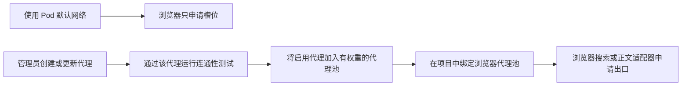
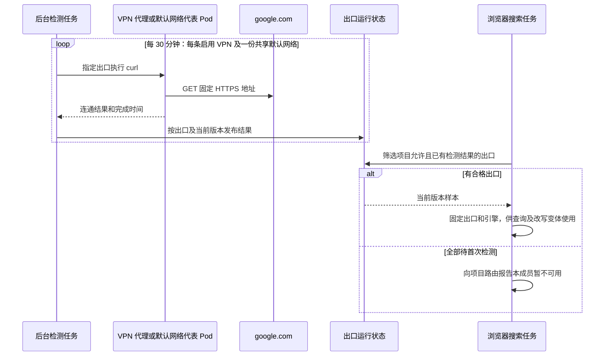
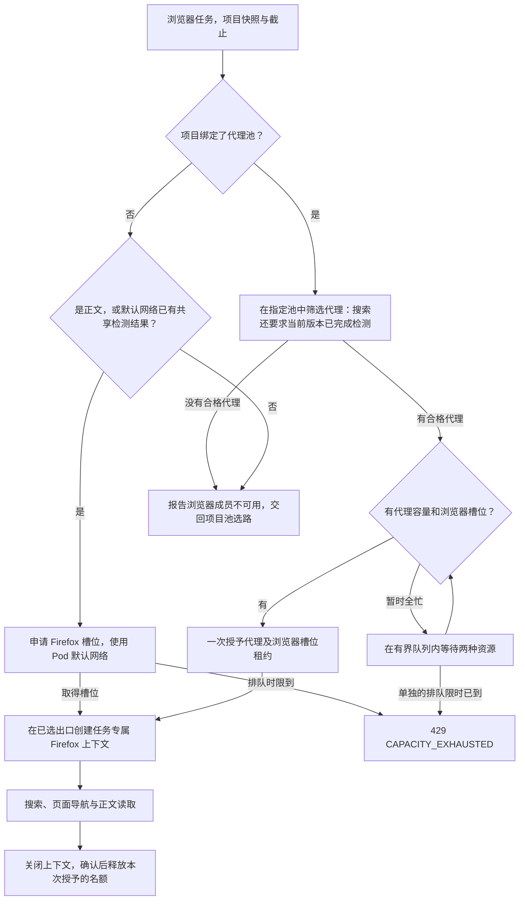
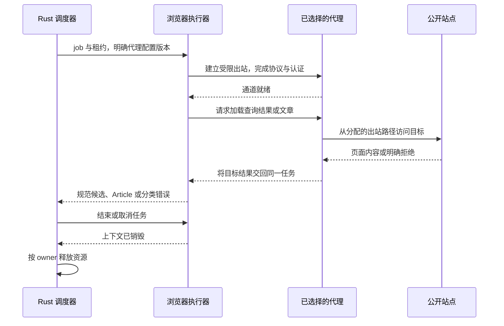
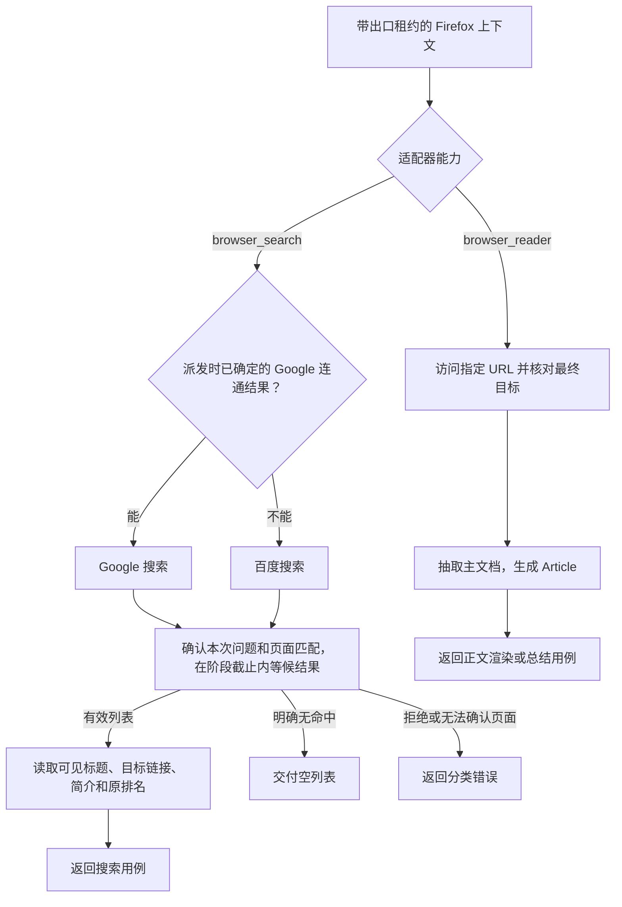
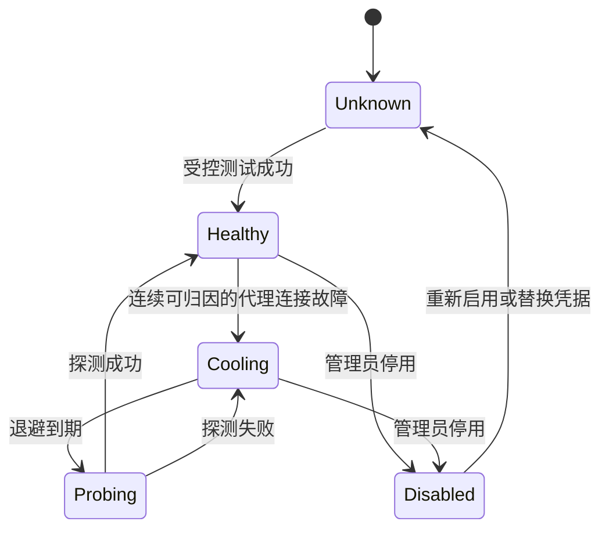

# 07 浏览器与 VPN 代理池

管理台提供「VPN 代理」列表。每一行表示一个可用出站代理，类型为 **SOCKS5** 或 **HTTPS 代理**。HTTPS 代理表示浏览器执行器与代理之间使用 TLS，可通过代理建立到 HTTPS 目标的 CONNECT 连接。SOCKS5 支持无凭据或用户名/密码认证，域名交给受控的代理出口解析。客户端只提交业务命令。项目可以绑定代理池，也可以使用被选中 Firefox Pod 的默认网络。

<a id="registry"></a>

## 代理列表、池与项目绑定



| 对象 | 字段与规则 |
| --- | --- |
| 代理 | `id,name,scheme,host,port,auth_mode,has_secret,max_concurrency,enabled,version`。`scheme=socks5/https`，端口 1–65535，`auth_mode=none/password`，用户名与口令作为秘密一次提交 |
| 代理池 | `id,name,members:[{proxy_id,weight}],version`，同一池不得重复。成员权重为正整数。同一代理被多个池引用仍共用其并发上限 |
| 项目 | `browser_proxy_pool_id` 与搜索/正文接入点独立配置。值为 `null` 时使用 Firefox Pod 默认网络；绑定池时按池选择出口。主动解除绑定后，新任务使用默认网络 |
| 运行状态 | 配置启停与健康状态分别存储和显示。列表分别展示代理健康、活跃租约、手工测试回执，以及周期检测的 Google 连通状态和检测时间。归档需先移除池引用 |
| 凭据与测试 | 凭据加密保存，`keep/replace/clear` 控制变更，不在列表、URL、错误和导出中回显。测试目标由管理员全局配置，测试 API 只接收代理 ID |

测试从执行器所在网络建立代理连接、完成可选认证、通过代理访问固定 HTTPS 测试页并核验预期响应。分别记录连接、代理协议和目标响应耗时。HTTPS 代理必须验证证书和主机名。若运行环境无法支持某一认证组合，在配置测试中给出可操作的原因。代理测试始终使用被测代理及其配置的认证方式。保存配置和测试是独立动作，测试结果只属于被测试版本。

<a id="google-probe"></a>

## 每 30 分钟检测 Google 连通性

后台使用 curl（或 Rust 调用 libcurl）对 `https://google.com/` 执行 GET。每个出口立即安排首次检测，之后每 **30 分钟（1800 秒）**检测一次。调度器维护两类样本。

| 出口 | 谁执行检测 | 谁使用同一份结果 |
| --- | --- | --- |
| 启用的 VPN 代理 | 从执行器的出站环境显式经过该代理，每个代理独立检测 | 引用同一代理 ID 和配置版本的所有项目 |
| 本次安装的 Pod 默认网络 | 由一个就绪的 Firefox Pod 代表全部副本，直接通过默认网络检测 | 未绑定 VPN 的所有项目及所有 Firefox Pod |

例如，2 条启用的 VPN 和 3 个就绪 Pod 在一轮中共发出 3 次检测。扩到 6 个 Pod，仍是 3 次。负责默认网络检测的 Pod 退出时，由另一个就绪 Pod 接任。共享样本按本次安装的默认网络配置标识，扩缩容和探测 Pod 轮换均保留该配置已完成的结果。没有就绪 Pod 时默认网络检测暂停。恢复就绪后，若无样本或本轮应检时间已到，由一位代表立即检测。

VPN 模式按代理协议校验证书或使用远端 DNS。探测使用独立超时并丢弃页面正文，记录出口身份、检测版本、完成时间和结果。业务请求的耗时与上游调用数只计该请求实际执行的工作。[curl 代理类型](https://curl.se/libcurl/c/CURLOPT_PROXYTYPE.html) · [TLS 证书验证](https://curl.se/docs/sslcerts.html)

通过目标 TLS 校验并收到 `google.com` 的 HTTP 响应头就表示网络可达，包括该域名返回的重定向或 HTTP 错误响应。DNS、连接、代理认证或 TLS 失败，或在探测截止前未收到目标响应，记为不可达。单独的代理 CONNECT 应答仅代表代理握手阶段。搜索页明确拒访时仍按目标拒访处理。

新增、重新启用或修改代理连接配置后，当前版本先标为「待首次检测」。首次结果返回前，该出口暂不接收内置浏览器搜索。首个结果为可达即可选 Google，为不可达即可选百度，出口仍须满足正常健康及容量条件。周期检测期间继续使用当前版本最近一次已完成的结果。定时任务错峰运行，同一出口最多一个探测在途；停用、配置替换及探测者交接时校验版本和任务归属，忽略失效的迟到回执。Google 检测的结果只决定搜索出口资格和引擎。正文读取、代理健康及接入点风控隔离各自沿用对应规则。



以下为 Linux 执行器使用无凭据示例代理时等价的检查。生产检测从代理配置取得认证信息。示例设置 5 秒总超时，仅采集目标 HTTP 状态。

```sh
curl --disable --silent --show-error --max-time 5 --noproxy "" \
  --proxy socks5h://proxy.example.org:1080 --output /dev/null \
  --write-out '%{response_code}\n' https://google.com/
```

<a id="dispatch"></a>

## 选择出口并分配浏览器

| 项目出口 | 搜索所用样本 | 已测可达 | 已测不可达 | 尚无首份结果 |
| --- | --- | --- | --- | --- |
| 绑定 VPN 代理池 | 池内各代理当前版本的独立样本 | Google | 百度 | 跳过该代理，继续选择池内已有结果的合格出口 |
| 未绑定代理池 | 全部 Pod 共用的一份默认网络样本 | Google | 百度 | 默认网络上的内置搜索暂不可派发 |

项目先在搜索池或正文池内选接入点。两种内置能力均由就绪的 Firefox Pod 自动提供，参与同级轮询和池间降级，豁免 30 分钟的接入点风控隔离。项目引用稳定的能力 ID。调度器在就绪的 Firefox 实例上预留槽位，按项目是否绑定池决定本次任务的出口。下文的权重与健康状态只描述代理成员。[项目接入点选路](04-routing-and-providers.md#routing) · [实例自动注册](01-system.md#browser-discovery)



绑定代理池时先筛项目授权、代理健康和协议能力。对于搜索，再筛掉待首次检测的出口，以及其已选引擎无法满足本次硬条件的出口。对剩余成员最小化 `(已授予租约数 + 1) / (max_concurrency × weight)`，平分按轮询游标。调度所有者一次预留代理与浏览器容量。跳过待测出口时不占名额、不增加上游调用数。若浏览器成员无合格出口，先尝试同项目池的其他接入点，全池用尽才继续向后。正文只按自身的健康、容量与访问条件派发。代理自身健康未知时可按既有规则安排受控健康探测。绑定代理的作业租约保存 `job_id,project_id,proxy_id,proxy_version,slot_id,owner_token,deadline`。

综合请求第一次需要浏览器时建立一个任务会话，后续由浏览器完成的查询变体、导航、正文及子资源沿用同一 Pod、会话和出口模式。代理模式还固定同一代理。页面标签可以有界并行，Cookie 和页面状态随该任务的上下文一起销毁。列表和单页正文分别是独立业务任务。项目未绑定池是有效配置。已绑定池但全无可用代理时，该浏览器能力本次不可用，按项目池规则尝试其他接入点。若因此无法完成，返回 `PROXY_UNAVAILABLE`。共享默认网络待首测且搜索用尽项目池时，返回 `SERVICE_UNAVAILABLE`。有合格出口但并发名额已满时按排队预算处理。已绑定代理池的任务只在该池内取出口。

下图给出已绑定代理时的执行时序。默认网络模式省去代理连接和代理租约，仍使用任务专属上下文。



执行器负责浏览器原生代理配置及认证兼容。若浏览器不能直接使用带认证的 SOCKS5，可在执行器中实现本任务独占、仅本机可见的转发适配器，固定连接已授权的上游代理。权限、凭据及生命周期均随任务结束。代理模式的浏览器连接仅经选定代理出站。默认网络模式经该 Pod 所在网络出站。两种模式均执行公开目标地址和跳转校验，控制通道与网页流量独立。搜索页或目标站点要求验证、明确拒访时终止并返回分类结果。

## 浏览器怎样产出列表和正文



Firefox 中只有 Google 和百度两种列表搜索适配器。派发时冻结出口、当前有效的连通结果、完成时间和引擎，综合请求的多个查询变体共用。后续检测结果供新任务使用。每次搜索回执绑定请求 ID、当前查询和实际执行的 Pod。默认网络任务另记录采样的代表 Pod，便于查看两个 Pod 分别承担的工作。选择引擎后遇到目标明确拒访，终止对该目标的访问。合法空列表需要本次查询的页面给出明确空结果。`browser_reader` 直接访问用例已校验的网页 URL，跳转和子资源保持本次出口。综合流程中同时选用这两种能力时，搜索与取正文共用本次浏览器会话。原生 HTTP 适配器直接请求对应服务。[第三方协议](04-routing-and-providers.md#native-providers)

## 故障归因、回收与隔离



- 还未向站点提交请求时，代理连接/认证故障可释放原租约，并在剩余预算内按策略至多重选一次。第一次目标访问之后不换出口。目标 HTTP 403、挑战、合法空结果、解析失败和模型错误都不会被当作代理自身故障。
- 停用代理后不再授予新任务。常规停用允许当前任务在原截止内收尾，紧急撤销凭据可取消关联任务。替换凭据、迟到的测试回执和健康写入带版本比较。
- 客户端断开、页面超时或任务取消时，关闭页面上下文和专属连接，确认清理后按 owner 释放。执行器失联时将槽位隔离，终止失联上下文或重建执行器后才重新分配。服务重启不恢复旧 Cookie、活动页面或租约。
- 网页地址只允许公开 HTTP(S)。服务检查输入与每次重定向。默认网络模式在 Firefox 实际出站路径执行目的地址限制；经代理远端解析时，还须由受信代理出口执行最终地址限制。用于浏览器任务的代理需满足该出站策略。代理服务器自身地址使用独立的运维允许范围。

本地 E2E 使用可区分的 Pod 默认网络和代理出口。分别模拟两种出口的 Google 可达、不可达，覆盖四种组合；另测已绑定代理失效、只有正文调用，以及 Pod 扩缩容。对列表、网页正文、综合总结分别核验实际出口、同一任务一致性、凭据不出现在载荷中，以及断连后槽位和代理名额全部归还。
