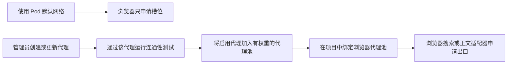
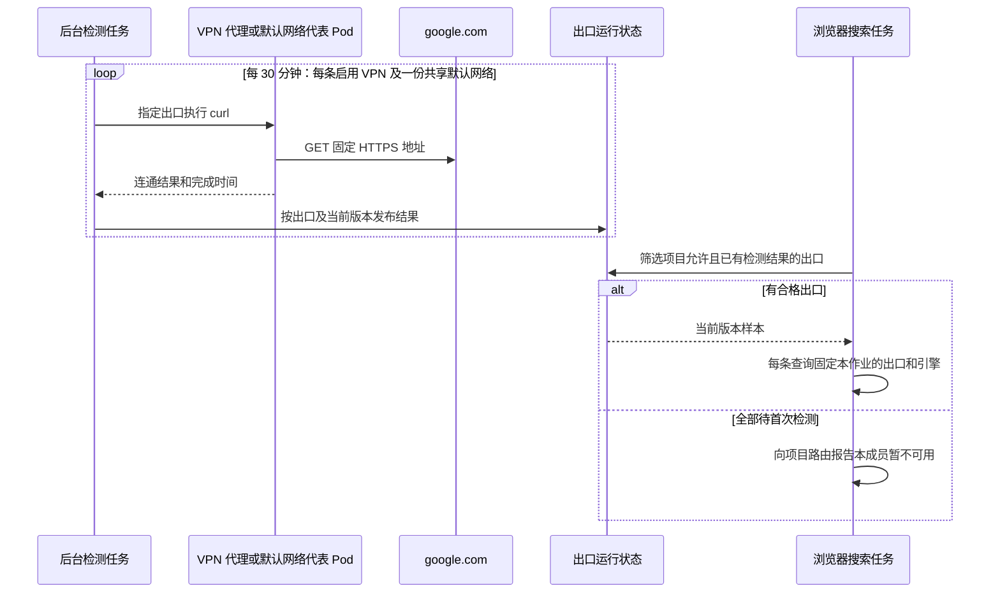
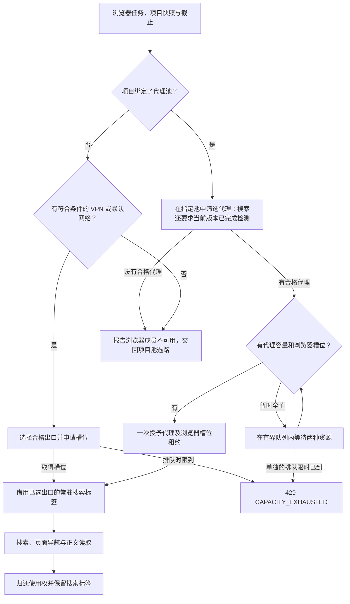
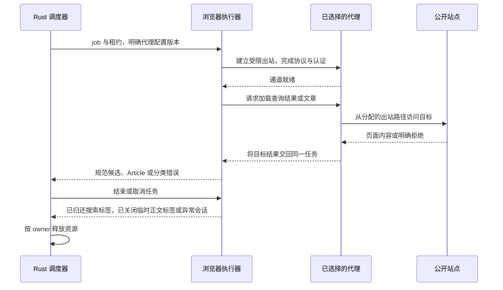
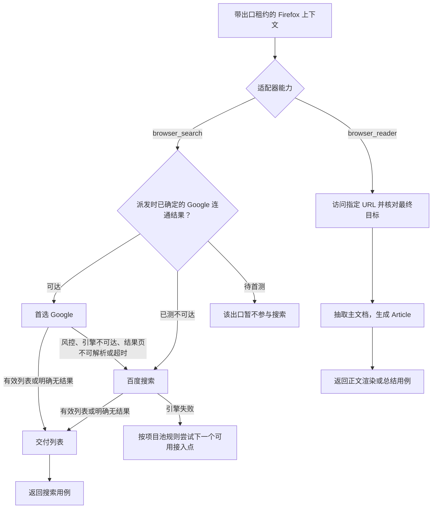
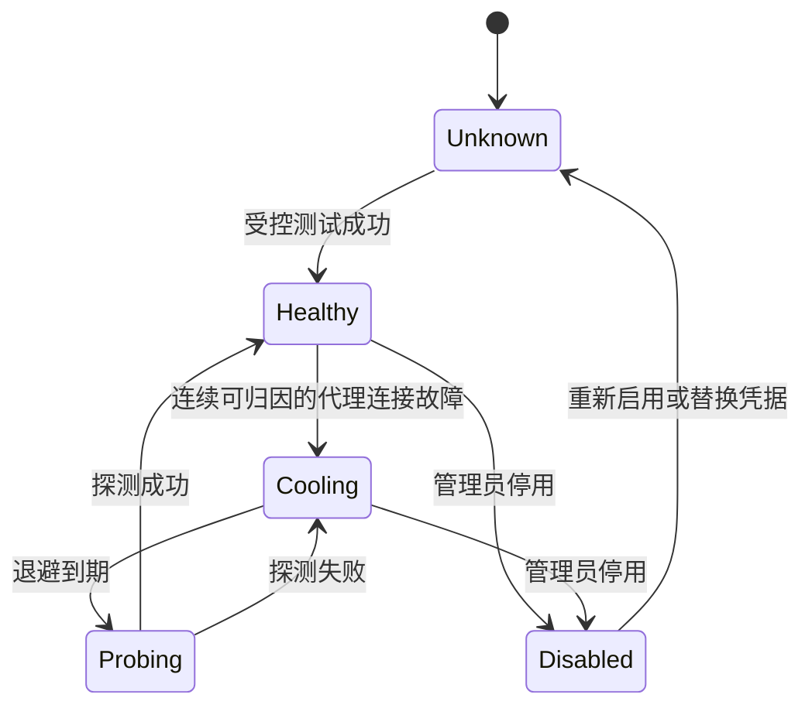

# 07 浏览器与 VPN 代理池

管理台提供「VPN 代理」列表。每一行表示一个可用出站代理，类型为 **SOCKS5** 或 **HTTPS 代理**。HTTPS 代理表示浏览器执行器与代理之间使用 TLS，可通过代理建立到 HTTPS 目标的 CONNECT 连接。SOCKS5 支持无凭据或用户名/密码认证，域名交给受控的代理出口解析。客户端只提交业务命令。项目可以绑定代理池，也可以在启用的 VPN 与 Pod 默认网络间自动选择。

<a id="registry"></a>

## 代理列表、池与项目绑定



| 对象 | 字段与规则 |
| --- | --- |
| 代理 | `id,name,scheme,host,port,auth_mode,has_secret,max_concurrency,enabled,version`。`scheme=socks5/https`，端口 1–65535，`auth_mode=none/password`，用户名与口令作为秘密一次提交 |
| 代理池 | `id,name,members:[{proxy_id,weight}],version`，同一池不得重复。成员权重为正整数。同一代理被多个池引用仍共用其并发上限 |
| 项目 | `browser_proxy_pool_id` 与搜索/正文接入点独立配置。值为 `null` 时自动选择可用 VPN 或 Pod 默认网络；绑定池时按池选择出口。主动解除指定后，新任务恢复自动选择 |
| 运行状态 | 配置启停与健康状态分别存储和显示。列表分别展示代理健康、活跃租约、手工测试回执，以及周期检测的 Google 连通状态和检测时间。归档需先移除池引用 |
| 凭据与测试 | 凭据加密保存，`keep/replace/clear` 控制变更，不在列表、URL、错误和导出中回显。测试目标由管理员全局配置，测试 API 只接收代理 ID |

测试从执行器所在网络建立代理连接、完成可选认证、通过代理访问固定 HTTPS 测试页并核验预期响应。分别记录连接、代理协议和目标响应耗时。HTTPS 代理必须验证证书和主机名。若运行环境无法支持某一认证组合，在配置测试中给出可操作的原因。代理测试始终使用被测代理及其配置的认证方式。保存配置和测试是独立动作，测试结果只属于被测试版本。

<a id="google-probe"></a>

## 每 30 分钟检测 Google 连通性

后台使用 curl（或 Rust 调用 libcurl）对 `https://google.com/` 执行 GET。每个出口立即安排首次检测，之后每 **30 分钟（1800 秒）**检测一次。调度器维护两类样本。

| 出口 | 谁执行检测 | 谁使用同一份结果 |
| --- | --- | --- |
| 启用的 VPN 代理 | 从执行器的出站环境显式经过该代理，每个代理独立检测 | 引用同一代理 ID 和配置版本的所有项目 |
| 本次安装的 Pod 默认网络 | 由一个就绪的 Firefox Pod 代表全部副本，直接通过默认网络检测 | 未绑定 VPN 的所有项目及所有 Firefox Pod |

例如，2 条启用的 VPN 和 3 个就绪 Pod 在一轮中共发出 3 次检测。扩到 6 个 Pod，仍是 3 次。负责默认网络检测的 Pod 退出时，由另一个就绪 Pod 接任。共享样本按本次安装的默认网络配置标识，扩缩容和探测 Pod 轮换均保留该配置已完成的结果。没有就绪 Pod 时默认网络检测暂停。恢复就绪后，若无样本或本轮应检时间已到，由一位代表立即检测。

VPN 模式按代理协议校验证书或使用远端 DNS。探测使用独立超时并丢弃页面正文，记录出口身份、检测版本、完成时间和结果。业务请求的耗时与上游调用数只计该请求实际执行的工作。[curl 代理类型](https://curl.se/libcurl/c/CURLOPT_PROXYTYPE.html) · [TLS 证书验证](https://curl.se/docs/sslcerts.html)

通过目标 TLS 校验并收到 `google.com` 的 HTTP 响应头就表示网络可达，包括该域名返回的重定向或 HTTP 错误响应。DNS、连接、代理认证或 TLS 失败，或在探测截止前未收到目标响应，记为不可达。单独的代理 CONNECT 应答仅代表代理握手阶段。搜索页明确拒访时仍按目标拒访处理。

新增、重新启用或修改代理连接配置后，当前版本先标为「待首次检测」。首次结果返回前，该出口暂不接收内置浏览器搜索。首个结果为可达即可选 Google，为不可达即可选百度，出口仍须满足正常健康及容量条件。周期检测期间继续使用当前版本最近一次已完成的结果。定时任务错峰运行，同一出口最多一个探测在途；停用、配置替换及探测者交接时校验版本和任务归属，忽略失效的迟到回执。Google 检测的结果只决定搜索出口资格和引擎。正文读取、代理健康及接入点风控隔离各自沿用对应规则。



以下为 Linux 执行器使用无凭据示例代理时等价的检查。生产检测从代理配置取得认证信息。示例设置 5 秒总超时，仅采集目标 HTTP 状态。

```sh
curl --disable --silent --show-error --max-time 5 --noproxy "" \
  --proxy socks5h://proxy.example.org:1080 --output /dev/null \
  --write-out '%{response_code}\n' https://google.com/
```

<a id="dispatch"></a>

## 选择出口并分配浏览器

| 项目出口 | 搜索所用样本 | 已测可达 | 已测不可达 | 尚无首份结果 |
| --- | --- | --- | --- | --- |
| 绑定 VPN 代理池 | 池内各代理当前版本的独立样本 | Google | 百度 | 跳过该代理，继续选择池内已有结果的合格出口 |
| 自动选择出口 | 各 VPN 的独立样本或全体 Pod 共用的默认网络样本 | Google | 百度 | 默认网络上的内置搜索暂不可派发 |

项目先在搜索池或正文池内选接入点。两种内置能力均由就绪的 Firefox Pod 自动提供，参与同级轮询和池间降级，豁免 30 分钟的接入点风控隔离。项目引用稳定的能力 ID。调度器在就绪的 Firefox 实例上预留槽位，按项目是否绑定池决定本次任务的出口。下文的权重与健康状态只描述代理成员。[项目接入点选路](04-routing-and-providers.md#routing) · [实例自动注册](01-system.md#browser-discovery)



绑定代理池时先筛项目授权、代理健康和协议能力。对于搜索，再筛掉待首次检测的出口，以及其已选引擎无法满足本次硬条件的出口。对剩余成员最小化 `(已授予租约数 + 1) / (max_concurrency × weight)`，平分按轮询游标。调度所有者一次预留代理与浏览器容量。跳过待测出口时不占名额、不增加上游调用数。若浏览器成员无合格出口，先尝试同项目池的其他接入点，全池用尽才继续向后。正文只按自身的健康、容量与访问条件派发。代理自身健康未知时可按既有规则安排受控健康探测。绑定代理的作业租约保存 `job_id,project_id,proxy_id,proxy_version,slot_id,owner_token,deadline`。

默认部署 1 个浏览器 Pod，每个 Pod 维护 6 个常驻搜索标签，依据出口探测结果预热 Google 或百度首页。控制面把出口版本与引擎选择下发到各 Pod。首次探测前 Pod 即可接收探测任务。每个标签使用独立代理配置的 Firefox 会话，健康标签在作业归还后继续保留。每 600 秒重新加载首页，忙碌标签在归还后补刷。刷新只打开首页。出口配置变更时，空闲标签调整到新出口，执行中的任务保留其快照。

一个业务请求可同时借用多个独立标签作业，受查询／取文各四路上限、端点并发、Pod 槽位和代理并发共同约束。不同查询或网页不共享作业操作锁。Google 失败后的百度尝试仍属于同一逻辑查询，复用原作业和出口；请求快照固定探测样本，运行期引擎冷却仍按出口共享。每次逻辑调用完成立即关闭作业并归还健康标签。清理阶段只关联该作业的调用，取消和超时后的未确认作业继续占用租约，直至回收确认。

Firefox 由执行器直接启动，通过会话私有的浏览器扩展和 Native Messaging 控制。执行器同时提供 Rust Native Host，以带随机认证令牌的 Unix socket 连接对应扩展；消息使用有长度上限的二进制帧与请求 ID 关联，通道断开会终止待完成命令。宿主清单仅授权本扩展，socket、清单与配置位于该会话的私有目录。页面脚本没有通用执行或 Native Messaging 入口。执行器运行于 Linux 容器；`OAS_NATIVE_DEBUG=1` 可在受控验证时输出 Firefox 和扩展诊断，默认关闭。每次页面回执检查扩展环境与页面原始环境的 `navigator.webdriver` 均为 `false`，不改写该属性；异常时拒绝使用该会话。

会话被丢弃时，执行器终止该会话的进程组，并等待自己直接启动的 Firefox 退出。容器通过 Tini 启动执行器，由 Tini 转发停止信号并回收 Firefox 留下的孤儿进程。[Tini 的进程回收机制](https://github.com/krallin/tini#subreaping)

作业使用引擎搜索框与原生提交按钮，先确认填入的问题，再提交一次；检查扩展隔离环境的新文档标识、替换的结果签名、URL 问题与输入框回显，拒绝旧查询的结果。提交后以 75 毫秒间隔采样语义材料，DOM 的 MutationObserver 标记增删、文本及相关属性变化；表单值签名单独覆盖不触发 DOM 事件的 input.value 更新。通常最早 4 秒返回，时间不足时窗口随剩余预算收缩，提交后最多观察 7 秒且不超过接入点或请求原截止。200 毫秒安静期、400 毫秒发现期、600 毫秒占位宽限及 1500 毫秒生成宽限均受剩余预算约束；有可用材料时按这些条件有界返回，不无限等待未知模板或动画。普通卡片与 AI 回答分别处理：天气、换算、表格等卡片去除控件及链接结果后作为材料返回；AI 回答仅在完成标记、有效引用和连续 200 毫秒稳定后采纳。窗口到期仍可交付本次列表和普通卡片，明确空结果正常交付。单页正文在临时隔离标签中读取，完成后关闭正文上下文并切回搜索页。取消或无法确认浏览器状态的会话回收后重新预热。

指定代理池时只使用池内出口。自动模式从有容量并符合请求条件的 VPN 与直连出口中选择，单次任务固定出口。网络连通性检测继续使用 30 分钟周期。



执行器负责浏览器原生代理配置及认证兼容。若浏览器不能直接使用带认证的 SOCKS5，可在执行器中实现本会话独占、仅本机可见的转发适配器，固定连接已授权的上游代理。出口配置随版本和会话更新，使用权在任务结束时释放。代理模式的浏览器连接仅经选定代理出站。默认网络模式经该 Pod 所在网络出站。两种模式均执行公开目标地址和跳转校验，控制通道与网页流量独立。搜索页或目标站点要求验证、明确拒访时终止并返回分类结果。

## 浏览器怎样产出列表和正文



Firefox 中只有 Google 和百度两种列表搜索适配器。派发时冻结出口、Google 连通样本和采样时间。首测可达时从 Google 开始。若本次 Google 搜索被拒绝、超时、目标连通失败或无法取得可解析结果，在原 Firefox 作业和原出口内对同一问题尝试一次百度，并沿用语言、时间范围和数量。Google 首次尝试最多使用当时可用时间的一半，且不超过 7 秒，百度与它共用接入点和请求原有的截止时间。该逻辑查询后续尝试沿用百度；其他查询作业按出口共享的引擎冷却状态选择。首测明确不可达时直接使用百度。明确的空结果正常交付。取消、访问策略拦截、代理自身故障及作业控制错误按各自规则处理。百度也失败时，项目按原有池顺序继续选择接入点。连接测试、调试和业务请求共用此逻辑。后续检测结果供新任务使用。每次搜索回执绑定请求 ID、当前查询和实际执行的 Pod。默认网络任务另记录采样的代表 Pod，便于查看两个 Pod 分别承担的工作。选择引擎后遇到目标明确拒访，终止对该目标的访问。合法空列表需要本次查询的页面给出明确空结果。`browser_reader` 直接访问用例已校验的网页 URL，跳转和子资源保持本次出口。综合流程中每条查询和每篇正文使用独立作业，分别固定其授权出口，健康常驻标签在作业间复用。原生 HTTP 适配器直接请求对应服务。[第三方协议](04-routing-and-providers.md#native-providers)

每个 Firefox 会话使用独立的 profile、Native Messaging 连接与出站转发器，不启动 WebDriver、Marionette 或 BiDi 端口。健康会话保留 Cookie 与缓存，内容进程数受限。正文在独立容器标签中读取，搜索标签保持不变；完成后删除正文标签、容器及资源捕获状态。扩展通过 `webRequest` 核对主文档实际 HTTP 状态，首页准备等待新文档回执，网络事件按标签及导航请求 ID 关联，旧页面的迟到响应与取消事件不影响新页面。正文等待页面与网络回执指向同一最终 URL；401/403、429、目标异常和导航错误分别处理。正文资源通过 `filterResponseData` 旁路复制实际响应字节，同时原样交付页面；按资源数、单条和总字节数限制采集，超出只标归档缺失。导航计时包含状态确认，正文与归档各记录阶段。

## 故障归因、回收与隔离



- 还未向站点提交请求时，代理连接/认证故障可释放原租约，并在剩余预算内按策略至多重选一次。第一次目标访问之后不换出口。目标 HTTP 403、挑战、合法空结果、解析失败和模型错误都不会被当作代理自身故障。
- 停用代理后不再授予新任务。常规停用允许当前任务在原截止内收尾，紧急撤销凭据可取消关联任务。替换凭据、迟到的测试回执和健康写入带版本比较。
- 客户端断开、页面超时或任务取消时，关闭页面上下文和专属连接，确认清理后按 owner 释放。执行器失联时将槽位隔离，终止失联上下文或重建执行器后才重新分配。服务重启不恢复旧 Cookie、活动页面或租约。
- 网页地址只允许公开 HTTP(S)。服务检查输入与每次重定向。默认网络模式在 Firefox 实际出站路径执行目的地址限制；经代理远端解析时，还须由受信代理出口执行最终地址限制。用于浏览器任务的代理需满足该出站策略。代理服务器自身地址使用独立的运维允许范围。

代理健康按配置版本和运行状态修订号保存。默认连续 3 次可归因的代理连接或认证失败进入 30 秒冷却，少于阈值时显示连接异常但仍可调度；恢复检测失败后按 60、120 秒继续倍增，最长 1800 秒。成功的实际目标通道或受控健康检测清除失败计数。`OAS_PROXY_FAILURE_THRESHOLD`、`OAS_PROXY_COOLDOWN_SECONDS` 可调整初始阈值及冷却，接入点风控隔离始终单独固定为 30 分钟。停用、改版本、检测任务替换后的迟到回执不能恢复旧出口。

执行器用统一任务登记保存 owner、串行门控、取消令牌和截止。截止扫描先取消过期任务，再有界并行关闭上下文，不等待页面操作持有的任务锁才发取消。打开命令使用请求的剩余总预算，单次登记最多 60 秒；重复操作不延长该截止。关闭和取消对尚未创建的任务同样生效，保留 60 秒的关闭标记，覆盖最大控制 RPC 的迟到窗口，拒绝迟到的打开命令。任务 ID 不复用，旧 owner 的命令不能关闭另一 owner 的任务。登记上限为 4096，达到上限时拒绝新增登记，仍允许关闭已登记任务；标记到期且没有在途命令引用后才回收。

Google 检测、代理恢复检测、实例发现、历史清理和隔离槽位回收分别运行，探测总并发上限为 4，同一出口不重入。常规 Google 检测按出口稳定错峰，每 1800 秒一个周期，调度重启不会累积漂移；默认网络配置版本由 `OAS_DEFAULT_NETWORK_VERSION` 标识，更换网络配置时递增且不回退。首次常规周期只加一次最多 30 秒的出口错峰，后续按 1800 秒推进；下一次排期与采样结果一起保存，接管时继续该排期。Firefox 后台联网不作为当前目标的代理故障证据，明确的目标 HTTP 拒绝保持目标级归因。

本地 E2E 使用可区分的 Pod 默认网络和代理出口。分别模拟两种出口的 Google 可达、不可达，覆盖四种组合；另测已绑定代理失效、只有正文调用，以及 Pod 扩缩容。对列表、网页正文、综合总结分别核验实际出口、同一任务一致性、凭据不出现在载荷中，以及断连后槽位和代理名额全部归还。

## 手工测试的判定与诊断契约

周期 Google 采样保持「取得目标响应头即网络可达」的语义。手工测试另外核验固定测试页：执行器 `OAS_PROXY_TEST_URL` 默认 `https://example.com/`，`OAS_PROXY_TEST_EXPECTED_STATUS` 默认 `200`；可用 `OAS_PROXY_TEST_EXPECTED_BODY` 配置应包含的固定正文标记。部署方通过 `browser.extraEnv` 注入相同配置到所有执行器，更新执行器后生效。测试 API 不接受调用方 URL 或正文条件。最多读取 1 MiB，5 秒截止，保持 HTTPS 代理证书及主机名验证；代理口令通过 curl 标准输入配置传递。

| 字段 | 含义 |
| --- | --- |
| `reachable` | 已通过必要 TLS 验证并收到目标 HTTP 响应，不要求目标状态为成功 |
| `passed` | 通道可达、传输完整、状态等于预期且可选正文标记匹配 |
| `proxy_healthy` | 仅根据代理通道证据判定 true/false，归因不足时为 null |
| `http_status`、`expected_status`、`body_matches` | 实际与预期判定；未配置正文条件时 body_matches 为 null |
| `failure_kind` | 分开报告代理认证、代理证书、代理连接、目标连接、目标状态、正文不符、超时等原因 |
| `phases` | connect、handshake、response 的偏移、持续时间、终态及测量来源 |

连接阶段到 TCP 建立，协议阶段从连接完成到 curl 可以发送目标请求，包含代理握手及相关 TLS；目标响应阶段持续至传输结束，`first_byte_ms` 另外标识首字节位置。三段互不重叠，共用 curl 时间基准，其和等于 `total_ms`。进程启动与 API RPC 开销另计在测试回执 `elapsed_ms`，不能相加成网络耗时。

目标 404/500 或正文标记不符使手工回执为 error，但通道已建立时 `proxy_healthy: true`，不会因目标内容错误冷却代理。代理认证或证书等明确故障为 false；无法归因的超时保持未知并安排后续健康检查。界面单独展示测试结论、通道健康、实际/预期状态及阶段。回执和测试 Span 共用 [ProxyTest 契约](contracts/proxy-test.schema.yaml)。不保存原始 curl 标准错误、测试页正文或正文匹配标记，避免泄露凭据及运维测试内容。

## Google 搜索故障后的出口选择

网络可达探测与实际搜索状态分别保存。Google 在一个出口上的实际查询出现风控、超时、引擎或结果解析故障时，当前作业尝试百度，并按出口 ID 和配置版本记录十分钟冷却。冷却状态存于 PostgreSQL，所有 Pod 和后续请求共享。冷却期间直接选百度，在请求记录中标明原因与重试时间。到期后新请求恢复按连通样本尝试 Google，更换出口版本不沿用旧故障。预热使用同一份选择。合法空列表、缺少 AI 卡、取消、访问策略和代理故障各按自身语义处理。

## 搜索结果归属校验

搜索会话长期复用，因此提交后必须核验：结果属于扩展生成的新文档，或同一文档中查询和结果列表均已更新；结果页 URL 的问题及当前可见输入框的问题都与本次请求一致。否则不能把上一次搜索的列表交给当前请求。比较只容忍 NFC、空白和全角 ASCII 的显示归一化，不容忍问题内容改变。

提交与读取共用同一个可见输入框选择器，排除隐藏、不可见、禁用及 inert 控件。百度的隐藏 `#chat-textarea` 不得覆盖实际输入的 `#kw`；同时支持 `wd` 与 `word` 查询参数。扩展确认表单后只提交一次，提交前检查控件未被页面替换。回归覆盖隐藏和可见控件并存、同页刷新、重复查询、旧结果拒绝及 Unicode 归一化。这些校验不执行网络连通探测，也不决定 Google 与百度的初始选择。

## 搜索卡片的监听、完成与引用

Google 在主结果区域监听内容及可见性变化，排除普通链接块、相关搜索导航和已知 AI 概览后，对剩余材料做有界语义序列化，保留表格、数学、可读代码、图片描述及带标签的实时输入值。AI 完成证据必须属于当前回答容器：根完成标记、可见的完成页脚，或位于正文之外当前回答控制区的可用复制按钮；正文内部的复制按钮、后代片段标记及普通文本免责声明均不能代替完整回答完成。

百度独立监听左右结果区，区分自然链接、普通组件和生成式回答，过滤广告及查询建议。引用收集仅针对已完成的当前回答，以文档和回答签名关联；逐个点击当前可见引用触发器，最多十次，单个浮层最多观察 300 毫秒。只接纳相对触发前发生变化的引用浮层。回答正文或容器替换时重置引用缓存，旧浮层不能成为新回答的来源。

普通卡片通过 `cards` 返回，最多十项、合计 8192 个 Unicode 字符，绑定实际搜索页 URL；AI 回答继续使用 `engine_answer` 并保留普通链接列表。综合总结把同一搜索页的卡片合并成带行内材料的候选，针对原问题评分；被选中后直接使用该材料，引用指向实际搜索页。卡片内容提示核对地点、日期和统计范围，仍受原有上下文、字符和引用约束。搜索载荷保留 `search_readiness`，记录返回原因、提交后耗时、卡片数量、AI 状态及引用数量，供请求详情展示。
