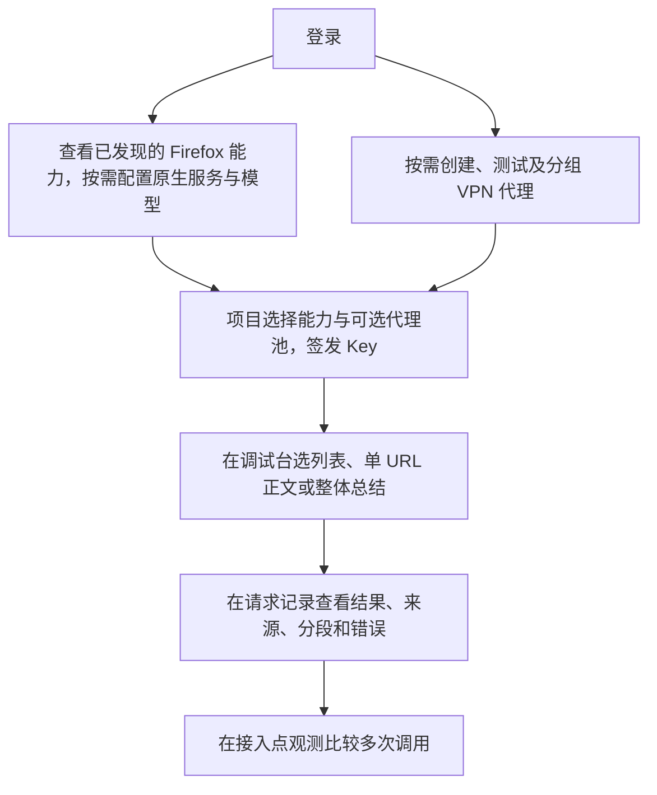
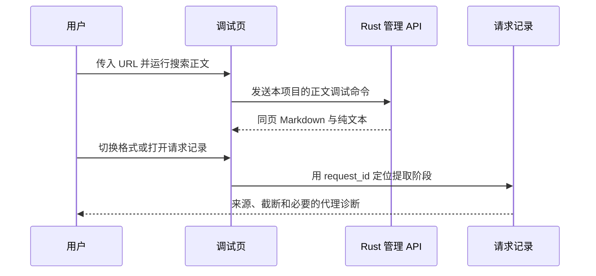
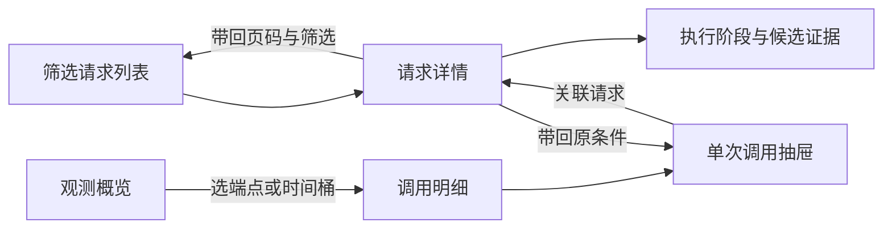

# 08 HeroUI 管理台

管理台使用 **React 19、TypeScript、Vite、HeroUI v3、Tailwind CSS v4**。React Router 维护页面路由，TanStack Query 管理服务端状态，i18next 提供中英文文案。HeroUI 的组件和样式包分别为 `@heroui/react` 和 `@heroui/styles`。全局 CSS 先导入 Tailwind，再导入 HeroUI 样式。页面使用组合式组件和统一的语义变量。[HeroUI 快速开始](https://heroui.com/en/docs/react/getting-started/quick-start) · [HeroUI 主题规范](https://heroui.com/en/docs/react/getting-started/theming)

## Atlas 工作台

管理台采用 Atlas 的固定侧栏、全局项目选择和独立请求详情。运行总览的异常数、操作分布和趋势时段都可带条件进入请求列表。从运行观测打开请求时，返回会恢复原端点、时段和调用抽屉。[打开 Atlas](demo.html) · [按页面实现与验收](11-atlas-frontend-reference.md)

## 页面与主操作

| 路由 | 核心操作 | 页面状态和关键显示 |
| --- | --- | --- |
| `/login` | 登录、切换语言与主题 | 过期回到登录，成功后只返回合法站内页面 |
| `/projects` | 创建/编辑、配置端点与代理池、设置默认语言和预算、轮换 Key | 版本冲突可重读，Key 在成功对话框一次显示。缺能力时指出对应配置项 |
| `/endpoints` | 按搜索、正文和模型分类查看能力。系统提供的 Firefox 能力可查看、测试并在项目中选择；外部服务可创建、编辑和测试 | 内置能力显示就绪情况，扩容由运维调整 Pod 副本。外部端点表单按所选原生服务商显示基址、凭据和选项 |
| `/language-routes` | 按语言选择优先搜索端点 | 按语言添加优先搜索接入点，显示已保存版本、未保存修改及失败提示 |
| `/proxies` | 「VPN 代理」列表与池管理 | 协议、显示名、地址、端口、认证状态、启停、活跃/容量、最近手工测试，以及 Google 周期检测结果和时间。支持创建、编辑、测试、停用、分组及维护权重。口令只可替换 |
| `/playground` | 选择项目与三个操作之一，核对本次参数、运行、取消 | 列表视图给标题/简介。正文视图给 Markdown 预览、Markdown 源文、纯文本与长度。总结视图给整体回答、来源分数、分段摘要和可定位的引用 |
| `/requests`、`/requests/:id` | 按项目、操作、状态、时间窗筛选，查看依据或下载脱敏记录 | 列表按游标翻页。详情按需加载阶段、候选、单步诊断、原文范围。能区分空、部分、缺失和取消 |
| `/observability` | 切换概览与调用明细，比较成功率、排队和模型耗时 | 采用服务端全窗口聚合，支持项目、端点、来源、时区与粒度。样本不足显示未知 |
| `/api` | 浏览三项公开操作及管理约定 | 字段与响应状态取自 OpenAPI。示例可复制，也可直接载入调试表单 |

项目、接入点、代理和代理池共用只读详情弹框。资源名称、能力、单位、池顺序和引用位置直接可见。编辑与保存通过独立表单完成。调试和诊断页使用同一套参数标签，正式 API 的字段由契约维护。[逐页交互验收](11-atlas-frontend-reference.md#screens)

项目列表为空时，工作台和调试页提供「创建项目」入口。已存在的项目可直接选内置搜索和正文，按需配置代理池与生成模型。调试页按当前操作提示所缺的依赖。未绑定代理池显示「Pod 默认网络」；已绑定但无可用代理、没有就绪 Firefox 实例分别提示具体原因。

## 组件与视觉规则

| 场景 | HeroUI 组件与组合规则 |
| --- | --- |
| 资源列表和状态 | 用 `Table` 的表头、列、行、单元格表达数据，`Chip` 配合文字显示协议、健康和状态。封装一次游标导航、加载、空态和错误态，列表页面共用。[Table](https://heroui.com/en/docs/react/components/table) |
| 配置编辑 | `Form, TextField, Label, Input, NumberField, Select, Switch` 组合字段，统一验证、帮助文字、密钥编辑和中英文错误。主操作用 `Button` 的 `onPress`。[TextField](https://heroui.com/en/docs/react/components/text-field) |
| 确认与详情 | `Modal` 或 `AlertDialog` 确认代理启停、放弃草稿和 Key 轮换，`Drawer` 适合窄屏配置和调用详情。关闭时恢复触发点焦点。[Modal](https://heroui.com/en/docs/react/components/modal) |
| 调试与证据 | `Tabs` 切换三个操作及正文的三种展示，`Card` 组织结果，`Accordion` 渐进展开每个来源和段摘要。键盘可切换并识别选中项。[Tabs](https://heroui.com/en/docs/react/components/tabs) |

颜色使用 `background/foreground/surface/accent/danger` 等语义 token。字体、间距、圆角、边框密度和图表配色在主题层统一。根元素设置 `lang` 和匹配的 `data-theme`/主题 class。首次跟随系统，用户显式选择的主题和界面语言允许本地保存。英文长字段、中文换行、焦点环和窄屏操作菜单均应可读。Markdown 渲染禁止执行嵌入脚本，URL 链接只允许安全协议，纯文本以文本节点显示。

## 请求状态、取消与追溯

会话、查询草稿和服务端数据分开管理。API 客户端统一处理凭据、CSRF、消息语言、取消和错误外壳。切项目、换操作、登出均取消当前任务并递增请求代次，旧响应不能覆盖新结果。前端预校验与后端错误采用同一字段路径。配置写遇 409 时保留草稿并提示读取新版本，禁止自动覆盖。代理测试只显示脱敏的阶段结果。所有页面覆盖 `zh-CN/en × light/dark` 以及键盘和窄屏路径。
## 请求排查与接入点观测

请求详情按阶段、调用加载当时保存的网页和模型往返。HTML 默认打开「网页原貌」，由已登录的父页读取布局 JSON，在 `sandbox=""` 的 iframe 中展示归档版式。调试台与历史回放共用 Markdown 渲染器，默认排版标题、列表、表格和代码块，支持切换源文。纯文本保留换行。缺失的布局资源显示占位和状态，仍可阅读现有原文。切换记录或退出登录后卸载 iframe。[网页回放规则](06-observability.md#layout-replay)

请求记录页的「全局保留设置」供管理员统一调整所有项目的完整材料、请求明细和统计，默认 7 天。表单说明新天数从下一条新请求开始生效，已有请求按详情中原定的到期时间保留。列表筛选仅决定查看范围。请求列表按开始时间筛选，默认近 24 小时，可按记录类型、项目、业务操作、状态、问题或请求 ID 查找。表头指标统计整个匹配窗口。列表把问题和返回摘要并排显示，详情页提供执行阶段、响应与证据、配置快照、记录信息和实际接入点。阶段详情用带名称和单位的只读字段展示实际输入、检索变体、候选、评分及分段。导出的 Markdown 采用章节、表格和引用。

查询改写与候选检索按变体分卡展示。桌面追踪抽屉占视口约 40%，标题与右上关闭键在滚动正文时保持可见。请求详情在问题与回答下方集中显示执行概览。可从变体与候选数进入去重阶段，从批次进入评分阶段，从端点名称查看该类实际调用。[概览字段与展示状态](11-atlas-frontend-reference.md#trace)

运行观测按接入点调用的完成时间统计。概览与明细共用能力类型、项目、端点、来源、业务语言、时间窗口和时区。调用量、执行耗时和质量趋势均可定位到某个时间桶。搜索相关率只计完整评价样本，正文获取率按有确定结果的取文尝试计算。调用抽屉展示执行与排队耗时、评价结果、调度原因及关联请求。列表专用的关键词、状态和评价筛选只影响明细。

