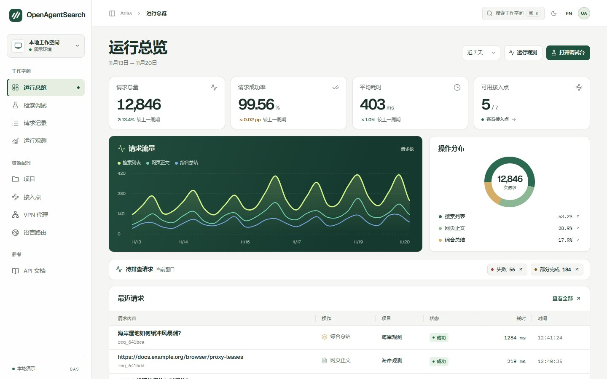
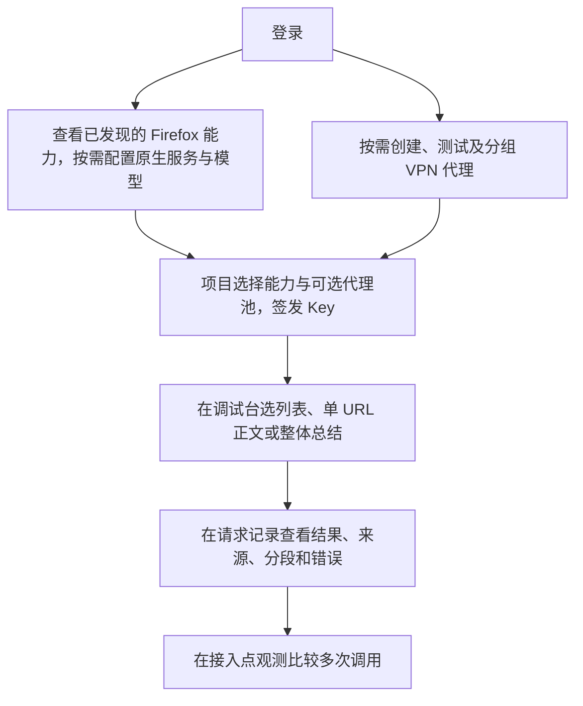
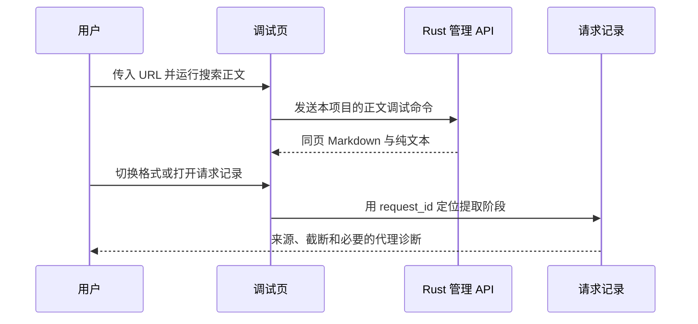
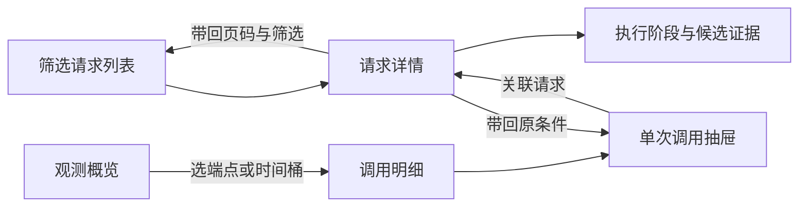

# 08 HeroUI 管理台

管理台使用 **React 19、TypeScript、Vite、HeroUI v3、Tailwind CSS v4**。React Router 维护页面路由，TanStack Query 管理服务端状态，i18next 提供中英文文案。HeroUI 的组件和样式包分别为 `@heroui/react` 和 `@heroui/styles`。全局 CSS 先导入 Tailwind，再导入 HeroUI 样式。页面使用组合式组件和统一的语义变量。[HeroUI 快速开始](https://heroui.com/en/docs/react/getting-started/quick-start) · [HeroUI 主题规范](https://heroui.com/en/docs/react/getting-started/theming)

## Atlas 工作台

管理台采用 Atlas 的分组侧栏、页面内的项目选择和独立请求详情。运行总览的异常数、操作分布和趋势时段都可带条件进入请求列表。从运行观测打开请求时，返回会恢复原端点、时段和调用抽屉。[打开 Atlas](demo.html) · [按页面实现与验收](11-atlas-frontend-reference.md)

## 页面与主操作

| 路由 | 核心操作 | 页面状态和关键显示 |
| --- | --- | --- |
| `/login` | 登录、切换语言与主题 | 过期回到登录，成功后只返回合法站内页面 |
| `/projects` | 创建/编辑、配置端点与代理池、设置搜索和总结预算、轮换 Key | 提供默认勾选的“原问题参与搜索”；关闭后综合总结只搜索改写查询且至少配置一个改写。配置快照保留该开关。版本冲突可重读，Key 在成功对话框一次显示。缺能力时指出对应配置项 |
| `/endpoints` | 按搜索、正文和模型分类查看能力。系统提供的 Firefox 能力可查看、测试并在项目中选择；外部服务可创建、编辑和测试 | 内置浏览器搜索状态旁的感叹号显示默认网络 Google 可达（绿）、不可达（黄）、待首次检测（灰）。悬停或键盘聚焦显示缓存样本时间和选路说明，并说明网络可达仍可能被搜索风控、绑定代理池需使用代理自身样本。该图标不触发检测、不改变接入点可用状态。扩容由运维调整 Pod 副本。外部端点表单按所选原生服务商显示基址、凭据和选项 |
| `/language-routes` | 按语言选择优先搜索端点 | 按语言添加优先搜索接入点，显示已保存版本、未保存修改及失败提示 |
| `/proxies` | 「VPN 代理」列表与池管理 | 协议、显示名、地址、端口、认证状态、启停、活跃/容量、最近手工测试，以及 Google 周期检测结果和时间。支持创建、编辑、测试、停用、分组及维护权重。口令只可替换 |
| `/playground` | 选择项目与三个操作之一，核对本次参数、运行、取消 | 列表视图给标题/简介。正文视图给 Markdown 预览、Markdown 源文、纯文本与长度。总结视图给整体回答、来源分数、分段摘要和可定位的引用 |
| `/requests`、`/requests/:id` | 按项目、操作、状态、时间窗筛选，查看依据或下载脱敏记录 | 列表按游标翻页。详情按需加载阶段、候选、单步诊断、原文范围。能区分空、部分、缺失和取消 |
| `/observability` | 切换概览与调用明细，比较成功率、排队和模型耗时 | 采用服务端全窗口聚合，支持项目、端点、来源、时区与粒度。样本不足显示未知 |
| `/api` | 浏览三项公开操作及管理约定 | 可下载含引用结构的独立 OpenAPI 3.1 JSON。字段与响应状态取自 OpenAPI。示例可复制，也可直接载入调试表单 |

项目卡片高 384px，按内容区宽度排列。内容区达到 736、1112、1488px 时分别排列两、三、四列。每张卡片最多宽 530px，筛选到单个项目时维持原列宽。长成员列表在卡片中单行省略，鼠标悬浮或键盘聚焦时展示完整内容，详情保留全部成员。签发与轮换共用一次性密钥行，右侧复制按钮在成功写入剪贴板后反馈。

项目、接入点、代理和代理池共用只读详情弹框。资源名称、能力、单位、池顺序和引用位置直接可见。编辑与保存通过独立表单完成。调试和诊断页使用同一套参数标签，正式 API 的字段由契约维护。[逐页交互验收](11-atlas-frontend-reference.md#screens)

项目列表为空时，工作台和调试页提供「创建项目」入口。已存在的项目可直接选内置搜索和正文，按需配置代理池与生成模型。调试页按当前操作提示所缺的依赖。语言路由的业务语言列表支持按代码或名称搜索。接入点编辑只维护服务商实际使用的参数。未绑定代理池显示「自动选择 VPN 或 Pod 网络」；已绑定但无可用代理、没有就绪 Firefox 实例分别提示具体原因。

## 组件与视觉规则

| 场景 | HeroUI 组件与组合规则 |
| --- | --- |
| 资源列表和状态 | 用 `Table` 的表头、列、行、单元格表达数据，`Chip` 配合文字显示协议、健康和状态。封装一次游标导航、加载、空态和错误态，列表页面共用。[Table](https://heroui.com/en/docs/react/components/table) |
| 配置编辑 | `Form, TextField, Label, Input, NumberField, Select, Switch` 组合字段，统一验证、帮助文字、密钥编辑和中英文错误。主操作用 `Button` 的 `onPress`。[TextField](https://heroui.com/en/docs/react/components/text-field) |
| 确认与详情 | `Modal` 或 `AlertDialog` 确认代理启停、放弃草稿和 Key 轮换，`Drawer` 适合窄屏配置和调用详情。关闭时恢复触发点焦点。[Modal](https://heroui.com/en/docs/react/components/modal) |
| 调试与证据 | `Tabs` 切换三个操作及正文的三种展示，`Card` 组织结果，`Accordion` 渐进展开每个来源和段摘要。键盘可切换并识别选中项。[Tabs](https://heroui.com/en/docs/react/components/tabs) |

颜色使用 `background/foreground/surface/accent/danger` 等语义 token。字体、间距、圆角、边框密度和图表配色在主题层统一。根元素设置 `lang` 和匹配的 `data-theme`/主题 class。首次跟随系统，用户显式选择的主题和界面语言允许本地保存。英文长字段、中文换行、焦点环和窄屏操作菜单均应可读。Markdown 渲染禁止执行嵌入脚本，URL 链接只允许安全协议，纯文本以文本节点显示。

## 请求状态、取消与追溯

会话、查询草稿和服务端数据分开管理。API 客户端统一处理凭据、CSRF、消息语言、取消和错误外壳。切项目、换操作、登出均取消当前任务并递增请求代次，旧响应不能覆盖新结果。前端预校验与后端错误采用同一字段路径。配置写遇 409 时保留草稿并提示读取新版本，禁止自动覆盖。代理测试只显示脱敏的阶段结果。所有页面覆盖 `zh-CN/en × light/dark` 以及键盘和窄屏路径。
## 请求排查与接入点观测

请求详情按阶段、调用加载当时保存的网页和模型往返。HTML 默认打开「网页原貌」，由已登录的父页读取布局 JSON，在 `sandbox=""` 的 iframe 中展示归档版式。调试台与历史回放共用 Markdown 渲染器，默认排版标题、列表、表格和代码块，支持切换源文。纯文本保留换行。缺失的布局资源显示占位和状态，仍可阅读现有原文。切换记录或退出登录后卸载 iframe。[网页回放规则](06-observability.md#layout-replay)

请求记录页的「全局保留设置」供管理员统一调整所有项目的完整材料、请求明细和统计，默认 7 天。表单说明新天数从下一条新请求开始生效，已有请求按详情中原定的到期时间保留。列表筛选仅决定查看范围。请求列表按开始时间筛选，默认近 24 小时，可按记录类型、项目、业务操作、状态、问题或请求 ID 查找。表头指标统计整个匹配窗口。列表支持摘要与紧凑两种密度、展开行和筛选后返回。匹配数、业务请求数、平均耗时和上游调用数都来自同一筛选窗口。列表把问题和返回摘要并排显示，详情页提供执行阶段、响应与证据、配置快照、记录信息和实际接入点。阶段详情用带名称和单位的只读字段展示实际输入、检索变体、候选、评分及分段。导出的 Markdown 采用章节、表格和引用。

查询改写与候选检索按变体分卡展示。桌面追踪抽屉占视口约 39%，标题与右上关闭键在滚动正文时保持可见。请求详情在问题与回答下方集中显示执行概览。可从变体与候选数进入去重阶段，从批次进入评分阶段，从端点名称查看该类实际调用。[概览字段与展示状态](11-atlas-frontend-reference.md#trace)

运行观测按接入点调用的完成时间统计。概览与明细共用能力类型、项目、端点、来源、业务语言、时间窗口和时区。调用量、执行耗时和质量趋势均可定位到某个时间桶。搜索相关率只计完整评价样本，正文获取率按有确定结果的取文尝试计算。调用抽屉展示执行与排队耗时、评价结果、调度原因及关联请求。列表专用的关键词、状态和评价筛选只影响明细。

## Atlas 视觉结构与公共组件

正式页面以仓库内 Atlas demo 的侧栏分组、文字层级、操作排列与数据卡片为视觉参照。浅色使用蓝灰页面、白色卡片和主色为 `#5070f2` 的按钮。深色使用深蓝底和浅蓝强调色。布局和尺寸由公共 HeroUI 适配层统一维护，页面仅定义其内容结构。

| 部分 | 规则与实现 |
| --- | --- |
| 登录 | 桌面左右等宽分栏，左侧展示 OpenAgentSearch 与简短说明，右侧展示 OpenAgentSearch 登录表单。900px 以下改为上下排列，输入框 48px、登录按钮 50px。登录前也可切换中英文和配色。见 `web/src/sign-in.tsx`、`styles/login.css`。 |
| 工作台框架 | 侧栏分为运行、资源配置和参考。顶栏提供页面面包屑、配色、语言和头像。头像右下的菜单包含退出登录，支持 Esc 和点击外部关闭。运行总览统计全部项目，调试台自行选项目，记录和观测各自筛选。移动端使用导航弹框。见 `web/src/workspace.tsx`、`styles/shell.css`。 |
| 公共控件 | 常规按钮和字段高 35px，常规按钮字号 12px。紧凑按钮高 28px、字号 11px，标签高 28px。与字段同行的操作统一为 35px，搜索框只在含图标的外框显示焦点，选择值与箭头各占一列。顶栏图标控件 38–40px。卡片圆角 12px，正文内边距通常 20px，小屏为 18px；表格和图表通过 flush 显式取消正文内边距。按钮、表格、Modal、表单与卡片使用 `web/src/ui.tsx` 和 `styles/system.css`，不由页面各自覆盖尺寸。 |
| 总览 | 请求总量、请求成功率、平均耗时、可用接入点、深蓝色请求流量区、操作分布、当前窗口摘要和最近请求构成稳定层次。所有数值来自聚合接口；未取得数据显示未知，合法零值正常显示。缺省的零次数操作补为 0，不能显示 NaN。成功率按已完成请求计算，success、partial 和 empty 计为完成返回。与等长上一窗口比较时仅使用已保留的真实样本。 |
| 图表 | 总览按小时补齐没有请求的区间，并保留窗口边缘的精确下钻范围。观测使用服务端时间桶与当前时区；未知质量或时延保持未知。支持图例显隐、指针定位、方向键选择及回车下钻。见 `web/src/chart-data.ts`、`trend-chart.tsx`。 |
| 资源与记录 | 空资源页提供明确的创建入口；资源详情与编辑分离。请求内容优先显示问题或 URL，独立能力测试显示名称化的来源和操作。列表操作及状态使用统一图标、文案和 Chip，不以内部 UUID 替代常规标题。 |
| 弹框与抽屉 | 标题、关闭及底部操作保持可达，正文独立滚动。放弃未保存修改继续使用独立确认弹框。字段与页内组件共用字号和配色。宽表单与回放按视口的 57% 展开，桌面宽度为 720–1080px。普通弹框为 600–768px，独立确认为 435px，小屏各留至少 8px 边距。 |

登录、总览、配置、记录、观测和 API 文档覆盖 `zh/en × light/dark`，桌面与 390px 窄屏均验证布局、按钮尺寸、卡片内边距和横向溢出。卡片内边距由 Card.Content 统一承担，页面通过 flush 显式选择整面内容。`live.css` 仅保留执行证据、网页结果和阶段等页面内容样式，公共尺寸集中在 system.css。

调试页的调用方时间使用 HeroUI 日期、日历和时间组件，可选择 UTC 偏移或清除。未选择时间时由服务补足本地时间。接入点即时测试反馈仅在对应能力栏目显示，切换栏目后清除。语言路由、调试与列表筛选复用完整可检索语言选择器。业务 API 说明从 OpenAPI 展示字段用途、默认值、限额、请求头、可复制调用示例及逐层响应字段。

模型配置可选择推理强度。选项按服务商与具体模型支持情况设置，默认选项会省略上游参数。当前配置、真实调用与回放使用同一值。

## 请求详情的执行与材料

执行阶段内的每次尝试使用页签切换，显示执行序号、网页或接入点名称、耗时与结果。成功使用绿色、失败使用红色，部分完成使用警示色；阶段汇总根据全部尝试计算，降级成功时保留失败尝试的记录。已指定的阶段 URL 在刷新后继续指向同一次执行。页签采用无胶囊底座的横向布局，选中项以下划线标记，超出可横向滚动。阶段标题呈现全部执行的汇总状态。网页材料首次打开时默认选择对应网页第一条成功的取文尝试，显式 URL 指定的失败尝试仍保留选择。

候选评分展示本次请求的全部候选及已接受的最终评分。已选来源优先并用绿色标记，各组按分数降序、同分维持原顺序。网页标题、URL、相关性和选材原因直接可见，点击标题可查看候选依据。

请求详情把来源准备与正文提取合并为「网页材料」。一级页签按网页标题组织，显示该网页最终材料状态和处理耗时；页内列出最终采用的正文、搜索随附正文或简介，以及每个接入点的取文尝试。父级来源与子级取文的耗时重叠，不重复累计。直接取文请求没有来源父节点时，按网页地址汇集尝试。网页归档直接嵌入当前页签，默认加载网页原貌或已有的排版预览，可切换源文与纯文本。模型原始请求和响应同样在页内切换。预览保持请求内材料隔离，切换执行或记录时卸载旧 iframe。

阶段、字段、时间范围、总结方式及原因码随中英文界面切换。网页与模型原文保持归档内容，系统生成的缺失图片提示使用当前界面语言。

项目新增与编辑表单提供「直接使用搜索列表总结」开关，默认关闭。开启后说明使用标题和简介并跳过正文获取；正文失败的简介回退选项显示为不可用。项目卡片、调试页与请求配置快照展示当前总结材料，候选详情可识别主动使用的搜索列表材料。资源保存后立即以服务端保存结果更新列表，再后台刷新，重新打开编辑时使用已保存的配置。

搜索列表把普通卡片材料与已完成 AI 回答分别展示，保留来源搜索页链接。请求的搜索阶段同时显示卡片数量、AI 状态、返回原因及提交后耗时，支持双语、深浅色与窄屏。

改写详情显示请求数、有效数、回退结果和原因。重复原问题或重复变体的条目标为未搜索，不伪造 Q1 编号。缺少新诊断的历史记录按已保存的查询变体推导展示，不修改历史消息和调用结果。模型往返中可直接阅读自然语言参考信息与材料块，用户消息是原问题。
