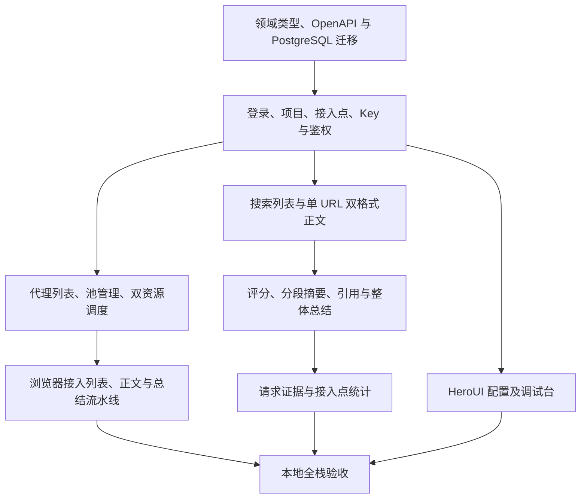

# 09 Rust 实施与验收

先跑通三个业务接口，再逐步接入搜索源、正文服务、观测和浏览器池。实现采用 Rust workspace 和独立构建的 HeroUI 管理台。

## 建议的工程结构

| 目录 | 职责与接口 |
| --- | --- |
| `crates/domain` | 类型化的项目/资源 ID、`SearchQuery, ReadUrl, SummaryQuery, Article, EvidenceRef`，限额、选择、段序、终态归并等纯函数 |
| `crates/application` | 三个业务用例，拥有请求/阶段截止和取消树。定义 `ConfigStore, SearchProvider, ContentReader, GenerationModel, ProxyAllocator, TraceSink` |
| `crates/runtime` | Tokio 任务、全局准入、端点令牌桶、代理与浏览器双资源预留、受控关闭，使用 RAII 租约 |
| `crates/adapters` | reqwest 出站、模板与 Token 计数、文章解析与两种渲染器、模型协议校验。SQL 仓储通过 sqlx 与 PostgreSQL 交互 |
| `apps/server`、`apps/browser-worker` | Rust API、健康探针、迁移与就绪实例发现。执行器负责 Firefox 进程、任务上下文、实际出口和引擎选择、取消与清理回执 |
| `apps/oasctl` | 面向已有 Kubernetes 集群的 Helm 安装、升级、状态和诊断命令。普通升级保留持久卷、密钥及项目配置。 |
| `web` | React / TypeScript / Vite / HeroUI，API 类型、国际化、主题与功能页面 |
| `tests`、`deploy` | 合成网页、HTTP 与模型替身、代理协议替身、全栈测试编排和回收 |

DTO 严格拒绝未知字段，项目限制在解析后根据快照检查。CPU 密集的文档转换、模型分词和压缩交给有界工作池。持有互斥锁时不等待远程 I/O，取消调用者也需要跟踪实际后台工作至结束。前后端模块按职责拆分，单个源文件不超过 2000 行。

## 实施依赖与最小纵向切片

1. 建空库、初始管理员和测试项目，用授权 Key 对三个入口分别得到可预测的鉴权/校验结果。根据公开 OpenAPI 派生客户端类型。
2. 建一个搜索替身和两份合成网页。列表应返回两个 URL。把其中一个 URL 原样传给正文接口，应同时拿到可读的 Markdown 和纯文本。
3. 模型替身给两个候选打不同分数，各段摘要携带段 ID。综合接口按序返回整体回答、来源分数及有效引用。让一个段失败，验证仍有证据时的 `partial`。
4. 先用 Pod 默认网络执行一次内置搜索与取文，再分别绑定 SOCKS5、HTTPS 代理验证；扩容后用同一能力 ID 派发。检查引擎选择、实际承接的 Pod，以及同一浏览器任务始终使用同一出口。
5. 用真实 PostgreSQL 验证配置并发、观测幂等、项目归属和记录清理，再用浏览器跑完整管理员操作、故障路径和两种主题。

## 验收矩阵

| 编号 / 层次 | 测试动作 | 必须观察到的结果 |
| --- | --- | --- |
| A01 契约 | 对三个路由发送错误 Key、重复键、未知字段、空白问题、过量请求体 | 稳定的双语错误，超大 body 在解析前 413。公开搜索 API 只有三项 |
| A02 事务 | 两次持同版本并发写，轮换项目 Key，另一请求持旧快照 | 一次提交一次 409，后续鉴权只接受新 Key，已有请求不混用两套配置 |
| A03 搜索列表 | 重复 URL、缺标题、合法空、畸形响应和错误上游 | 稳定去重、缺字段语义明确，区分 empty、partial 与 502。没有模型调用 |
| A04 URL 正文 | 只传 URL，输入含标题、表格、嵌套链接、代码和多字节字符 | 同一 HTTP 请求返回同页 `markdown` 与 `text`、请求 URL 和正确长度。只有来源确认时才返回 `final_url`。无检索、无模型调用 |
| A05 提取边界 | 长文章超限、登录页、地址不可访问、重定向改目标 | 两种格式的截断位置语义一致，拒绝不允许目标。没有有效正文时不给空成功 |
| A06 评分 | 多变体命中同一 URL、同分、未知/重复评分 ID、全部不相关 | 候选只计一次，分组及排序稳定，格式修正限次，明确不相关全部为空结果 |
| A07 分段与综合 | 短文一段、长文多段、超 Token、单段失败、模型给出不存在的引用 | 段序可重放，始终检查证据引用。合法降级给 partial，最终无有效综合给 502 |
| A08 预算 | 上游慢响应、名额全满、排队取消、模型队列竞争 | 队列与线程有界，截止不重置，取消不泄漏名额。一个长文不会独占模型 |
| A09 代理 CRUD | 配置两种协议、测试口令、改版本、停用、删除仍被池引用的代理 | 认证不回显，测试归属版本正确，停用立即影响新派发，删除引用冲突可定位 |
| A10 代理调度 | 两个已知测试出口、不同池权重、并发饱和、连接失败 | 可从测试站点观察到选定出口，代理与浏览器名额同时授予。同任务出口固定 |
| A11 浏览器回收 | 导航中取消、执行器崩溃、回执迟到、站点拒访 | 未清理槽位隔离，旧 owner 不能释放新租约。站点拒访停止该访问 |
| A12 项目归属 | 两个项目配置不同的搜索源，用各自的业务 Key 提交相同问题 | 两个请求 ID 不同，各自的接入点调用、来源和最终引用均能追溯到对应项目及配置版本 |
| A13 可观测性 | 队列满、载荷过期、重复 call_id、整日加零散时间窗 | 业务终态独立，缺失原因可见，趋势没有双计，分母为零的比率显示未知 |
| A14 HeroUI E2E | 登录、建项目与池、运行三项调试、查看 Markdown/文本、按引用下钻 | 中英文、深浅色、窄屏、键盘与焦点恢复均可用。视图切换不重抓网页 |
| A15 部署与质量 | 从空库启动、丢失调度所有权、混合负载、替换模型后复测 | 就绪与取消正确。报告 P50/P95、错误、排队、输入/输出 token、引用有效率和材料覆盖率 |
| A16 Helm 可选组件 | 覆盖都关闭、只启用 SearXNG、只启用 Crawl4AI、两者均启用。再通过升级启用一项，绑定到项目后升级关闭该项 | 四种组合下基础服务均能就绪。工作负载和 Service 与各自开关一致。关闭后已有项目可看到该引用不可用，新项目只从可用选项中预选 |
| A17 改写上下文 | 依次发送两个字段皆无、仅地区、仅时间和两者都有的总结请求。另测跨午夜的等价时刻、非法日期、缺失偏移及 0 次改写 | 提示词指令和结构化字段独立出现。当地日期按传入的偏移解读。错误指出字段，关闭改写时合法输入产生零次改写调用 |
| A18 管理台配置 | 在搜索、正文和模型分类中按目录新增服务商，调换项目池，添加并保存语言优先规则、并行打开两份配置和测试不同版本 | 凭据操作准确、超时换算一致、调试按已提交配置选路。版本冲突保留草稿，历史记录仍指向执行时的配置 |
| A19 请求证据 | 从综合回答的引用和请求阶段分别进入候选，比较有正文、简介回退、无材料和载荷不完整的请求 | 引用属于该请求，原文范围可复核。普通取文失败按项目策略处理，材料缺失不显示为零分或成功正文 |
| A20 管理界面可读性 | 打开项目、各类接入点、代理及代理池的只读详情。检查调试参数、失败提示、配置快照与报告，再按资源引用跳转 | 字段以名称、取值和单位呈现，详情与编辑有独立入口。项目默认与显式参数可区分。取消有改动的表单须确认，语言路由草稿在页面间保留。查询条件和资源归属可核对 |
| A21 调度规则 | 三个池，第二池两个平级成员。分别测试语言命中、普通成员风控、内置搜索和内置正文风控、池用尽、改变观测样本及跨项目访问 | 命中第二池直接从该池开始，仅向后降级。同池等权轮询，一个成员风控仍可选同池其余成员。普通成员在第 30 分钟到期时恢复；内置浏览器可承接或触发降级，下一次调用即可再选。仅改变观测样本，调度结果相同 |
| A22 Firefox 实例发现 | 已有项目绑定两个内置能力，把副本从 2 扩到 3，再滚动替换、缩到 0 和恢复 | 仅就绪 Pod 承接新作业。同一项目和能力 ID 自动使用新增容量，缩到零时引用保留。历史调用仍指向实际 Pod UID |
| A23 网络与引擎 | 用可控时钟运行两条 VPN、三个就绪 Pod，再扩至六个并替换负责检测的 Pod。模拟首次检测待定、可达、不可达及代理改版本后的迟到回执 | 每 1800 秒始终做三次常规检测：两条 VPN 各一次，默认网络一次。未首测的出口获零个搜索租约，旧版本的迟到回执也不能使其参与搜索。同池其他已测出口可用。默认网络的多个执行 Pod 引用同一份样本。已测可达走 Google、不可达走百度；正文可在相同出口正常取文，后续轮次只影响新任务 |
| A24 原生适配器 | 为每家服务用其原生路径、鉴权和响应结构提供成功、合法空、失败夹具。覆盖已跳转但上游不提供最终地址的取文 | 请求使用原生协议且占用零 Firefox 槽位；响应 `url` 保留原请求，无法确认时省略 `final_url`。随附材料可进入评分 |
| A25 部署与升级 | 通过 `oasctl` 安装、升级、更改 Firefox 副本和检查可选组件；模拟迁移失败及命令超时 | 升级后项目配置和数据仍可读取，项目 Key 和接入点凭据仍然有效。错误标明阶段与实况，再次执行先核对已有迁移与修订 |
| A26 历史回放 | 归档含样式表、图片的两栏网页以及含标题、表格、代码块的 Markdown。下线原站后打开第一次请求，对照原始模型往返并尝试读另一请求的材料 | 隔离 iframe 中可核对原来的栏位、样式和图片，缺失资源有提示；Markdown 按语义排版并可看源文。切换视图不产生对原站的请求。越权读取失败，历史模型输入输出可核对 |
| A27 全局历史到期 | 在项目 A 的旧请求已保存 4 天时把 7 天改为 3 天，用项目 B 创建新请求。另测同一小时桶两条请求跨过设置变更、延长保留期及物理清理滞后 | 旧请求按原定第 7 天到期，新请求按各自第 3 天到期。两者的完整材料、调用、回放和导出均遵循所属记录期限。聚合只计仍有效贡献，即使整个时间桶横跨两个设置版本或不同到期时刻 |

## 本地 Kubernetes 全栈环境

全栈 E2E 在本地 Docker 承载的 Kubernetes 测试集群运行。基础场景使用浏览器执行器、受控搜索页、合成网页、模型替身和 SOCKS5/HTTPS 测试代理，验证三项业务操作。SearXNG 集成场景启用其 Helm 开关，配置可控搜索源并检查结果列表。Crawl4AI 集成场景独立启用其开关，读取合成网页并检查 Markdown 和纯文本。两者同时启用时，再验证从 SearXNG 检索到 Crawl4AI 提取的组合。测试 CA 仅用于此栈，保留证书验证。通过不同出口标识核验浏览器的实际出站路径。

验收结束卸载本轮 Helm release，销毁本轮专用容器、网络、测试卷和镜像，并核对剩余资源。运行容量实验时注明输入长度、模型、并发和错误率。答案质量分别检查事实、时效、覆盖、引用是否支持结论及目标语言，失败率独立报告。
