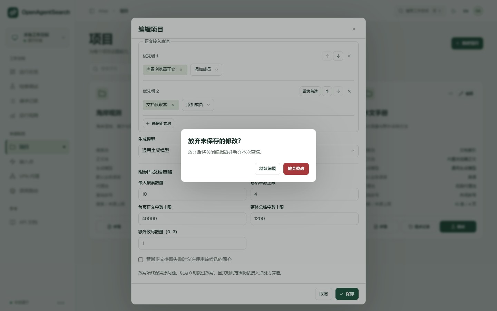
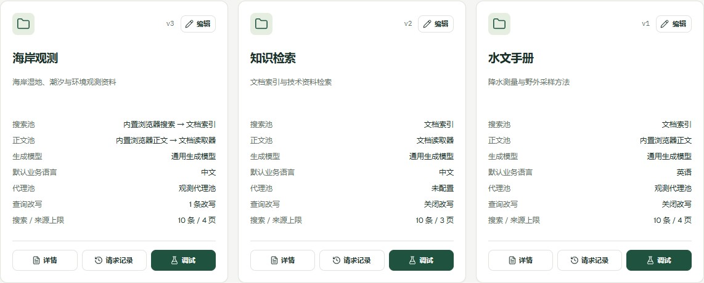
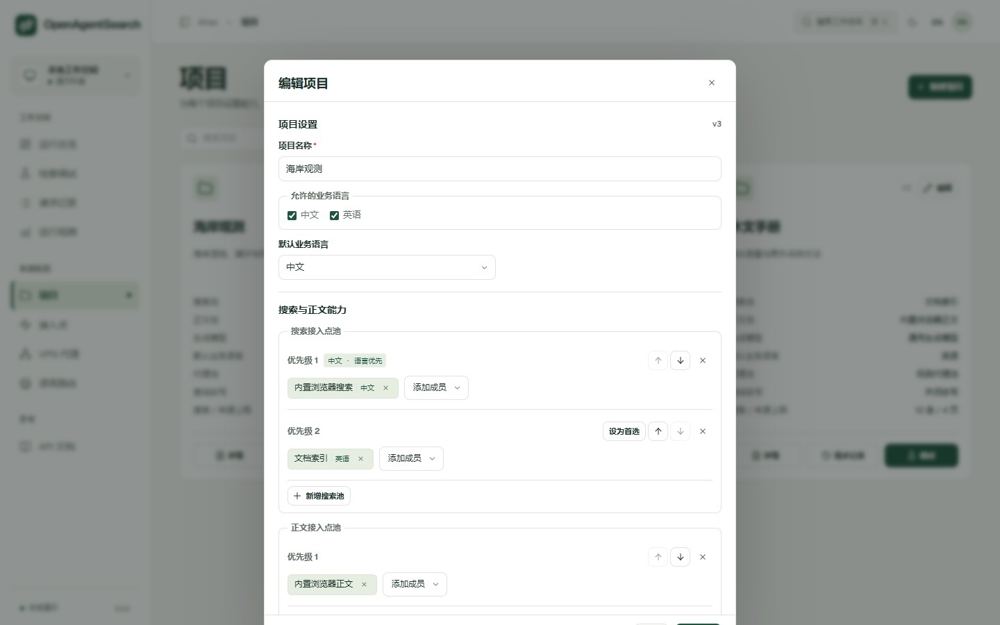
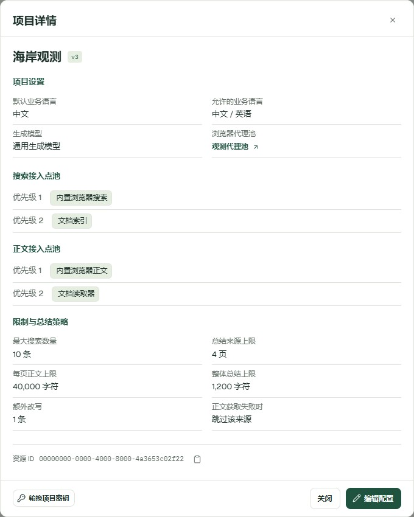
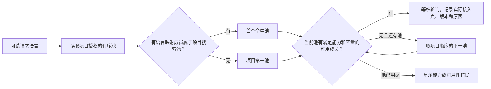
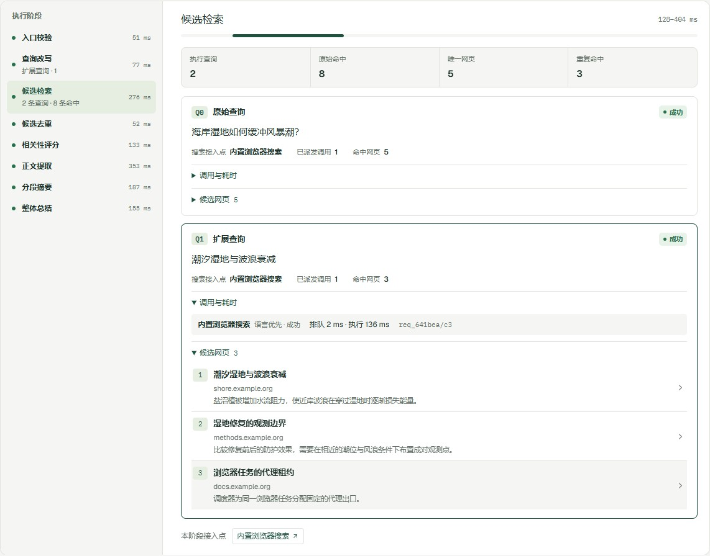
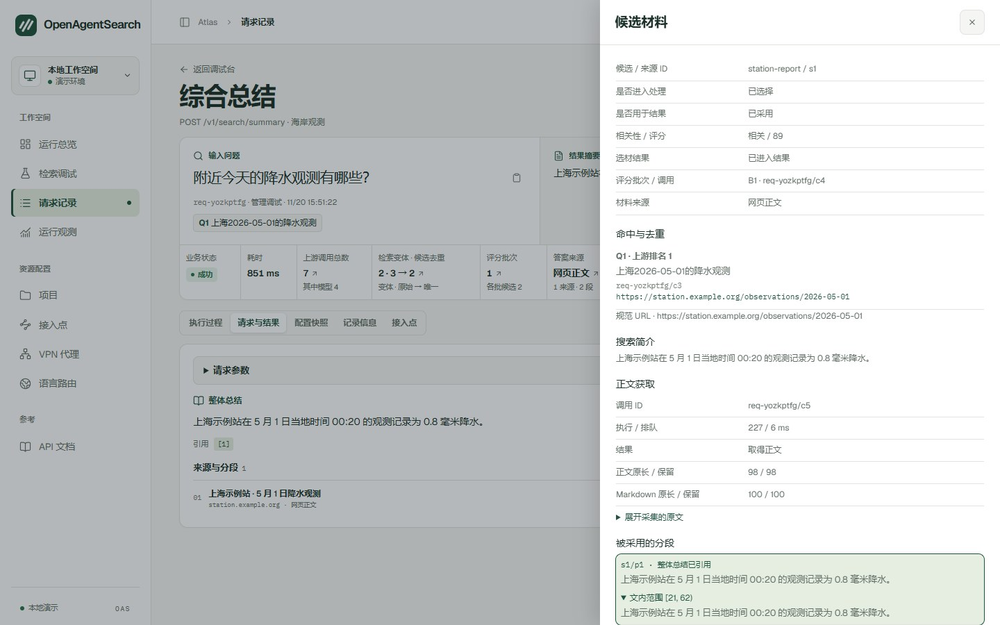

# 11 Atlas 前端实施对照

[打开工作台](demo.html) 可以验证 Atlas 的页面布局、表单和下钻交互。离线样本仍演示手工浏览器表单、已绑定代理的作业和有限的历史载荷。正式版的自动发现、出口周期检测、iframe 原貌回放、Markdown 排版和保留设置以本文和 API 契约为准。业务请求及返回类型从[业务 OpenAPI](contracts/business.openapi.yaml)生成，资源编辑、管理调试及诊断读模型从[管理 OpenAPI](contracts/management.openapi.yaml)生成。页面仅保存草稿、当前选择和展示状态。服务端持有项目权限、密钥、调度和请求记录。

## 接入点与项目配置

搜索与正文分类均可选择 DeepSeek。默认基址为 `https://api.deepseek.com`，也接受 `/v1` 结尾的基址。表单按能力提示搜索的 128 字符与不限时间要求，或网页 URL 转 Markdown 的输入输出。新增后可用功能测试验证保存的凭据和原生路径。[DeepSeek 配置](04-routing-and-providers.md#deepseek-搜索和正文配置)

| 接入点 | 表单及读回规则 |
| --- | --- |
| 可手工配置的接入点 | 先进入搜索、正文或模型分类，再选择服务商。保存能力、服务商、执行协议、单次超时、最大并发和每分钟请求上限。已配置的能力和服务商只读。输入秒，提交整数毫秒，允许 2.5 秒这样的精度。并发、RPM、毫秒须为正整数。 |
| 内置浏览器搜索和正文 | Kubernetes 中就绪的 Firefox Pod 自动登记能力。列表显示系统来源和就绪 Pod 数，项目分别绑定稳定的搜索、正文能力 ID。内置搜索采用实际出口的 Google 连通结果。VPN 列表逐条展示每 30 分钟更新的 curl 样本。内置搜索详情展示所有 Pod 共用的一份默认网络样本。待首测时暂不派发内置搜索，已测可达首选 Google，Google 搜索页失败时沿同一作业切换百度。已测不可达直接选百度。调用详情分别标明实际执行的 Pod、默认网络检测的代表 Pod、引擎和检测时间。搜索按适配器和所选引擎判断时间能力；正文接受项目提交的网页 URL。扩缩容由运维变更副本数。 |
| Tavily、SearXNG、AnySearch、DeepSeek 搜索 | Rust 直连服务商原生搜索 API。按供应商显示服务基址、凭据与原生选项。SearXNG 自身的引擎选项独立配置。集成搜索随命中返回的同 URL 材料仍参加候选评分。 |
| Tavily、AnySearch、Crawl4AI、DeepSeek 正文 | Rust 请求服务商原生取文接口。正文适配器把返回材料归一为同一文档，业务接口提供 Markdown 和纯文本。[服务商请求与响应](04-routing-and-providers.md#native-providers) |
| OpenAI 兼容模型 | `chat_model` 配置服务基址、可选凭据、模型 ID、分词器标识、最大输入和输出 Token。评分、分段和综合使用项目绑定的模型。 |

凭据表单区分保留、替换、清除。只有替换才需要输入新值。接入点详情把凭据状态显示为“已配置”“未配置”或“无需凭据”。新密钥只在编辑表单中填写。编辑提交携带 `expected_version`。409 保留草稿，管理员可载入新版本继续编辑。在详情的「使用位置」中，点击项目或优先语言可打开对应配置。系统内置浏览器提供查看与功能测试入口。内置搜索测试回执逐次列出实际引擎、状态和失败原因。

项目、接入点、代理和代理池共用编辑器关闭规则。有未保存的修改时，点击取消、关闭按钮或编辑器外侧，或按 Esc，会在编辑器上方打开独立的确认弹框。默认焦点在「继续编辑」。选择它或按 Esc 可回到原草稿和滚动位置。选择「放弃修改」才丢弃草稿并关闭编辑器。未修改的表单直接关闭。

测试针对**已经保存的版本**。运行中可撤销本次等待，完成后显示功能结果、耗时和测试链路。管理 API 返回 200 表示获得了诊断回执，功能成败读 `data.status`。资源修改后显示新版本待测。迟到的旧版本回执可以从历史请求查看。详情操作的依据是回执和记录关联 ID。[接入点编辑](demo/src/endpoint-editor.tsx) · [接入点列表与回执](demo/src/config-pages.tsx)

| 项目设置 | 交互与约束 |
| --- | --- |
| 项目身份 | 名称必填。业务语言按请求和全局路由决定。项目创建和 Key 轮换成功后只展示一次 Key，资源详情使用项目 ID 与版本。界面中英文切换独立于业务语言。 |
| 搜索池与正文池 | 两个分开的二维列表。整池可上移、下移、删除，成员可添加、移除。池内平级，同一能力的端点跨池也唯一。空池组删除后可提交空外层数组，项目可以分步配置。 |
| 模型与出口 | 可绑定一个生成模型和一个浏览器代理池。浏览器代理池留空表示使用 Pod 默认网络；选择代理池后仅使用池内可用出口。内置搜索和正文可以分别选择。代理列表接受 SOCKS5 或 HTTPS。 |
| 执行参数 | `search_limit`、`source_limit`、`body_limit`、`summary_limit` 均为正整数，来源数 ≤ 搜索数 ≤ 10。`rewrite_count` 取 0–3；`search_original_query` 默认开启，关闭后只检索改写查询且至少配置一个改写。`allow_snippets` 控制普通取文失败后的处理。项目池优先级由配置顺序决定，同池可用成员等权负载均衡。 |
| 可选服务 | SearXNG、Crawl4AI 可独立启用。未安装资源显示状态，新增成员只列可用项。正式部署按接入点的 `managed_by` 和 `availability` 判断。关闭托管组件只影响其对应资源，同一服务商的外部实例独立显示。离线演示用「组件选项」切换场景。 |

项目卡片在右上方提供「编辑」，底部等宽排列「详情」「请求记录」「调试」。从项目详情操作区可以轮换项目密钥。表单保存时再次校验引用和版本。草稿、密钥的短时输入和服务端读模型分别管理。只对发生冲突的资源重载。[项目编辑](demo/src/project-editor.tsx) · [有序池与编辑表单](demo/src/config-controls.tsx) · [配置与选路规则](demo/src/configuration.ts)

## 语言路由

上方按业务语言展示已配置的优先搜索成员，下方直接添加规则。选择语言和一个可用搜索接入点，点「添加规则」加入草稿，再点「保存路由」让后续请求生效。相同语言和端点只可添加一次。可以移除单个成员或整种语言，最后一个成员移除后，该语言恢复项目池顺序。失效成员可定位和移除。草稿在页面间保留，重载前会确认是否放弃。规则语言可按本地名称、英文名称或代码检索。目录随应用提供，现有路由中的其他标签也可继续选择。

例如，「海岸观测」第一搜索池为内置浏览器，第二池为文档索引。英文命中文档索引就从第二池开始，即使第一池可用也一样。若给项目添加了第三池，第二池全不可用时才进入第三池。清除英文映射后从第一池开始。池内平级轮询，普通接入点触发风控后暂停 30 分钟，内置浏览器照常参与池间降级并豁免这段隔离。切换界面语言时保持请求语言。[语言路由页](demo/src/languages.tsx) · [调度和容量](04-routing-and-providers.md#routing)

## 调试台

| 操作 | 表单 | 结果及验收点 |
| --- | --- | --- |
| 搜索列表 | 问题、可选业务语言、时间窗口和数量 | 有序列表、网址、简介，允许空结果。上游调用只涉及搜索。 |
| 网页正文 | 一个 HTTP(S) URL，可选正文字数上限 | 预览、Markdown、纯文本，来自同一份响应。显示调用方的 URL、截断和两种格式各自长度。取得 `final_url` 时另列已确认的最终地址。 |
| 综合总结 | 问题、可选业务语言、时间窗口、来源上限、总结字数、地区和带偏移时间 | 回答、来源评分、材料类型、分段与可点引用。可按字段核对生成语言、变体上限及实际采用的地点与日期参照。 |

每个项目与操作拥有独立草稿。请求参数页列出问题或 URL、实际业务语言、检索时间范围及适用的数量或字符上限。继承项目上限的字段标记“项目默认”，已完成的调试读取本次执行保留的配置。地区和当地时间按实际填写情况出现。接口和认证要求在 API 文档中查阅。运行中显示耗时和取消按钮。切换操作或项目时结束旧任务，迟到的结果不能覆盖新操作。在响应条打开记录，再返回调试台，可继续核对同一份输入和结果。

地区与时间只进入综合总结的改写上下文。日期时间采用 `2026-05-01T00:30:00+08:00` 这样的格式。两项均可独立留空，实际提交非法值应得到字段错误。项目关闭改写时只检索原问题。演示提供“附近今天的降水观测有哪些？”作为可复现的改写样例。正式实现由模型生成变体；仅在允许原问题搜索时回退，否则明确失败。[调试台](demo/src/playground.tsx) · [字段规范](02-business-api.md#rewrite-context) · [四种提示词组合](03-search-pipeline.md#rewrite-prompt)

## 请求记录、候选材料与运行观测

请求详情在问题、回答下方和详情标签上方显示一栏执行概览。桌面并排展示十项，小屏分行。首屏使用 `GET /admin/v1/requests/{id}` 返回的 `metadata` 和 `execution_summary`，各项可直接定位到该请求的阶段、响应或调用明细。[执行摘要契约](contracts/request-execution.schema.yaml)

| 概览项 | 取值与下钻 |
| --- | --- |
| 业务状态、耗时、上游调用总数 | 显示请求终态及从入口到终态的耗时。每次实际发送计一次，模型次数包含在总数内。点击总数查看全部已发送调用。 |
| 检索变体 · 候选去重 | 按“已执行变体数 · 原始命中数 → 唯一候选数”显示。含实际检索的原问题。同一变体的重试不重复累计结果，不同变体命中同一规范 URL 只产生一个候选。点击可核对检索或去重阶段。 |
| 评分批次 | 每个逻辑批次计一次，列出各批候选数。批内纠正重试沿用批次 ID。点击进入评分阶段。 |
| 答案来源 | 综合回答按实际引用的段区分网页正文、搜索简介或两者混合。下方保留返回来源和段数。列表显示搜索结果，单 URL 读取显示网页正文。点击进入「请求与结果」，可展开请求参数并核对相应证据。 |
| 记录信息 | 单独标记记录完整或部分缺失。业务成功也可能缺少诊断载荷，仍显示已知的调用和耗时。 |
| 搜索、正文、模型接入点 | 按能力列出执行时实际调用的接入点名称。多个端点可展开对应类型的调用列表。已知没有发起调用显示“未调用”，缺少归属时显示“未记录”。 |

成功检索却没有命中时，去重计数为 `0 → 0`。已派发但缺少候选数据时，相应计数显示“—”。正文读取和功能测试的检索与评分栏显示“不适用”。

| 从哪里看 | 必须能核对的事实 |
| --- | --- |
| 请求列表 / 入口 | 请求开始时间、来源、项目、操作、终态、耗时和响应预览。列表条件、页码、返回来源随钻取保留。入口拒绝请求时给出字段或错误码，实际调用数为零。 |
| 改写与检索 | 改写阶段分卡展示 Q0 与扩展查询、执行模型、实际扩展数和参与检索数。点某条查询可进入对应的候选检索卡片。检索阶段显示原始、唯一与重复命中，按变体列出实际接入点、调用状态、排队与执行耗时。点击排名、标题和简介所在的候选行可查看材料。上下文使用调用方原始偏移。改写关闭或分支未执行时，瀑布只展示实际阶段。 |
| 去重、评分与选材 | 规范 URL 收集全部命中组和原始排名，候选追溯到评分批次和模型调用。分别展示相关、不相关、未取得合法评分，记录来源上限、是否进入处理及是否最终采用。 |
| 正文、分段与回答 | 每次真实取文调用独立记录。集成源随附正文注明来源。普通取文失败后的简介必须标明 `snippet`。分别展示原始与保留长度，段 ID、原文半开区间和原文片段可复核。点引用会展开对应段，「查看原文范围」直接打开该段的候选抽屉。最终引用能定位到本请求的 `source_id/segment_id`。 |
| 配置快照 / 实际接入点 | 请求绑定的项目版本、池、限制、改写开关、路由决策及实际调用的接入点。编辑或删除现有配置后，历史名称和版本按已记录的快照显示。未知值显示“—”。 |
| 运行观测 | 按调用完成时间聚合，端点、项目、能力、来源、业务语言和时区可筛选。图表时段进入同范围调用明细。抽屉提供排队与执行耗时、是否已发送、原因和评价分母。浏览器尝试关联任务和实际 Pod，显示默认网络或项目代理池及分配到的代理。内置搜索另显示当时采用的 Google 连通样本、检测时间和引擎。可逐步查看上下文准备、页面加载、提取及回收。返回时保留原抽屉。 |

候选材料及调用详情共用右侧抽屉。桌面按视口的 39% 展开，宽度取 480–960px 并受视口约束，640px 及以下使用全宽。标题左对齐，关闭键固定在右上角，长内容在正文区独立滚动。

列表和抽屉摘要显示短预览。打开单份网页材料时优先在隔离 iframe 中回放捕获时的 HTML 版式。只取得 Markdown 时默认打开渲染后的预览，标题、表格、列表和代码块均按格式显示，并可查看源文。管理员也可按调用顺序展开模型实际输入、输出。过期或缺失时显示原因。回放读取当次快照。管理 API 的结构化导出、用户下载的 Markdown 报告和界面详情使用同一份脱敏记录。报告按请求参数、结果、来源与引用、执行阶段、配置和调用分节。尚未采集、已过期、明确失败和数值零分别显示。正式前端使用 `/requests/{id}/evidence` 与 span、call、statistics 接口，按授权和保留范围呈现数据。演示用本地样本生成可核对的调用、耗时与评分，供验证交互和关联关系。[阶段证据](demo/src/stage-evidence.tsx) · [候选抽屉](demo/src/candidate-sheet.tsx) · [观测口径](06-observability.md) · [端到端用例](demo/test/console.test.mjs)

## 逐页交互验收

| 页面 | 直接操作 | 验收要点 |
| --- | --- | --- |
| 工作台与登录 | 概览按异常或时段进入请求列表，命令面板定位资源，重新登录返回站内记录 | 时间筛选和当前详情连续。中英文、主题及窄屏导航都可操作 |
| 项目 | 查看详情、编辑、轮换密钥、按项目查请求或进入调试 | 只读弹框按优先级显示池与成员，数量和字符上限带单位。项目引用的代理池可继续打开 |
| 搜索、正文和模型接入点 | 按能力查看系统登记的浏览器或新增外部服务，查看测试回执、引用与观测 | 增加就绪 Firefox Pod 后，内置搜索和正文的执行实例自动增加。内置浏览器采用所选代理或 Pod 默认网络，第三方请求直接发往服务商原生 API |
| VPN 代理与代理池 | 查协议、认证和启停状态、Google 周期检测及完成时间；按池查看成员和权重，运行手工连通测试 | 从测试记录可返回代理列表。变更配置后可针对新版本复测。被引用资源可定位到所属代理池或项目 |
| 语言路由 | 按业务语言添加或移除优先搜索接入点，保存或重载规则 | 草稿显示未保存状态。版本冲突可重新载入，失效成员可定位。最后一个成员移除后该语言的规则随之移除 |
| 检索调试 | 选项目、操作与参数，载入样例，运行或取消，查看响应并定位请求 | 参数区分显式填写与项目默认。错误提示指出需要检查的业务字段。网页正文可切换阅读、Markdown 和纯文本 |
| 请求列表与详情 | 按项目、状态或关键词筛选，设置所有项目的新请求统一使用的保留天数，从改写查询定位检索阶段，按引用查看归档网页或渲染后的 Markdown | 详情展示当次请求采用的保留天数及固定到期时间。入口、快照和接入点按执行时的记录展示。导出 Markdown 能顺着候选、分段、调用和浏览器阶段追溯 |
| 运行观测 | 按能力、项目、来源和时段查看统计或调用明细 | 调用抽屉显示结果、排队与执行时间、调度原因及出口，从所属请求返回保留筛选和抽屉 |
| API 文档 | 查看业务、管理与健康接口，复制业务示例或载入调试台 | 接口字段保留约定名称。示例对照字段阅读，载入后操作与参数和选中的示例一致 |

[只读资源详情](demo/src/config-info.tsx) · [请求参数展示](demo/src/request-facts.tsx) · [Markdown 报告](demo/src/trace-markdown.ts) · [页面验收用例](demo/test/console.test.mjs)

## 真实调用的增量证据与诊断展示

候选抽屉按派发顺序显示全部取文尝试，失败端点、错误码与后续成功材料均可追溯；简介回退也保留失败链。执行概览在未收到全部检索响应时显示已知下界与不完整提示，合法零命中仍显示零。

调用详情共用可读的事实列表及阶段组件，展示实际 Pod、作业、出口、上下文是否复用、共享样本与搜索引擎。API 的 execute 包络下缩进执行器实测阶段，并明确提示父子区间不能累加。手工代理测试在资源详情、测试回执和请求阶段详情复用同一诊断组件，分别展示网络可达、测试匹配、通道健康和连接／协议／目标响应阶段。保持中英文、深浅色与窄屏行为一致。项目池上移、下移和删除按钮带完整的池类型及优先级无障碍名称。

## 正式页面的视觉实施

工作台布局、登录分栏、控件尺寸和数据图表遵循 [Atlas 视觉结构](08-console.md#atlas-视觉结构与公共组件)。`web/src/workspace.tsx` 负责侧栏、顶栏和账户入口，`sign-in.tsx` 负责 OpenAgentSearch 品牌说明与登录表单。登录页也提供语言及配色入口，桌面左右排列、窄屏上下排列。

页面共用 `web/src/ui.tsx`：常规操作 35px、紧凑操作 28px，登录按钮 50px。Card.Content 承担正文内边距，表格和图表的整面模式显式使用 flush，避免不同页面互相覆盖。总览恢复深蓝色请求流量、操作分布及最近请求的组合，数据来自服务端；图例、时间下钻和空数据状态可通过自动化测试验证。新增的 A14.login_split、A14.atlas_controls、A20.atlas_dashboard 验证中英文、深浅色、窄屏、组件尺寸和实际数值。

登录页与侧栏共用 `PRODUCT_NAME` 和品牌标志。`web/src/styles/theme.css` 定义蓝白及深蓝主题和文字层级，`overlays.css` 同时管理 HeroUI 门户的外层容器与对话框尺寸。桌面顶栏高 64px，导航约 40px，页标题为 30–40px，章节标题 16px，表格正文 13px。主要按钮高 35px、字号 12px。紧凑按钮高 28px、字号 11px。分段标签高 28px，图标与文字一起标出操作。

项目表单按项目设置、搜索与正文能力、限制与总结策略分组。搜索池与正文池各占一行。请求列表先展示匹配窗口指标，再按字段筛选。运行观测将视图切换放在筛选区上方，趋势与按端点的质量样本并排显示。两页共用时间范围控件。调试台在桌面左右并排显示输入及响应，API 文档以目录和详情两栏展示当前契约，窄屏依次排列。

请求详情在同一张卡片内并排展示输入与结果摘要，下方展示执行概览。独立测试使用当时记录的资源名称、回执与原因码。执行过程按阶段分组，点选后就地显示执行区间和单步材料，同阶段的多次执行可以单独选择。请求与结果、配置快照、记录信息和实际接入点各有单独标签。记录信息显示完整性、保留天数及到期时间。未采集的材料显示缺失状态。

调试台的项目配置条列出首选搜索池、正文池和模型。输入区提供方法、路径、参数开关和可编辑样例。右侧可切换结果与请求参数，运行后使用该次提交的输入和项目默认值。沿请求记录返回会恢复当次结果。调试项目选择器位于输入卡片的操作标签旁。桌面和窄屏均纵向排列项目的两类接入点池。
