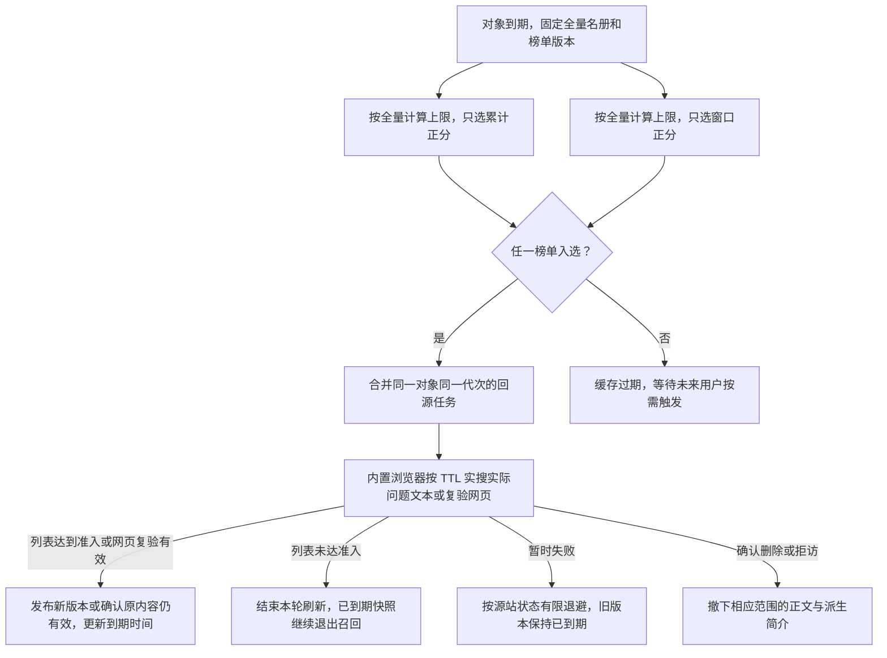

# 累计热点、近期热点与到期刷新

每个项目为**问题列表**和**网页正文**分别维护累计榜与近期榜。同一对象类型的两榜都按全量名册计算名额上限，再只从本榜有正分的对象中选取。累计与近期独立计分，默认各 10%，每项最低 1%，输入 0 按 1% 生效。到期对象进入任一榜即排入内置浏览器刷新队列，双榜重合只刷新一次。列表刷新沿用入库时实际检索的文本（包括已改写的具体日期），自然语言的“今天、明天”只依 TTL 调度。两榜都未入选则直接过期。

## 引用如何入账

| 对象 | 一次引用的含义 | 身份与去重 |
| --- | --- | --- |
| 问题列表 | 双命中选 A、B 就各加 1，含“A 给原问 AI 回答、B 供链接评分”。两题在最终 Top K 中各占几条不影响选源票数。单命中 A 只加 1，零命中没有旧问题获得引用 | 按所属范围内的逻辑 `question_id` 计。同题两份快照的全部候选参与去重评分，仍只给该题加 1。一个综合请求的多个变体复用同一来源，整个请求对该来源至多记一次 |
| 网页正文 | 直接取用缓存正文、综合实际使用正文或向用户交付该版本的原语言页级 AI 简介，都算对该页面的一次使用。只有链接或上游短简介时未取用页级材料 | 按项目内的渲染页面及其表示计。`#/install`、`#/upgrade` 分开，确认是同页的定位锚点合并。同一请求去重，切换请求语言不另造页级简介或热度 |

业务、综合原问与实际检索变体、管理员调试和测试按[入口规则](README.md#producers)归属。问题登记、逻辑判定和来源引用各自计量。降级精确交付仍给该原问记一次引用，故障旁路本身不投票。后台补搜、定时补文、复验和生成摘要不投票。可靠引用按 `(request_id, object_kind, object_id)` 幂等消费。换快照、系统 embedding 升级或调整页级简介输入上限都不重置逻辑对象的热度。

**计数故障时优先返回业务结果。** Valkey 暂不可用而持久事件已写入时，从已确认的消费位点重放。事件也无法在交付预算内可靠记录时，照常返回搜索列表、正文或综合回答，允许本次少计。对于已确认未保存的事件不事后估算。提交结果不确定时仅按原事件 ID 幂等核对，避免重复记票。尽力用独立监控标注统计缺口或滞后区间。无法掌握丢失数时显示“未知”。失败的计数不能变成业务错误、`partial` 警告、额外实搜或任务成功回执。

## 两张榜怎样计算

建议首版按分钟在 UTC 发布一致的榜单。对同一范围、同一对象类型和同一截止时刻 `t`，两榜共用同一份全量名册及其大小 `N`。业务、综合、管理员测试经鉴权后的真实问题以及实际执行的改写问题按逻辑 ID 登记。首次只命中别的问题、从未取得合格快照、快照已过期、累计或近期引用为零的对象都在分母中。无项目归属的管理员测试有独立范围，避免被任意业务项目接收。名册登记与[浏览器快照准入](README.md#admission)分别处理。

正文名册以 [页面身份](README.md#page-identity)和实际表示登记。不同 hash 路由可共享物理正文哈希，但各有名册身份。清除对象或失去保存资格时按授权范围移除。个别快照来源撤权只剔除该版本。一次到期扫描固定名册、策略和榜单版本。

| 榜单 | 排序依据 | 计算前列比例的分母 |
| --- | --- | --- |
| 累计热点（总热点） | 截至 `t` 的全部真实引用次数，降序 | 本项目该类对象全量名册的 `N` |
| 近期热点 | `[t − W, t)` 内的真实引用次数，降序。建议初始 `W = 24 小时` | 同一个 `N`，窗口内零引用的对象计入分母 |

每榜名额上限 `K = ceil(N × 本榜有效百分比 / 100)`。设本榜正分对象数为 `P`，实际入选 `min(K, P)` 个。正分同分以稳定对象 ID 排序。空名册或本榜无人引用时实际入选 0 个。比例为 100% 时覆盖本榜全部正分对象。零分对象不占空位，窗口滑动只改变近期分数。到期调度取两榜**并集**，只刷新已到期且可合法回源的缓存对象，保留入选原因、榜单版本和时刻。

例如项目有 100 个逻辑问题，其中 40 个最近 24 小时被引用，两榜默认各选 10 个。若有 2 个重合，并集有 18 个。若有 1,000 个问题、近期比例 1% 且仅 2 个有近期引用，近期上限为 10，实际只选这 2 个。即使 900 份冷快照过期，两榜仍以 1,000 为分母。

| 总榜入选 | 近期榜入选 | 到期动作 |
| --- | --- | --- |
| 是 | 否 | 刷新一次，原因记为累计热点 |
| 否 | 是 | 刷新一次，原因记为近期热点 |
| 是 | 是 | 刷新一次，保留两种原因 |
| 否 | 否 | 退出可命中集合，无主动刷新任务 |

## 管理员手动调整

建议提供系统默认值，在管理台的项目缓存策略中分别为“列表”和“正文”继承或覆盖。两类对象各有下列三个可编辑字段，字段名为拟议管理契约。

| 设置 | 建议默认值 | 作用 |
| --- | --- | --- |
| `total_hot_percent` | 10% | 累计榜的有效比例为 1–100 的整数，输入 0 归一为 1% |
| `recent_hot_percent` | 10% | 近期榜的有效比例为 1–100 的整数，输入 0 归一为 1% |
| `recent_window_hours` | 24 小时 | 正整数小时，仅决定近期榜统计窗口 |

例如列表可设“累计 5%、近期 20%、窗口 6 小时”。正文若填“累计 0%、近期 0%”，两项分别保存并回显为 1%。负数、非整数或超过 100 的输入返回字段错误。定时列表发布后仍补齐缺失或已过期的正文，即使该 URL 未进入正文两榜。任务原因区分“列表补文”和“正文热点续期”。两类任务共享[后台浏览器并发](03-cache-console.md#dispatch)。并发值必须是正整数，输入 0 会被拒绝，只有热榜百分比对 0 作 1% 归一。

管理员保存时沿用 `expected_version` 防止覆盖其他人的修改。界面显示生效值、继承来源、各榜入选数、交集数、最近计算时间。修改后重新计算受影响的榜，准备好后原子发布配置与榜单版本，从下一批到期对象起使用。调整占比无需重建向量索引，也不触发所有入选对象立即回源。近期计数按可支持的最大窗口保留时间桶，扩大窗口时用完整桶重算，恢复或补算期间继续使用最近完整发布的策略并标明状态。

## 大规模下的实现

- **写入。** 热度增量与向量文档分开。中小项目可按项目和对象类型使用 Valkey 有序集合维护累计排名，近期排名按时间桶增减。`ZINCRBY` 更新和 `ZREVRANK` 查名次均为 `O(log N)`。增量可批处理，持久事件与消费进度用于故障重放。若每秒有 `R` 个列表请求，单命中、双命中占比分别为 `p1`、`p2`，每秒问题引用增量为 `R × (p1 + 2 × p2)`。[Valkey 增量](https://valkey.io/commands/zincrby/) · [Valkey 排名](https://valkey.io/commands/zrevrank/)
- **恢复。** 持久化全量逻辑对象名册、每个对象的累计计数检查点、近期时间桶及相应的事件消费位点。从检查点重放已可靠保存的增量后发布两张榜，零引用和已过期对象也恢复其名册身份。记录故障期间未保存的票数允许缺失，不用请求日志或任务次数反推。计数恢复独立于请求回放的保留天数。
- **跨分片。** 一个有序集合键落在一个集群槽位。大项目按逻辑对象 ID 分片，每个对象只归属一片。汇总各片名册数量得到全量分母，各榜分别合并正分对象的计数分布。同分按稳定 ID 决胜，最多选到该榜的正分数或名额上限。到期任务直接查成员资格。[Valkey 集群槽位](https://valkey.io/topics/cluster-spec/)
- **到期与淘汰。** 通过 `expires_at` 获取到期对象，任务按项目、对象类型、对象 ID 和过期代次幂等，入榜原因可有两个。榜单不可读不等于全冷。入榜的到期对象可排队刷新，满队列时按[最老等待任务淘汰规则](03-cache-console.md#overflow)处理。磁盘压力可以在 TTL 前移出冷缓存，保留逻辑身份及计数，后续真实需求仍可重建。[物理回收与历史回放](02-index-selection.md#eviction)
