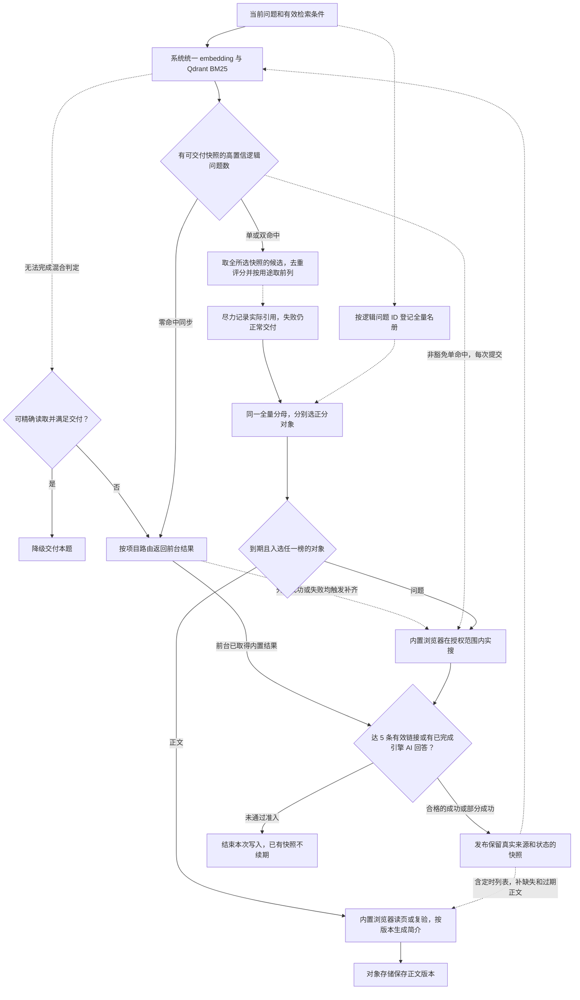

# Qdrant 索引与自托管部署

**Plan 2 已选用自托管 Qdrant。** 同一集合检索历史问题的稠密向量和带 BM25 评分的问题文本，按项目、语言、可见范围及有效期过滤。采用支持原生 BM25 全文评分的 Qdrant 1.20 或以上版本。应用为新问法生成一次稠密 embedding，词项一路由 Qdrant 的全文索引完成。部署时固定已验证的服务端镜像和 Helm Chart 版本。[Qdrant 1.20 全文检索](https://qdrant.tech/blog/qdrant-1.20.x/) · [混合查询](https://qdrant.tech/documentation/search/hybrid-queries/)

## 部署难度与依赖

已有 Kubernetes 和 Helm 时，单节点验证只增加 **1 个 Qdrant Pod 和 1 个数据 PVC**。高可用建议 **3 个 Qdrant Pod、3 个独立数据 PVC**，副本跨宿主机放置。两种规模使用同一服务镜像。Qdrant 内建负责集群拓扑和集合结构的 Raft，无需另部署 etcd、ZooKeeper、消息队列或外部数据库来启动索引服务。[本地单容器示例](https://qdrant.tech/documentation/quickstart/) · [官方 Helm Chart](https://github.com/qdrant/qdrant-helm) · [自托管集群](https://qdrant.tech/documentation/scaling/distributed_deployment/)

| 场景 | 需要准备 | 主要工作 |
| --- | --- | --- |
| 开发与功能验证 | 单容器或单 Pod，`/qdrant/storage` 挂一块持久化 SSD/NVMe 数据卷 | 创建问题集合和过滤字段索引，验证稠密向量与中文 BM25 两路召回、写入可见性及重启后数据可读 |
| 生产高可用 | 官方 Helm Chart 的 StatefulSet，建议起步 3 个 peer，每个 peer 一块 SSD/NVMe 数据 PVC，业务集合设置 `replication_factor=2` 或更高 | 检查每个分片的副本确实分布在不同节点。3 个 peer 中保有 2 个可维持集群管理操作的多数。数据读写可用性还取决于分片副本和一致性设置。[高可用建议](https://qdrant.tech/documentation/scaling/resilience/) |

在线数据卷应为带 POSIX 文件系统的块存储，可用本地 NVMe，也可验证云 SSD 块卷。NFS 共享目录和 S3 桶不能作 Qdrant 主数据盘。应用按协议访问集群内的 REST `6333` 或 gRPC `6334`，peer 间通过内网 `6335` 通信。生产运维的主要工作是分片迁移和恢复。新增节点后检查现有分片的落点，自托管改变已有集合的分片数要预留新集合迁移空间。分布式集合按节点取快照，副本和集群外备份分别覆盖节点故障和数据恢复。[存储要求](https://qdrant.tech/documentation/installation/) · [横向扩展](https://qdrant.tech/documentation/scaling/horizontal-scaling/) · [分布式快照](https://qdrant.tech/documentation/snapshots/)

**完整缓存涉及三套基础设施服务。** Qdrant 负责检索，Valkey 负责双热点榜，S3 兼容对象存储负责正文。已有服务可复用。PostgreSQL 继续保存配置和任务状态。所有项目使用同一套部署级多语言 embedding，可由应用内编码器或系统统一的 embedding 端点提供。页级摘要的生成模型仍按项目配置。[现有组件边界](../plan1/01-system.md) · [热点方案](01-hotness.md)

## 索引和数据放在哪里

| 组件 | 建议落点 | 在线访问方式 |
| --- | --- | --- |
| 问题倒排、向量及过滤字段 | 系统统一 embedding 和活动索引版本，每项目每个逻辑 `question_id` 对应一个 point。BM25 索引问题文本，payload 索引支持项目、语言和有效期过滤 | 混合查询只用相同版本的向量。精确降级按 ID 读取并重验全部条件，检索与统计仍按项目隔离 |
| 实搜快照及候选特征 | 按机会累积快照，保存各来源的 `snapshot_id`、浏览器作业、实搜时间、原排名、授权与完整度，以及成套的标题、短简介。候选文本特征按输入文本哈希和统一模型版本复用 | 批取其中全部候选，按页面身份归组，按当前问题逐份评分，返回最佳一份的标题和短简介。每份材料的来源均可追踪。[候选与排序](README.md#ranking) |
| 正文和 AI 简介 | 完整 Article/Markdown 按版本放 S3 兼容对象存储。URL 元数据按渲染页面键保存，明确 hash 路由各有 ID。元数据含原文语种、简介、更新类型、输入覆盖范围和生成配置 | 一页的同一正文版本按网页原文语言生成简介。不同问法、请求语言及 embedding 升级可复用该版本。采集和撤下区分页面身份及主文档 HTTP 状态。[原文语言与生成预算](README.md#page-summary-budget) |
| 全量逻辑名册、累计与近期排行 | 含业务列表、综合原问/实际检索变体及管理员调试/测试的独立来源标识。未入库、已过期和零引用对象均计入所属范围的全量分母 | 两榜以全量计算上限，只取各榜正分。Valkey 聚合已可靠记录的事件，可从持久检查点重放。无法可靠记录时允许少计、用户正常取得结果 |
| 管理配置、任务协调与历史请求 | PostgreSQL 保存缓存策略、后台浏览器并发配置版本、任务状态与租约 | 管理员在[缓存管理](03-cache-console.md)调节全局并发。单一调度所有者在申请实际标签时原子校验容量，Qdrant/应用实例扩容不放大该上限 |

原问和系统 embedding 版本相同时，热点重搜沿用问题向量。同来源更新按代次发布，其他有效来源可共存。后台作业只调内置浏览器能力并校验来源，项目配置的第三方端点没有缓存生产路径。仅有统计身份的问题无需创建 Qdrant point。[Qdrant 更新 payload](https://api.qdrant.tech/api-reference/points/set-payload) · [批量读取 point](https://api.qdrant.tech/api-reference/points/get-points) · [集合与向量配置](https://qdrant.tech/documentation/manage-data/collections/) · [Ceph 对象网关](https://docs.ceph.com/en/latest/radosgw/)

### 系统统一 embedding 与模型换版

系统级配置固定一个活动模型及其版本、输出维度、距离度量和归一化方式，所有项目使用同一向量空间。请求开始时固定索引代次和对应编码器。项目侧只管理原有授权、数据可见范围和生成模型。

- **问题与网页分两级评分。** 先在问题向量和倒排索引中找历史问题。网页评分使用该页自己的材料，在浏览器快照入库时可批量编码标题和短简介，按文本哈希和系统 embedding 版本存成可按 ID 批读的特征。前台用同一问题向量与已选候选在内存中算相似度，并结合词项和原排名。多份来源分别计算得分，页面取最高项，不需为完整网页库再建 ANN 索引。实时新材料尚无兼容特征时仍可使用该候选的词项与原排名。容量评估应单列候选特征的写入、磁盘和读取成本。
- **切换版本。** 用现有合格快照的文本在新的索引代次重算问题及候选向量，追平期间的新增、过期和撤权记录。核对覆盖度、第二条召回率和错误双命中后，把编码器、索引和相应阈值作为一个活动版本切换。在途请求固定其原版本，完成后再回收旧索引。相同维度的不同模型也不可混用。逻辑问题 ID、历史热度和完整正文均可沿用，无需重新访问网页。
- **故障。** 仍能按 ID 读取时，严格匹配的原问允许降级交付。没有这样的快照或 Qdrant 无法读取时，在原请求截止内回到项目路由。单路词项排名不自行取得高置信资格。[降级判定与计量](README.md#degraded)

## 选型依据与备选记录

| 方案 | 磁盘、双路检索和分布式能力 | 影响选型的差异 |
| --- | --- | --- |
| **Qdrant（已选）** | 在同一个检索服务内支持稠密向量与 BM25，可分别配置量化副本、原始向量和索引的内存层级。支持分片和节点间复制 | 用真实问句校准中文分词、代码标识和版本号的匹配效果。按自托管约束规划初始分片，预留集合迁移和恢复空间。[混合检索](https://qdrant.tech/documentation/search/hybrid-queries/) · [全文打分](https://qdrant.tech/documentation/search/text-search/full-text-search/) · [内存分层](https://qdrant.tech/documentation/ops-configuration/memory-tiers/) · [横向扩展](https://qdrant.tech/documentation/scaling/horizontal-scaling/) |
| **OpenSearch** | 文本倒排和 k-NN 可做混合召回。`on_disk` 模式可先查压缩索引，再从磁盘取少量完整向量复算。主分片分布数据，副本承担读取与冗余 | 适合中英文技术词和向量信号同等重要的场景。内置 CJK 分析器按二元词切分，还应验证版本号、错误码、别名和 ICU 分析效果。自托管可用集群外快照仓库做恢复演练。[磁盘检索](https://docs.opensearch.org/latest/vector-search/optimizing-storage/disk-based-vector-search/) · [混合查询](https://docs.opensearch.org/latest/vector-search/ai-search/hybrid-search/index/) · [分片路由](https://docs.opensearch.org/latest/search-plugins/searching-data/search-shard-routing/) · [CJK](https://docs.opensearch.org/latest/analyzers/language-analyzers/cjk/) · [快照恢复](https://docs.opensearch.org/latest/tuning-your-cluster/availability-and-recovery/snapshots/snapshot-restore/) |
| **Milvus Distributed** | 稠密向量支持 DiskANN，官方建议为相关数据目录提供快速 NVMe SSD。支持 BM25 全文检索，集群组件可以分别扩容 | 适合向量规模或建索引吞吐成为主成本的场景，需考虑分布式组件、持久化依赖、索引追赶和整套恢复的运维成本。[DiskANN](https://milvus.io/docs/diskann.md) · [BM25](https://milvus.io/docs/full-text-search.md) · [组件架构](https://milvus.io/docs/architecture_overview.md) · [扩容](https://milvus.io/docs/scaleout.md) |
| **Elasticsearch** | 文本与向量排名可融合，DiskBBQ 提供磁盘上的压缩向量检索，集群支持主分片、副本和集群外快照 | 优势在于复用已有 Elastic 集群、监控和恢复流程。采用 DiskBBQ 时需核对拟部署版本及许可。[DiskBBQ 与许可条件](https://www.elastic.co/docs/reference/elasticsearch/mapping-reference/bbq) · [混合排名](https://www.elastic.co/docs/reference/elasticsearch/rest-apis/reciprocal-rank-fusion) · [节点和分片](https://www.elastic.co/docs/deploy-manage/distributed-architecture/clusters-nodes-shards) · [快照](https://www.elastic.co/docs/deploy-manage/tools/snapshot-and-restore) |
| **Vespa** | 支持文本与稠密信号组合、多阶段排序，内容节点增减时可在线重分布并维护副本 | 适合需要复杂排序表达式的系统。官方明确提醒 `paged` 张量与 HNSW 组合在内存紧张时会因随机访问拖慢写入，需为其规划内存工作集。[混合搜索](https://docs.vespa.ai/en/learn/tutorials/hybrid-search.html) · [分页属性的限制](https://docs.vespa.ai/en/content/attributes.html#paged-attributes-disadvantages) · [在线扩容与恢复](https://docs.vespa.ai/en/content/elasticity.html) |

备选方案的公开容量数据可作量级参考。OpenSearch 2.18 在 1.13 亿条 1,024 维向量、10 个带本地 SSD 的数据节点、8 倍压缩的测试中，预热后 8 客户端向量检索 P90 为 95.05 毫秒，Recall@100 为 0.98。Qdrant 的目标工作负载还包括中文短问句、授权和时效过滤、置信度判定及列表读取，需要独立测量。[OpenSearch 测试配置与结果](https://opensearch.org/blog/reduce-cost-with-disk-based-vector-search/)

## 固态盘与索引速度

- **工作集。** 完整向量、倒排文件和列表快照持久化在 SSD/NVMe。给压缩向量、索引热页及文件系统页缓存预留 RAM。记录 Kubernetes 持久卷的实际介质、随机读 IOPS 和尾延迟。若生产候选同时包括本地 NVMe 与网络 SSD 卷，两种存储分别测冷启动、稳定读和并发写。以 1,000 万个真实历史问题、768 维 `float32` 为例，单份原始向量约 30.72 GB，另计图索引、倒排、元数据、副本、段合并及恢复空间。
- **少漏掉第二个问题。** 两路可各取前 20 个作为起测值。为项目、语言和时间条件建立对应的 payload 索引，并在两路检索时过滤。两路按 ID 合并后以置信度和快照状态放行。候选数、量化强度和磁盘复算深度要在相同的第二条漏召回率下比较。[Qdrant 的向量与 payload 索引](https://qdrant.tech/documentation/manage-data/indexing/)
- **并发写入。** 新问法沿用前台已算好的向量，实搜成功后按稳定 ID 发布。批量写入和清理过期记录，分别观察新点的查询可见性及后台建索引积压。如果启用 `indexed_only`，查询会跳过尚未建好索引的大段，近期写入的第二个问题可能暂时不可见。验收覆盖连续写入场景。每次命中的引用增量走独立计数路径。[Qdrant 索引优化器](https://qdrant.tech/documentation/ops-optimization/optimizer/)
- **分片和恢复。** 用项目或项目分区减少无关分片的查询扇出，大项目可跨分片。节点、数据卷和副本按故障域分布。节点扩容后的重平衡、滚动升级、单盘丢失和集群外备份恢复都要覆盖。恢复后以原始快照核对 ID、到期时间、权限、热点榜版本和计数消费进度，避免旧数据重新成为有效命中。

### 磁盘水位与提前淘汰

TTL 给出最晚可复用时间。Qdrant 的 SSD/NVMe 数据卷或正文对象存储达到容量高水位时，允许提前淘汰仍新鲜的冷缓存。分别观测节点/分片可用空间和对象存储配额，高低水位及安全余量由部署容量测试决定。回收到低水位后停止，避免反复剔除和填充。

1. 优先回收已过发布宽限期且确认没有指针或写入租约的孤立对象，接着回收已过期和未被引用的旧版本。列表、正文和派生简介分别核对版本关系。
2. 仍有压力时，优先淘汰榜外且近期少用、占用大的新鲜列表或正文。先按代次撤出可交付指针，再回收底层数据。移除一份快照后，若该问题还有另一份可交付快照，有效库存仍计该问题。轻量问题名册、累计数及近期桶独立保存，后续请求按实际可用源回到 2/1/0 路径。
3. 保护活动写入、在途读取和保留期内的回放证据。历史已独立冻结实际交付材料时，可回收缓存副本。若回放共用同一对象，则在最后一个有权引用到期后才删除。发布失败产生的孤儿经过宽限期再次核验，避免清理与新发布互相覆盖。
4. 安全可回收空间耗尽时暂停新增缓存写入，前台照常返回。运营指标区分“容量提前淘汰”“源站删除/撤权”“自然到期”和后台“队满淘汰”。提前回收不会触发该代快照的到期续写，恢复空间后可由真实需求重建。回放引用只保护物理留存，读取仍要通过当前权限和保留期检查。[历史材料与保留期](../plan1/06-observability.md) · [源站状态处理](README.md#origin-status)

## Qdrant 容量与验收

同一批脱敏问题、同一 embedding、相同 SSD/NVMe、RAM 和副本预算下，对比 Qdrant 的索引及分片配置。样本保留真实的项目规模分布、冷热比例、中英文混合、版本号、否定词、相对日期以及双榜刷新写入。用精确向量扫描、完整词项检索和标注问句对建立高置信问题的对照集。高可用拓扑的建议起点见[部署难度与依赖](#deployment)，单节点规格及峰值所需节点数按实测确定。

| 验收维度 | 项目需要测的数据 |
| --- | --- |
| 质量与上游成本 | 对照真实的正常 2/1/0，记录第二问题漏召回和误双命中。精确降级与故障旁路单列。验证同 URL 多份材料的代表选择、hash 路由隔离、浏览器原语简介和前缀截断、候选特征的版本一致性 |
| 读速与写速 | 分开统计 embedding、混合索引、批量读取与端到端 P50/P95/P99。覆盖冷盘、热盘、到期批处理及节点重平衡。记录持续写入问题数/秒和新快照可检索延迟 |
| 容量与成本 | 每百万问题的 SSD、RAM、副本和备份占用，磁盘读负载及容量水位。演练 TTL 前淘汰、并发发布与孤儿回收、回放保护、轻量名册持续计数及写受限时的前台交付 |
| 可维护性 | 中文分析器配置、增加节点是否需要重建、升级与回滚、许可限制、备份恢复步骤、节点故障时可用范围及恢复时间 |

在满足磁盘持久化、跨节点部署及业务正确性的 Qdrant 配置中，按目标流量下的 P99、写入可见性、故障恢复和资源成本确定上线规格。
