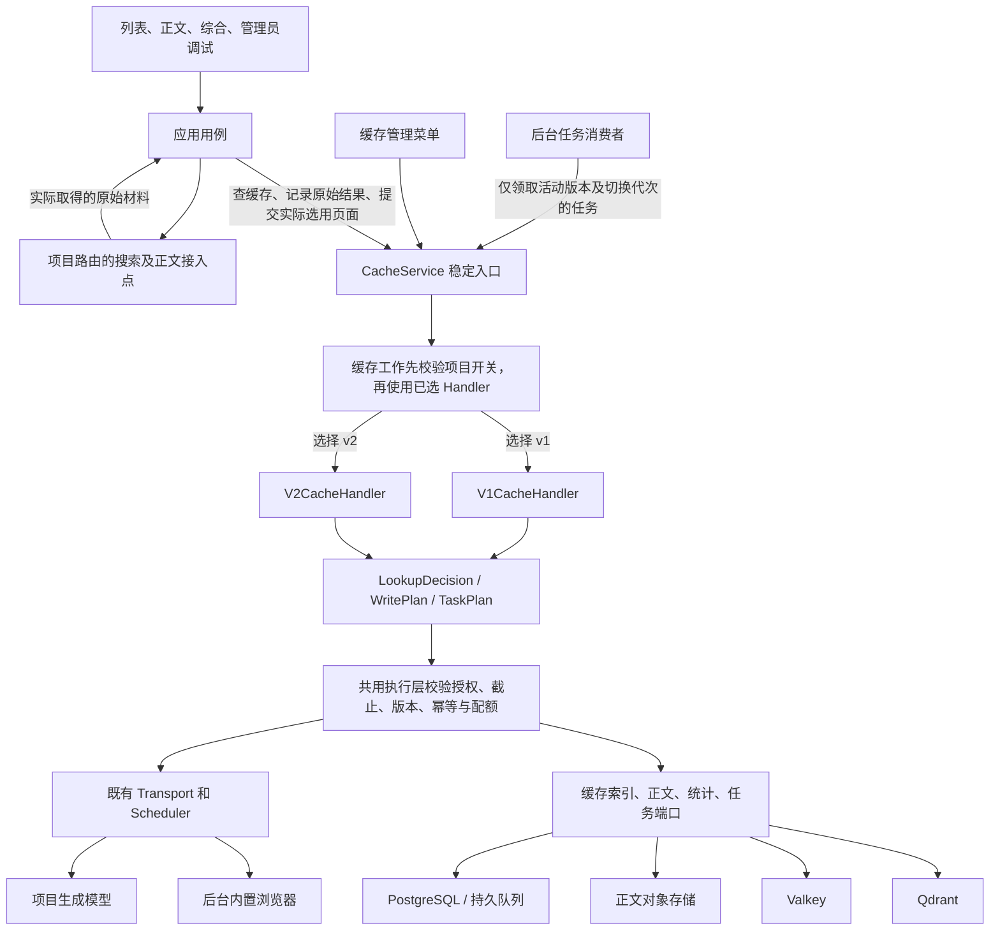
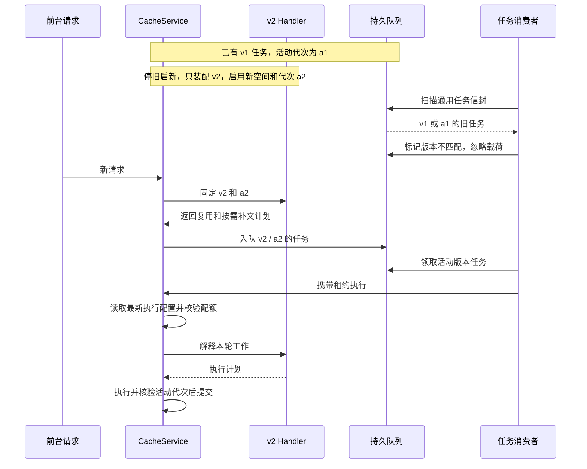

# 可替换的缓存 Handler

本章为 Plan 2 的模块设计。缓存通过稳定的 `CacheService` 接入应用用例，在内部装配 `Arc<dyn CacheHandler>`。v1 和 v2 实现同一策略契约，运行时只启用当前配置选中的实现。切换直接生效，不要求新 Handler 兼容旧任务或旧缓存。策略负责判断要复用、保存、补齐或刷新哪些材料，共用执行层负责校验与实际执行计划，存储通过独立端口接入。首版在 API 进程内实现，沿用仓库的依赖注入与单一调度所有者。[现有应用接口边界](../plan1/01-system.md)

## 架构与调用位置

`CacheHandler` 通过已绑定项目和可见范围的只读端口组织召回与匹配，返回类型化的决策和执行计划。共享层复核计划中的来源和对象，再完成写入、记票、任务派发及异常隔离。Handler 使用领域材料及真实采集结果，适配器负责厂商 JSON、SQL 行及对象地址。管理台读取共用读模型，调用相同的策略与调度配置入口。

`CacheService` 在项目缓存工作入口校验 `cache_enabled`。关闭项目直接继续应用用例的正常路由，缓存查询、取材入库、选中页补齐和到期刷新均不调用 Handler。管理读模型仍可展示保留库存、历史任务和清理状态。无项目管理员测试沿用已定义的独立测试范围。[项目开关及界面](README.md#project-cache-switch)

| 应用交接点 | Handler 契约中的责任 | 业务结果及执行边界 |
| --- | --- | --- |
| `select` | 根据原问、上下文与有效快照决定 2/1/0、精确降级或旁路，组织问题及网页匹配 | 交付来源与候选，保留当前 2 秒共享预算。未命中由应用继续项目路由 |
| `retention` | 接收实际列表或完整正文及当轮配置，返回拒绝准入或该材料的 TTL | 最终 Top K/Top N 截取前记录材料，保存来源。外部失败的后台补齐同样经过共享调度和访问约束 |
| `on_selected` | 根据实际返回 Top K、综合 Top N 或显式 URL 及已有正文，生成 `TaskPlan` | 仅给实际需要的页面补缺文或补摘要，未入选原始候选保持已有材料 |
| `on_expired` | 根据 TTL、两张热点榜及对象状态，生成刷新或退出复用的计划 | 单独判断列表及正文。列表续期只更新原始列表与随结果取得的已有材料 |
| `execute_job` | 仅解释当前活动版本及切换代次的任务载荷，决定本轮应完成的工作 | 共用执行层读取派发时的最新配置，授予浏览器/模型配额，校验租约与代次后执行并提交 |

应用继续拥有“列表取 Top K、综合按详情配置取 Top N 并总结”的用例流程。缓存 Handler 处理缓存选择、准入、时效和任务计划。实际选中的页面通过 `on_selected` 传入，执行层将本次请求派发的补文目标限制在该集合内，已有正文自身的热点续期独立执行。原始材料与选择事件的契约可独立用于前台命中、外部接入点结果和管理调试。

## v1 与 v2 的替换范围

| 部分 | v1 | v2 策略边界 |
| --- | --- | --- |
| 问题与候选策略 | 当前混合召回、2/1/0 复用、全量候选匹配 | 召回、合并、匹配阈值及程序化排序策略 |
| 时效策略 | 配置化的固定列表/正文 TTL | 页面类型、动态 TTL 等决策。分类模型执行仍由共享模型端口完成 |
| 热点与准入 | 累计及近期正分榜、普通列表门槛 | 热点资格、准入和刷新优先级的策略版本 |
| 原始材料与输出契约 | 查询原始榜单、规范 Article、页面版本及派生简介 | 业务输出通过稳定接口交付，内部材料可在新命名空间采用新格式，继续记录来源、时间及覆盖信息 |
| 共用执行层 | 鉴权、页面范围、2 秒缓存查询截止、任务寿命、幂等、采集先后、租约和配额 | 每个 Handler 的计划都经此层执行，正常业务总截止继续沿用现有列表/正文/综合约定 |
| 存储端口 | Qdrant、Valkey、正文对象存储和 PostgreSQL 适配器 | 更换某个存储实现时，面向稳定端口更新适配器并验证其一致性语义 |

V1CacheHandler 和 V2CacheHandler 在 handler_for 工厂登记。v2 持有应用侧 ReuseMatcher 端口，系统 HTTP 适配器连接常驻双语判断器。异步选择共用请求的剩余时间，最多发送一个授权范围内的八个短材料包。匹配器只返回分类、可复用得分和固定配置的阈值。共享服务负责精确降级、身份、统计和实际交付。推理期间发生的授权、快照或材料变化在选源后复查，旧判定只对应实际审阅的材料。两种策略使用相同的采集准入、固定 TTL、热榜和后台任务逻辑。切换 Handler 创建新的缓存空间和启用代次。[判断器协议与训练](06-verified-reuse.md)

## 启动装配与切换

使用启动配置 `OAS_CACHE_HANDLER=v1` 选择活动 Handler。选择材料复核策略时设为 `v2`，沿用当前单 API、单调度所有者的停旧启新部署。启动时验证所选实现、数据契约及所需端口，配置错误明确报告。`apps/server` 在组合根通过工厂创建所选 Handler、适配器和 `CacheService`，再注入应用引擎。当前架构不提供多 API 滚动接管或运行时热替换。

持久控制记录保存活动 `handler_version、cache_namespace、activation_id`。启动先取得既有数据库调度锁，再事务性读取或更新此绑定，之后才准入缓存工作和领取任务。每次切换 Handler 或不兼容格式都创建新命名空间并递增切换代次 `activation_id`。即使后来切回 v1，也使用新的代次和空间，旧 v1 待办不会因此恢复。相同 Handler、相同数据契约的普通进程重启沿用已保存的绑定，能够继续处理本版本的有效待办。

一次请求固定 Handler 实例、活动绑定、有效项目上下文与截止时间。之后的 `lookup、retention、on_selected` 使用同一份句柄。切换前按现有关闭流程有界收尾，活动代次变更后，旧请求及旧任务的迟到结果均不能再发布为可用缓存。实际交付材料仍按原请求记录保留。

消费者在解析策略载荷之前，只读取通用任务信封，核验活动 Handler、命名空间、切换代次及可支持的载荷版本。不匹配的待办直接忽略，不执行浏览器或模型工作，不消耗重试次数，不转换为新版本任务，也不阻止业务启动。忽略记录不占活动等待队列容量，管理台单列“版本不匹配”。记录仍受原绝对截止与清理规则约束，不能无限积压或在回退后自动复活。

项目开关由共用执行层独立管理。每次 `cache_enabled` 真正变化时递增 `project_cache_epoch`，仅修改项目名称、模型等其他配置不递增。请求及任务固定该项目开关代次，在入队、派发和发布前复核当前开启状态及代次。关闭项目的旧待办退出活动消费，重新开启也不复活，旧缓存作业的真实占用按下文清理。已有前台业务继续交付，缓存写入和补齐受最新门禁约束。开关切换保持当前 Handler 数据空间，已保存材料仍按原键、TTL 和权限判断可复用性。

切换使旧任务失去发布资格。旧浏览器作业仍按原 `job_id/owner` 取消并确认清理，确认结束或 Pod 消失前继续占用真实标签与代理名额。模型调用按本地取消及超时规则收尾，本地名额按调用生命周期释放，不承诺进程重启后恢复或确认取消远端模型作业。旧结果不可更新当前正文、索引或源站状态，已写入但未发布的对象按孤儿回收规则处理。后台重试、普通重启和需求合并均不重置三轮、三十分钟的预算。

## 版本与任务信封

| 版本 | 作用 | 切换影响 |
| --- | --- | --- |
| `handler_version` | 定义策略和任务语义 | 只启用一个版本，后台仅处理与活动版本匹配的任务 |
| `schema_version / cache_namespace` | 定义缓存内部格式及数据隔离范围 | 切换 Handler 使用新空间冷启动，旧空间退出召回、写入和热点扫描，随后按容量及回放保护规则回收 |
| `activation_id` | 标识本次启用，隔离旧待办及迟到结果 | 切换递增，切回旧 Handler 也创建新代次。普通重启不改变此值 |
| `project_cache_epoch` | 隔离同一项目关闭、重新开启前后的缓存工作 | 开关变化时递增，普通保存不改变。重新开启保留合法材料，但不恢复旧代次待办 |
| `embedding_version` | 定义系统向量空间、维度、距离和校准阈值 | 按[系统 embedding 换版](02-index-selection.md#embedding-version)准备新索引并切换。更换 Handler 不自动更换模型，新缓存空间按真实请求逐步建立索引 |

通用信封保存 `handler_version、payload_version、cache_namespace、activation_id、project_id、project_cache_epoch、task_kind、target`，以及对象代次、领取租约、首次入队时间、原绝对截止和尝试数。活动绑定、项目开关代次、目标及业务限定条件固定后不得借合并改写。只有同活动绑定、同项目开关代次、相同工作种类、目标、限定条件及所需对象代次的任务可合并，摘要任务还需匹配目标正文哈希或版本。跨版本或旧开关代次待办不吸收新需求。

发布校验分别检查项目缓存开关及其代次、活动代次、对象撤下/恢复代次和本轮领取租约，不能用含义模糊的单个 `expected_generation` 代替。有效完整正文仍按实际派发时间和采集序号比较新旧，不能只因读取时的正文版本后来变化就拒绝更新的合法采集。派生简介只绑定它实际读取的正文哈希和生成配置，旧正文的模型结果不能挂到新正文上。

当前命名空间内保存原始采集时间和 TTL 到期时刻，配置调整不延长已有材料。切换不改变逻辑问题 ID、累计引用及近期使用记录，这些轻量名册独立于缓存空间保存。保留的旧热度不会单独触发旧空间抓取。历史回放材料继续遵守原保留期及当前权限。

## 最新执行配置与恢复

后台入队固定原始查询、语言/地域/时间等业务限定、页面身份和工作目标。每轮实际派发前，读取当时最新的项目状态及缓存开关、生成模型、代理、出口、TTL 配置和额度，形成该轮执行快照并记录资源版本。重试下一轮重新读取，正在执行的一轮不混用两份配置，缓存关闭及访问资格变更仍在发布前再次校验。后台取材仍只使用内置浏览器，不因前台路由改动而使用外部接入点。

派发与发布均复核当前访问资格。项目禁用、撤权或地址禁用优先于已固定的执行快照。模型、提示词及输入策略变化后，简介按实际使用的配置版本保存。无模型或配置错误可停放等待，等待同样受原三十分钟绝对截止约束，到期终结，之后只能由新的有效需求建立任务。

每轮在调用外部能力前可靠登记派发身份、执行快照及租约，调用完成后按阶段提交材料和状态。相同 Handler 的普通重启先核对已发布材料，再按既有浏览器恢复流程确认旧调用清理，之后只恢复仍缺少的工作。不能把所有“执行中”任务直接重置为“等待”并重复派发。网络调用与持久化无法形成一个事务时，通过阶段检查点、条件提交及租约校验防止重复发布，清理真实占用仍受原机制约束。

## Rust 代码归属与验收

接口放在使用者一侧，沿用当前 Cargo workspace。代码归属如下。

| 位置 | 内容 |
| --- | --- |
| `crates/domain/src/cache.rs` | 查询/页面身份、快照版本、实际已取材料、选中页面与计划的纯数据类型 |
| `crates/application/src/cache/` | `CacheService`、Handler trait、v1 策略、活动版本工厂及计划执行。后续在此注册新的策略版本 |
| `crates/adapters/src/cache/` | 索引、计数、正文对象及任务持久化的实际适配器，复用现有 repository/Transport 能力 |
| `apps/server` | 装配已配置的适配器与 Handler，将服务注入业务引擎和管理接口 |
| 现有浏览器与模型调用 | 通过既有调度器取得真实容量、授权出口和租约，背景消费继续由同一调度所有者控制 |

开发验收用同一组应用接口用例检验各个 Handler，覆盖原始材料准入、实际选用页面的补文范围、权限撤销、超时与业务交付。项目开关测试覆盖默认关闭、关闭后正常业务仍交付、缓存读写与后台维护停止、重开旧任务不复活且仍有效材料可复用。切换测试验证只装配活动 Handler、新空间按需重建、旧待办不执行也不占活动等待容量、旧调用迟到不可发布、切回旧版本不复活旧任务。普通重启测试验证活动代次和任务预算不重置、旧租约先清理、阶段材料不重复获取。配置测试覆盖排队后更换模型/代理、派发使用最新配置、停放也会按原截止终结。存储更换还要验证条件更新、幂等和恢复。仅替换 Handler 的测试可以通过端口的可控实现完成。
