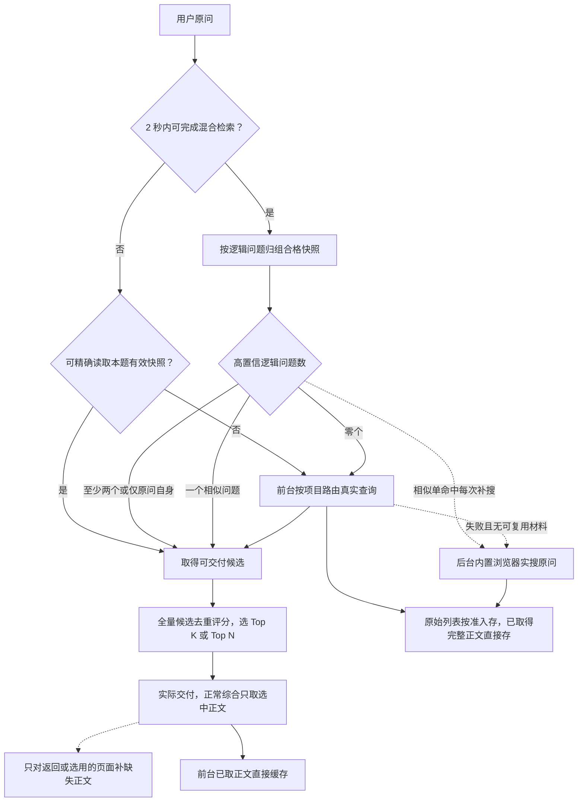
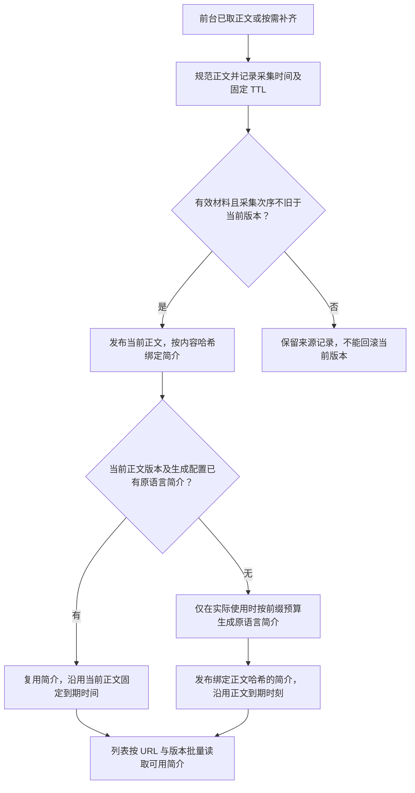

# Plan 2 搜索列表与正文缓存

本计划处于设计阶段，采用统一 embedding 和 Qdrant 复用历史问题。各接入点已取得的原始列表和完整正文直接缓存，原始候选仍完整保存。**额外补文仅针对本次实际返回或综合选用的页面**，列表取 Top K、综合取 Top N 后再确定缺项。未入选的原始候选不因这次请求主动抓正文。本期列表和正文分别使用可配置的固定 TTL，类型化 TTL 留作后续扩展，2/1/0 高置信命中规则继续沿用。

| 设计内容 | 入口 |
| --- | --- |
| 项目输出数量、原始列表缓存、全量候选评分及 DeepSeek 字段 | [数量与缓存边界](#counts) · [候选与排序](#ranking) · [列表项字段](#list-summary) |
| embedding 与降级、正文覆盖、原语言简介与当前固定 TTL | [检索降级](#degraded) · [正文更新](#current-version) · [简介预算](#page-summary-budget) · [固定 TTL 与后续扩展](#cache-ttl) |
| 累计榜、近期榜的分母、到期并集、手动调参与示例 | [双热点与刷新策略](01-hotness.md) |
| Qdrant 单节点与高可用部署、依赖清单、存储边界与压测 | [Qdrant 索引与部署](02-index-selection.md) |
| 独立管理菜单、缓存数量、命中率、任务消费、后台浏览器并发 | [缓存管理页面与调度](03-cache-console.md) |
| Handler 直接切换、旧任务忽略、最新执行配置、任务与数据隔离 | [可替换的缓存 Handler](04-cache-architecture.md) |
| 当前接口和执行边界 | [业务接口](../plan1/02-business-api.md) · [搜索流水线](../plan1/03-search-pipeline.md) · [存储与历史保留](../plan1/05-control-and-storage.md) |

## 缓存来源与调用入口

Rust 负责写入 Qdrant、正文对象存储和任务状态。内置 Firefox 与项目配置的外部搜索/正文接入点**已经取得的有效结果直接复用**，保留接入点、服务商、查询、时间与完整度。已取得的列表无需另发一次浏览器查询来制造缓存副本。完整正文经统一 Article/Markdown 规范化后可直接缓存。查询简介、节选及覆盖未知分别标记，不能冒充完整页级正文。[现有原生适配器](../plan1/04-routing-and-providers.md#native-providers)

| 实际请求 | 前台交付 | 缓存与补齐 |
| --- | --- | --- |
| 列表检索 | 对全部实际查询结果去重评分，按有效 `count` 和项目上限返回 Top K | 各查询原始列表按准入存储。仅对本次返回的 Top K 页面补缺失/到期正文，未返回候选只保留已取得材料 |
| 正常综合总结 | 评分后按有效 `source_count` 选 Top N，前台路由取这 N 个正文并总结 | 原始列表及已有完整正文直接缓存。正文补齐范围仅为本次选用的 Top N，其余候选不主动取文 |
| 直接按列表总结 | 同样取详情配置的 Top N，以所选标题和简介完成 `summary_snippets_only` 总结 | 缓存原始榜单，仅对实际选中的 Top N 页面异步补缺文。后台正文不改变本次简介模式的证据 |
| 单 URL 正文读取 | 命中则读已有版本，否则按项目前台路由实际取得正文 | 内置浏览器或外部正文接入点取得的完整有效正文均直接缓存，`max_chars` 只作用于本次交付 |
| 外部失败且没有可缓存材料 | 当次维持原错误、截止和已有部分材料语义 | 沿用既定失败补齐策略，由后台内置浏览器查原问或读 URL。目标拒访、地址禁用与撤权按[源站状态](#origin-status)停止访问 |
| 单命中后台列表补搜、定时列表续期 | 已交付请求无需等待 | 更新原始查询列表并复用随附材料。仅发布一份后台新榜不触发其中新 URL 的正文预取；正文自身的热点到期刷新继续按既定策略执行 |

后台取材在每轮派发前读取最新项目、模型、代理、出口、TTL 与并发配置，记录本轮执行版本，原始查询限定及页面目标保持不变。前台已经取得同范围同版本材料时，待办领取前复查复用，避免再次抓取。[后台队列与模型优先级](03-cache-console.md)

缓存通过稳定 `CacheService` 装配当前唯一活动的 Handler。v1 切到 v2 直接启用新缓存空间，不要求兼容或执行 v1 任务。旧空间退出命中及热点扫描，旧任务不解析、不执行、不参与新队列去重或容量；真实浏览器作业仍须按原身份清理。版本不支持不影响正常业务启动，切回旧 Handler 也创建新的启用代次，不复活历史待办。逻辑名册和两张热榜独立保留，新缓存由真实需求逐步建立。[Handler 与任务边界](04-cache-architecture.md)

业务、综合原问及实际执行的改写、管理员调试/测试均参与所属范围的名册与真实引用。指定端点测试仍实际访问被测端点，其合格结果也可入缓存。强制直连的这次测试不计缓存命中率。无项目管理员资源测试使用独立范围。仅计划、重复或丢弃的改写和普通健康探测不额外登记。[名册与计数](01-hotness.md)

每个真实查询有独立判定 ID。外层请求多个变体复用同一源问题，热度至多加一次。缓存按每个真实查询存其原始榜单。本次多查询合并评分后的最终响应存入请求记录。

## 请求路径

同一项目可见范围内，`question_id` 标识规范化后的原问及影响答案的业务条件，包括语言、时间、地域和显式来源或站点限制。`snapshot_id` 标识一次真实搜索取得的版本，记录所属问题、实际引擎、接入点、出口、采集深度、实搜时间和结果状态。同一原问先后由 Google、百度实搜，仍是一个问题 ID、一份热度。同一问题进入全量统计名册后，只有通过[快照准入](#admission)的实搜结果才能供缓存读取。

查询经鉴权后使用系统统一的多语言 embedding 模型和问题倒排索引并行召回。新问法通常只编码一次。每份快照独立校验授权、时效、地域、显式来源限制及可交付材料，然后按逻辑问题 ID 归组。**同题快照按机会积累**。业务实搜、管理员实测、补搜或刷新恰好从另一内置引擎取得的有效快照可以共存。一次成功作业即可完成，不为凑齐第二份快照额外启动另一引擎。Google 故障后的百度切换沿用现有调度。问题级置信度决定选哪些逻辑问题，候选网页的得分由该页自身的材料计算。[系统模型及索引换版](02-index-selection.md#embedding-version) · [内置引擎选择](../plan1/07-browser-proxies.md#dispatch)

“今天、明天”的自然语言缓存首版直接按 TTL 到期，不因跨午夜强制清除、创建次日问题或转移热度。已启用问题改写的入口按实际检索文本登记，若“今天”被改写成具体日期，另一日期的文本自然形成不同的逻辑问题。日期条件不兼容时即使相似度高也不跨用。未改写的普通列表继续按原文和 TTL 处理。调用方显式传入的 `time_range` 仍按业务契约的滚动窗口检验。[时间筛选](../plan1/02-business-api.md)

| 不同的高置信问题数 | 本次交付 | 被引用的问题 | 对当前用户原问的动作 |
| --- | --- | --- | --- |
| 至少 2 个 | 从两个高置信源问题 A、B 的有效快照中取全候选，去重评分并按用途交付 | A、B **各 +1** | 直接复用选中来源，接入点真实取得的结果均可成为缓存快照 |
| 1 个，恰为当前原问且快照仍有效 | 对本题全部候选评分，可附匹配的引擎 AI 回答 | A **+1** | 免补搜，按自身 TTL 到期。项目的最终返回数量不改变这份缓存的采集范围 |
| 1 个，属于相似问法 | 先对 A 的全部候选评分交付 | A **+1** | 每次提交当前原问的后台内置实搜，同目标在途可合并。准入按实际采集结果判断 |
| 0 个 | 等待项目路由，合并实际查询结果后按用途评分交付 | 本次没有旧问题获得引用 | 已取得的列表和正文直接缓存，只补缺失材料。外部失败时沿用既定失败补齐 |

### 检索故障时的交付

- 缓存路径先暂定 **2 秒总预算**，包含 embedding、混合召回、元数据读取及程序化列表评分，所有阶段共用截止时间，可在该预算内进行精确降级读取。到点后按故障路径给项目实搜让路，仍受原业务总截止约束。Qdrant 可按稳定 `question_id` 读取时，允许同项目、同条件、同授权及新鲜度的原问**降级精确命中**。最终需要展示几条不改变原始快照的采集范围。
- 没有合格精确快照或 Qdrant 整体不可读时，走**检索故障旁路**，在原请求剩余预算内按项目路由执行。首版不依靠单路 BM25 或单路向量给近义命中资格。实际取得的材料按正常来源直接缓存。外部失败时可独立提交内置补齐。
- 这两类判定分别记录原因和活动模型版本，单列于管理台。正常双路工作时才记录常规 2/1/0。故障旁路不冒充业务零命中。[指标口径](03-cache-console.md#lookup-metrics)

### 浏览器地址、页面身份与源站状态

Plan 1 的列表规范化会删除 fragment。Plan 2 从内置 Google/百度结果抽取起保存完整目标链接，在列表、正文和热榜中按以下边界取键。[当前规范化约定](../plan1/03-search-pipeline.md#list)

| 用途 | 规则 | 示例 |
| --- | --- | --- |
| 导航与展示 | 保存完整原始 href 和浏览器确认的最终 URL，包括 fragment。沿用协议、主机、敏感凭据与重定向访问校验 | 取正文时实际导航到 `/docs/#/install` |
| 页面身份 | 保留路径、有效查询参数和会改变渲染内容的片段。`#/…`、`#!/…` 是独立路由。已确认只改变页内定位的锚点可合并，未确认的片段先保留，列表无须为此阻塞取页 | `/docs/#/install` 与 `/docs/#/upgrade` 有两个页面键。同一手册的 `#section` 确认为页内锚点时共用正文 |
| HTTP 主文档身份 | 按实际请求/重定向后的无片段网络地址与访问范围记录 HTTP 状态和验证器，再关联依赖它的渲染页面 | 两个路由都可能加载 `/docs/`。壳页面的 200 或 304 本身不足以证明两个渲染正文相同或未变 |

列表候选去重、`url_id`、取文任务合并、页级简介和路由级撤下都使用相应的页面身份及授权/表示范围。不同页面最终生成的规范正文哈希完全相同时，可共享物理内容，各自保留页面身份和引用记录。

### 项目输出数量与缓存边界

项目的“列表最多返回几条”和“详情/综合选几篇”控制**评分后的结果**。例如项目设列表 10、详情 2，本次实际执行 3 个查询，每个取得 10 条，处理如下。

| 阶段 | 数量与行为 |
| --- | --- |
| 原始取得 | Q1、Q2、Q3 各有 10 条原始结果。保留来源、原排名和完整度，各查询分别按准入缓存 |
| 候选合并 | 全部实际取得或从缓存读取的候选按页面键去重评分，至多 30 个不同页面 |
| 列表请求 | 按有效 `count` 及项目列表上限取最高分前 10 条 |
| 正常综合 | 按有效 `source_count` 和详情配置取最高分 2 个相关来源，前台取这 2 个正文并总结 |
| 直接列表总结 | 仍按详情配置只取最高分 2 个相关来源，用标题和简介总结。希望用 10 个来源时需把有效详情数量设为 10 |
| 后台正文 | 30 个不同候选中，列表实际返回 10 个且均缺正文时最多补这 10 个。正常综合只选 2 个且前台正文均成功时，没有额外补文；简介总结选 2 个且均缺正文时最多补这 2 个。未入选页面只保留已有材料 |

例中 10 和 2 是该项目的实际配置，并非新增的系统默认值。`count`、`source_count`、`max_chars` 各控制对应的最终交付和取材。本次实际执行哪些查询由查询规划决定。内置浏览器每次查询实际获得的原始条目及独立采集策略决定该快照内容。

每份快照保存全部实际条目，定时刷新仍使用原始采集策略。详情 2 不会把列表采集量降为 2。**原始缓存范围与主动补文范围独立**：先完整保存已有材料，再从本次 Top K/Top N 中确定需要补齐的正文。两个高置信问题的匹配与引用继续按既有 2/1/0 执行。

### 先取全量候选，再按用途取 Top K

1. 沿用 2/1/0 问题命中规则。每个已选问题从当前权限、条件和时效都相容的快照中至多选两份不同的 `snapshot_id`（多于两份时按实搜时间及稳定 ID 决胜），读取其中的**全部**自然链接。按[页面身份](#page-identity)归组，组内保留每次实际命中的标题、短简介、原排名、来源和快照时间。入组顺序不决定代表材料。
2. **公开 `/list`** 对同一页的各份来源材料分别打分。每份标题和短简介成套与当前问题匹配，可使用同一页面表示下可交付的页级简介作为辅助信号。同一页面取最高分来源的完整 href、标题和短简介成套对外展示。组内平分时优先较新的有效快照，再按原排名及稳定快照 ID 决胜。保留其余命中供追踪，重复出现不累加网页分。页面之间按代表材料的分数排序，平分按原排名和稳定页面键决胜。只用程序化向量/词项特征及已有材料，无需逐页调用生成模型。[网页评分特征](02-index-selection.md#embedding-version)
3. 公开列表只排序，不设独立的网页最低相关分。通过硬条件的有效网页够 10 条且本次有效 `count=10` 时，即使只有 2 条高度相关也返回 **10 条**。其他请求按有效 `count`（最多 10，省略取项目值）截取，候选确实不足就按实际数返回。弱相关分本身不会改变问题的 2/1/0 分支或触发额外实搜。
4. **综合 `/summary`** 为实际执行的原问和各改写变体取得全部候选，按页面身份跨变体汇总，保留成套材料和来源，围绕原始用户问题评分。按有效 `source_count`（调用方指定或项目默认，遵守 `source_limit`）取前 N 个**相关**来源再总结。若只有 2 个相关来源、请求 5 个，则用这 2 个完成回答。公开列表的 Top 10 不截断该输入，`summary_snippets_only` 的证据继续使用其既定标题与短简介。[综合评分与取材](../plan1/03-search-pipeline.md#selection)
5. 入选的不同源问题各记一次引用，同题两份快照仍只给该问题记一次。追踪另存最终入选的 URL、评分、名次、快照 ID 及归属。合格 `partial` 可参与评分，按实际采用的材料传递状态与告警。
6. **纯 AI 原问与另一来源。** 原问 A 的 `engine_answer` 可交付且没有自然链接时，A 提供 AI 回答，B 的全部自然链接去重评分后可占本次全部链接位（最多 10 个）。引擎 AI 的引用只按原契约呈现，不伪造为自然链接。A、B 各 +1。

同一原问有多份合格 `engine_answer` 时，选择最近实际搜索、完成标记和引用均合法、权限与时效匹配的一整份。回答文本、引擎和来源引用配套交付，时间相同按稳定快照 ID 决胜。其他回答留在管理追踪中，同一问题的热度仍只加一次。

- **快照时钟。** 普通列表先试 30 分钟 TTL，以生成本版合格结果的实际搜索时间计。内置和外部接入点都由服务端记录本轮实际派发时刻 `collected_at` 及同时间的采集序号。排队时刻和缓存访问不续期，新的真实搜索可以形成新一轮采集。供应商另给的网页抓取时间留作追踪，普通覆盖仍按本地实际采集次序执行。[热点判定](01-hotness.md)
- **补搜与在途合并。** 原问自命中免补搜，异题单命中每次提交后台实搜需求，实际相同在途作业可合并。独立任务执行结束后未准入，下次真实请求仍可再次提交。历史未准入不产生请求级冷却。后台任务自身的重试和寿命见[任务生命周期](03-cache-console.md#task-lifetime)。

例如 A、B 各有 10 条有效链接且互不重复，A 的原第 6 名在当前问题的评分中排第 1，则它排在公开列表首条。若前十全来自 B，直接返回这十条，A、B 的问题引用仍各 +1。综合场景可对这 20 个候选继续评分，例如有效 `source_count=3` 时只让排名最高的三个相关来源进入总结。同一逻辑问题的两份快照也取全量链接去重后评分，热度只加一次。

若 A 对同一本手册的短简介强调安装，B 的短简介强调卸载，用户问卸载且 B 得分更高，就显示 B 的原链接、标题和短简介。这一页只占一个名次，两份来源证据均保留。

## 真实搜索快照的准入与复用

准入使用各接入点**实际取得的原始列表**。字段、URL 及[页面身份](#page-identity)校验去重后，普通列表至少 **5 个有效不同页面**可入库。已完成并通过引用校验的 `engine_answer` 仍享有数量例外。准入发生在最终输出截取之前。

| 原始采集情况 | 缓存规则 |
| --- | --- |
| 实际仅 1 条普通链接，没有已完成引擎 AI 回答 | 普通列表不入库，只服务本次 |
| 原始去重后有 5 条及以上，用户最终只展示 1 条 | 原始列表照常入库，最终展示条数不改变准入 |
| 原始去重后仅 0–4 条普通链接 | 不写普通列表快照，已有版本不因此续期。单个完整正文仍可独立缓存 |
| 原始列表满足门槛，状态为 `success` 或 `partial` | 均可入库，复用时传递实际采用材料的状态与警告 |
| 有已完成的 `engine_answer` | 不足五条或只有 AI 回答可入库。回答只在原问、时效和授权相容时交付 |

每份快照记录实际查询、原始采集参数、有效条目数、来源、时间、覆盖和 `warnings`，多份快照独立计时。项目最终返回数不参与快照身份或有效性判断。正文简介、DeepSeek 的单条 `summary` 和普通卡片都不触发整体引擎 AI 回答的数量例外。

### 列表项的 `summary`

拟议业务契约在 `items[]` 增加字符串字段 **`summary`**，保留人读的 `snippet`。已有非空长简介时直接随该项返回，尚未取得时省略该字段并立即交付列表。源站撤下或已知拒访时遵从下文交付范围。`data.engine_answer` 仍是引擎针对原问的整体回答，综合接口的 `data.summary` 仍是跨来源总结。

| 本次结果来源 | `items[].snippet` | `items[].summary` |
| --- | --- | --- |
| 项目路由前台使用 DeepSeek（DS）或复用其缓存条目 | `results[].snippet` | 直接使用非空 `results[].summary`，随原始来源条目存储和返回。相似问题通过既有命中规则后也可复用，无需要求查询文本逐字一致，不另加意图复核或模型调用 |
| 内置浏览器或其他缺少原生长简介的来源 | 本问得分最高的那一套材料的短简介 | 同一页面表示有当前正文版本的原语言页级简介时直接使用。否则省略该字段。已有材料正常交付，后续按页级摘要规则补齐 |

例如同一条可返回 `{"url":"https://example.org/releases","title":"发行说明","snippet":"查看各版本变化。","summary":"按版本列出变更、兼容条件和迁移步骤。"}`。原生长简介随当前选中来源的条目复用，管理追踪保留它原先的查询和取得时间。既有问题级置信度、权限、地域、时间及显式限定条件决定能否选源，通过后的长简介不再增加独立的意图门槛。`ai_summary` 是页级派生记录，公开列表统一用 `summary`。两种长简介都不触发整体引擎 AI 回答的数量例外。[DeepSeek 原生字段](https://api-docs.deepseek.com/zh-cn/api/search/)

## 正文缓存

**仅为当前实际返回或选用的页面补齐正文。** 先对全部原始候选去重评分，再形成该请求的补文集合。列表是实际返回的 Top K，综合是实际选用的 Top N，单 URL 读取是用户指定的页面。只有集合内缺少有效完整正文、正文到期、仅有节选或覆盖未知的页面进入补文队列。已存在合格正文直接复用。

原始列表和接入点已经随附的完整正文仍可直接保存，不丢弃已取得材料。未入选的原始候选不因本次响应额外抓页或生成页级简介；以后真正进入另一请求的返回/选材集合时，再按需补齐。异步列表补搜及定时列表刷新只更新榜单及已有材料，不为新榜全部链接预取正文。已有正文对象自身的热点续期仍沿用两榜策略。

适配器区分完整正文、查询相关节选及覆盖未知。有效完整正文统一为 Article/Markdown 后存版本。实际返回/选用页面只有节选、覆盖未知或无正文时，才以该页面身份排后台 `browser_reader`。已取得的完整材料直接缓存，`max_chars` 只控制本次交付渲染。[正文渲染](../plan1/03-search-pipeline.md#read)

正常综合先为 Top N 登记前台取文在途身份，原始候选的其余页面不发布取文任务。前台成功的正文直接缓存；选中页面失败后，仅在仍有有效需求且授权允许时交给后台补齐。列表和简介总结在最终集合形成后才提交各自缺文任务。领取时再复查完整正文及在途读取，避免重复抓取。30 个候选、详情选 2 个且前台均成功时，额外补文为 **0**。

### 新采集覆盖当前正文

在活动缓存空间、启用代次、对象访问资格和执行租约均有效的前提下，相同项目、页面身份及实际表示的**最新一次搜索或读页取得的有效完整正文直接覆盖旧的当前版本**。前台外部接入点、集成来源和浏览器适用同一规则。`collected_at` 使用该轮实际派发时刻，同时间用服务端采集序号决胜。较早采集的任务即使较晚完成也不能回滚新版本，切换前的旧任务也不能发布到新空间或修改当前源站状态。有效新材料不因供应商可能自行缓存、缺少源站核验时间而退回采用旧正文，也不为普通覆盖再发一次浏览器验证。

例如 10:00 浏览器取得“服务已恢复”，10:02 外部接入点的新采集返回完整“服务中断”，后者通过当前权限、页面和完整度校验后直接成为当前正文。真实来源、时间及内容哈希供追踪，普通覆盖不比较两份材料的事实结论。

正文哈希变化时发布新版本，旧页级简介停止对新版本交付，实际需要该页时按新正文生成原语言简介。未生成时可先交付原始搜索短简介。哈希未变且生成配置相容则复用简介，正文到期按本轮有效采集时间加固定 TTL 计算。已有删除、拒访、撤权及地址禁用约束继续执行。[源站状态](#origin-status)

### 网页原语言与超长正文

项目生成模型读取任意合规来源的已缓存规范正文，按**网页主文原语言**生成 `ai_summary`。英文页给英文简介、中文页给中文简介，混合页依主要用语。模型输出本期只要求简介；AI 额外输出页面类型并映射 TTL 是后续可扩展能力。DeepSeek 原生长简介继续随语义命中的来源条目复用。[字段映射](#list-summary)

| 拟议环境变量 | 初始值与单位 | 生效范围 |
| --- | --- | --- |
| `OAS_CACHE_SUMMARY_MAX_INPUT_TOKENS` | **8192**，正整数，按该项目**生成模型**的 tokenizer 计 | 后台页级简介使用的规范 Markdown 正文前缀 token 上限。未设置取 8192，可在 API/摘要任务执行进程的环境中覆盖，Helm 可用 `api.extraEnv` 传入。[现有环境变量注入](../plan1/12-oasctl-and-helm.md) |

先为系统提示、标题、聊天模板和输出预留空间，再计算模型单次输入上限与上下文窗口允许的正文余量。实际正文预算取该余量与环境值的较小者。短文读全文，超长文只取从正文开头起可完整解码的最长合规前缀，按最终请求再次预检。例如设置 `OAS_CACHE_SUMMARY_MAX_INPUT_TOKENS=4096` 后，正文最多取开头 4,096 个 token。采用默认 8,192 时，若模型实际仅能容纳 4,000 个正文 token，就只读开头 4,000 个以内。没有可用正文预算时保留正文并按既有缺简介语义交付。常规一次生成，超长页也不另选中段、尾段或分批合成。每篇简介常规目标 200–400 token，输出硬上限仍为 1,000 token。

完整 Markdown 存储、正文哈希与 `/content` 的 `max_chars` 独立于摘要输入预算。派生记录保留正文版本、语言、模型/提示词和输入策略版本、实际 token 数与全文/前缀覆盖，每轮使用派发时最新的有效生成配置。模型配置变化或简介缺失时，仅在本页实际返回、读页或被综合采用时单飞补做，已有正文不重抓。无模型或明确配置错误时可停放等待，等待也受原绝对截止约束，默认三十分钟到期终结。临时失败沿用 3 轮/30 分钟预算，重试下一轮重新读取配置。生成简介不重置正文新鲜度。

### 当前固定 TTL 与后续类型化扩展

本期列表与正文分别使用固定、可配置的 TTL。建议初值沿用列表 **30 分钟**，正文 **6 小时**。到期均从本轮实际采集时间起算；缓存读取、评分、模型摘要和排队不续期。正文的 6 小时先用作统一初值，部署可调整。

| 拟议环境变量 | 建议初值 | 作用 |
| --- | --- | --- |
| `OAS_CACHE_LIST_TTL_SECS` | 1800 秒 | 原始查询列表的固定复用时限 |
| `OAS_CACHE_CONTENT_TTL_SECS` | 21600 秒 | 规范正文的固定复用时限，页级简介随所属正文有效性读取 |

两项均要求正整数，未设置采用建议初值；修改影响后续真实采集，存量版本保留原定到期时刻。热点比例继续决定到期时是否主动刷新。后续可以让正文摘要模型额外输出类型，再将类型映射到不同 TTL，届时补充分类、映射配置与验收。本期继续使用既定高置信命中策略，不为这项后续扩展增加当前匹配门槛。

### 失败补缓存与源站状态

前台通过外部服务失败也产生一次独立的内置浏览器补齐需求。前台保留自己的错误与截止时间，后台按同目标合并、队列容量、授权和浏览器并发约束执行。区分“服务商接口返回的状态”和“目标网页主文档返回的状态”。服务商自身的凭据失效、限流或提取失败不是目标网页已删除的证据。保留错误归属、可确认的源站 HTTP 状态、最终 URL、授权/表示范围和观测时间。[现有取文与访问约束](../plan1/03-search-pipeline.md#read)

| 已确认的情况 | 缓存与后续动作 |
| --- | --- |
| 源站主文档 `410 Gone` | 按真实无片段主文档及授权范围撤下依赖该消失资源的正文和派生简介，列表重新组装时由下一候选补位。仅在某个 SPA 路由上确认的删除只影响该页面表示。壳返回 200 但前端报告未找到时，另记路由观测，不伪造网络 410。快照无材料后退出选源，迟到任务不能复活被撤版本 |
| 首次源站 `404` | 标记待短期复验，到期不续旧 TTL。另一次有效复验仍确认消失时按删除处理，重新取得合法内容时按新代次解除待复验状态 |
| 目标明确拒访（含已确认的源站 `401/403`）、地址禁用或项目撤权 | 立即阻止该授权范围对旧正文及派生简介的交付和新取材。地址本身被禁用或项目失去来源授权时，链接也从该范围的返回中剔除。在入队、派发和缓存读取时分别核验。外部失败触发的补齐任务同样遵守这一限制 |
| 源站 `429`、`5xx` 或暂时网络错误 | 保留原因，遵守源站给出的重试间隔并有限退避。到期旧版本停止交付，这类失败不会给 URL 标记永久删除 |
| 外部服务商失败且未证实目标拒访/删除 | 维持前台实际响应。没有取得可复用材料时按既定失败补齐由后台调用内置浏览器。已成功取得的列表和正文直接缓存，无需为它们另追加同内容的浏览器采集 |

**确认删除后的恢复。** 新的显式读页请求或后续独立检索新发现已删除 URL，可触发一次合并的内置浏览器验证。仅当当前授权允许、浏览器成功取得合法新正文后，以新的恢复代次解除相应删除标记。旧列表定时任务和删除前的迟到作业不能复活旧版本。撤权或明确拒访仍需先恢复访问资格。源站撤下与[容量提前淘汰](02-index-selection.md#eviction)分别处理，后者可按后续真实需求重建。

## 与现有架构的衔接及验收

前台查询和取文继续按项目路由执行。Plan 2 在接入点返回有效原始材料后缓存，再作项目最终输出/来源数量的截取。来源记录实际 `call_id` 或缓存 `lookup_id/snapshot_id`，前台与后台消费分别计量。已有结果及实际来源直接复用，统计故障允许少计并优先交付。[缓存管理](03-cache-console.md)

落实列表项 `summary` 时同步更新业务 OpenAPI、DeepSeek 服务商适配、管理调试与前端类型。后台队列淘汰、源站不可用和存储水位在管理端独立展示。历史回放按原请求权限和保留期读取当时的材料及其来源，缓存名册的累计引用具有独立生命周期。

| 验证层 | 开发阶段要证明的行为 |
| --- | --- |
| 单元测试 | 同题快照、2/1/0、纯 AI 例外及 `partial`。3 个实际查询各 10 条时原始缓存分别完整，列表取 Top 10，正常综合和简介模式按有效详情 2 取 Top 2。最终展示 1 条不妨碍合格原始榜缓存。其余 hash 路由、成套材料择优和热点/TTL 保留 |
| 来源复用测试 | 原始 30 条和接入点随附完整正文可直接缓存。列表返回 10 个且均缺正文时仅补 10 个；正常综合选 2 个且正文成功时额外补 0 个；简介总结选 2 个且缺正文时仅补 2 个。未入选页面没有主动取文/摘要任务，DS 原生长简介照常复用 |
| 集成测试 | 原问有效快照免补搜，异题单命中每次提交并合并在途。统一 embedding 不混版，缓存全路径 2 秒共享截止，降级精确与故障旁路单列。最终 `count/source_count` 不改变快照身份，不制造因“采集深度不足”的补搜 |
| 调度与存储集成测试 | 活动空间中新采集的外部完整正文覆盖较早的浏览器正文，较早采集的任务迟到不回滚。新旧正文简介按哈希绑定。现有材料不重复取，临时失败按 3 轮/30 分钟和模型前台优先处理。验证 Handler 切换隔离、旧待办不执行、普通重启预算不重置、最新配置派发和旧租约清理。队满、容量回收、删除恢复与统计故障均可追踪 |
| E2E | 3 个查询各 10 条仍保存原始快照，评分后按真实返回/选材范围排补文。后台列表续期不预取新榜全部正文，已有正文热点续期可执行。验证固定列表/正文 TTL、环境配置覆盖和摘要完成不延长 TTL。页级模型本期只需输出简介 |
| 已定行为回归 | 2/1/0、引擎 AI 准入例外、原始五条门槛、`partial`、热榜百分比 0 归一为 1%、队满淘汰和并发最低 1。定时列表只更新原始榜单及已有材料，真实请求选用页面才触发按需补文 |
| 容量与故障 | 用真实分布样本比较第二条漏召回、错判双命中、冷/热盘 P95/P99、节点丢失与快照恢复后的一致性。方法见[Qdrant 容量与验收](02-index-selection.md#validation) |
