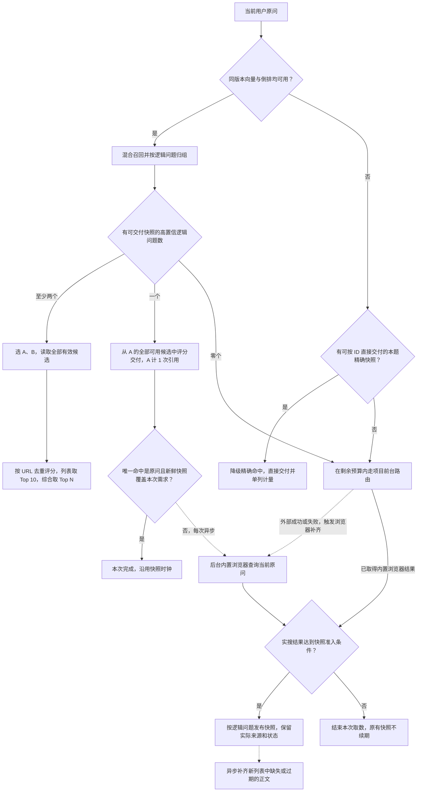
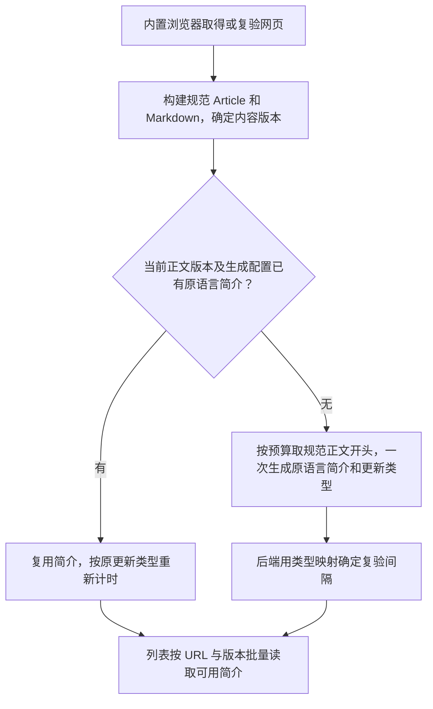

# Plan 2 搜索列表与正文缓存

本计划处于设计阶段，已选用 Qdrant 承载 SSD/NVMe 上的历史问题索引。列表与综合都从已选缓存中取全量候选，按规范 URL 去重、评分。公开列表按有效 `count` 返回前 10 条以内，综合按有效 `source_count` 选前 N 个相关来源进行总结。前台零命中按项目路由交付，外部接入点成功或失败都触发内置 Firefox 补缓存。列表和正文缓存只接受内置浏览器实际取得的材料。

| 设计内容 | 入口 |
| --- | --- |
| 浏览器页面身份、去重与网页评分、DeepSeek 字段映射 | [页面与路由键](#page-identity) · [候选与排序](#ranking) · [列表项字段](#list-summary) |
| embedding 配置及故障时的交付、后台页级简介的语言与输入预算 | [检索降级](#degraded) · [原文语言与长度配置](#page-summary-budget) |
| 累计榜、近期榜的分母、到期并集、手动调参与示例 | [双热点与刷新策略](01-hotness.md) |
| Qdrant 单节点与高可用部署、依赖清单、存储边界与压测 | [Qdrant 索引与部署](02-index-selection.md) |
| 独立管理菜单、缓存数量、命中率、任务消费、后台浏览器并发 | [缓存管理页面与调度](03-cache-console.md) |
| 当前接口和执行边界 | [业务接口](../plan1/02-business-api.md) · [搜索流水线](../plan1/03-search-pipeline.md) · [存储与历史保留](../plan1/05-control-and-storage.md) |

## 缓存来源与调用入口

Rust 负责读写 Qdrant、对象存储和任务状态。用于列表快照的搜索结果只能来自系统的 `browser_search`，用于页级正文缓存的网页材料只能来自内置浏览器，按 URL 补取或复验使用 `browser_reader`。实际使用的 Google、百度、出口与作业 ID 都随版本保存。缓存任务定向调用这两项内置能力，即使项目前台池只配置外部接入点也走独立的浏览器补齐路径。派发仍复核项目授权、出口、代理和容量，浏览器不可用时等待或按原因结束，不能改用外部接入点写缓存。[内置浏览器能力与出口](../plan1/04-routing-and-providers.md#routing)

| 路径 | 前台交付 | 缓存生产 |
| --- | --- | --- |
| 命中已有列表或正文 | 从存储读可交付的浏览器快照。按下文规则决定是否补搜 | 纯读不占浏览器标签。需要另行补齐时只调内置浏览器 |
| 零命中，项目路由实际使用内置浏览器 | 等待这次项目实搜或读页，按原状态返回 | 复用同一次浏览器作业的合格结果，直接走准入或正文版本判断 |
| 零命中，项目路由实际使用外部接入点 | 当次按项目路由返回实际成功、部分成功、合法空或错误。用户无需等待后台补齐 | 即使外部超时、限流、凭据错误或服务端故障，也独立提交同原问的 `browser_search` 或同 URL 的 `browser_reader`。调度器按当前授权复核，已确认的目标拒访、地址禁用或撤权按[源站状态规则](#origin-status)停止访问 |
| 定时热点续期、单命中补搜、新榜补文 | 已接收结果的用户无需等待 | 使用内置浏览器队列。Qdrant 检索、embedding 计算和基于浏览器正文生成 AI 简介属于独立的存储或模型阶段 |

问题全量名册和访问统计包含以下入口，并保留来源，供管理页分别筛选。

- **业务列表与综合总结。** 登记业务原问。综合操作也登记实际执行检索的原始查询和改写变体，进入相同的列表缓存判定。正文实际取用进入正文使用统计。仅计划、重复或被丢弃的改写不额外登记。仍按综合操作的证据、评分和 `summary_snippets_only` 约定形成回答。[综合检索与改写](../plan1/03-search-pipeline.md#selection)
- **管理员调试与测试。** 管理员发起的列表、正文和综合调试同样参与缓存、名册及真实引用计数。指定接入点的能力测试必须调用被测端点，测试中实际使用的搜索问题计入名册。绕过缓存的这次探测在页面列为“未执行缓存判定”。外部端点的测试回执只供测试，补缓存另走内置浏览器。项目级测试归入该项目，全局资源测试以独立的管理员测试范围展示。单纯健康、代理或模型探测没有搜索问题或正文对象。
- **计量单位。** 同一文本在同一业务条件下只登记一个逻辑 ID。每个实际执行的列表查询有独立判定 ID。同一外层请求即便多个变体复用同一个源问题，该源的热度仍最多加一次。系统定时刷新与任务重试单列为后台消费。

## 请求路径

同一项目可见范围内，`question_id` 标识规范化后的原问及影响答案的业务条件，包括语言、时间、地域和显式来源或站点限制。`snapshot_id` 标识一次真实搜索取得的版本，记录所属问题、实际引擎、接入点、出口、采集深度、实搜时间和结果状态。同一原问先后由 Google、百度实搜，仍是一个问题 ID、一份热度。同一问题进入全量统计名册后，只有通过[快照准入](#admission)的实搜结果才能供缓存读取。

查询经鉴权后使用系统统一的多语言 embedding 模型和问题倒排索引并行召回。新问法通常只编码一次。每份快照独立校验授权、时效、地域、显式来源限制及可交付材料，然后按逻辑问题 ID 归组。**同题快照按机会积累**。业务实搜、管理员实测、补搜或刷新恰好从另一内置引擎取得的有效快照可以共存。一次成功作业即可完成，不为凑齐第二份快照额外启动另一引擎。Google 故障后的百度切换沿用现有调度。问题级置信度决定选哪些逻辑问题，候选网页的得分由该页自身的材料计算。[系统模型及索引换版](02-index-selection.md#embedding-version) · [内置引擎选择](../plan1/07-browser-proxies.md#dispatch)

“今天、明天”的自然语言缓存首版直接按 TTL 到期，不因跨午夜强制清除、创建次日问题或转移热度。已启用问题改写的入口按实际检索文本登记，若“今天”被改写成具体日期，另一日期的文本自然形成不同的逻辑问题。日期条件不兼容时即使相似度高也不跨用。未改写的普通列表继续按原文和 TTL 处理。调用方显式传入的 `time_range` 仍按业务契约的滚动窗口检验。[时间筛选](../plan1/02-business-api.md)

| 不同的高置信问题数 | 本次交付 | 被引用的问题 | 对当前用户原问的动作 |
| --- | --- | --- | --- |
| 至少 2 个 | 选两个高置信逻辑问题 A、B，汇集所选快照中所有可用链接后去重评分。纯 AI 原问 A 可提供回答，B 的全部链接按相关性出榜 | A、B **各 +1** | 直接交付。拼接结果留在本次追踪中，只有真实浏览器作业可生成新快照 |
| 1 个，恰为当前原问且快照覆盖本次需求 | 对本题合格快照的全部链接评分取前列，可附匹配的引擎 AI 回答 | A **+1** | 免补搜，沿用原实搜时间与到期时间 |
| 1 个，属于相似问法，或本题快照采集深度不足 | 先对 A 的可用候选评分交付 | A **+1** | 每次都提交同条件的内置实搜，包含 `count<5` 或上次未准入的情形。相同在途作业可以合并 |
| 0 个 | 等待项目路由。对所取得的真实候选评分，按本次操作及原响应状态交付 | 本次没有旧问题获得引用 | 前台内置作业可复用其结果。外部完成或失败都另触发内置补齐，后台结果不改写本次响应 |

### 检索故障时的交付

- 若 embedding 超时、版本未就绪或混合判定无法完成，但 Qdrant 仍可按稳定 `question_id` 读取，允许**降级精确命中**。必须在同一项目和业务条件下精确匹配原问，逐份在各自快照上核对权限、时效及材料，按原问免补搜规则确认所需深度。有覆盖需求的合格快照就直接交付，可用词项与原排名完成降级排序，按实际选中问题计引用。
- 缺少合格精确快照、仅找到近似词项，或 Qdrant 整体不可读时，走**检索故障旁路**，在原请求剩余预算内按项目前台路由实搜。首版不根据单路 BM25 或单路向量判近义命中。后续缓存生产仍只用内置浏览器。
- 这两类判定分别记录原因和活动模型版本，单列于管理台。正常双路工作时才记录常规 2/1/0。故障旁路不冒充业务零命中。[指标口径](03-cache-console.md#lookup-metrics)

### 浏览器地址、页面身份与源站状态

Plan 1 的列表规范化会删除 fragment。Plan 2 从内置 Google/百度结果抽取起保存完整目标链接，在列表、正文和热榜中按以下边界取键。[当前规范化约定](../plan1/03-search-pipeline.md#list)

| 用途 | 规则 | 示例 |
| --- | --- | --- |
| 导航与展示 | 保存完整原始 href 和浏览器确认的最终 URL，包括 fragment。沿用协议、主机、敏感凭据与重定向访问校验 | 取正文时实际导航到 `/docs/#/install` |
| 页面身份 | 保留路径、有效查询参数和会改变渲染内容的片段。`#/…`、`#!/…` 是独立路由。已确认只改变页内定位的锚点可合并，未确认的片段先保留，列表无须为此阻塞取页 | `/docs/#/install` 与 `/docs/#/upgrade` 有两个页面键。同一手册的 `#section` 确认为页内锚点时共用正文 |
| HTTP 主文档身份 | 按实际请求/重定向后的无片段网络地址与访问范围记录 HTTP 状态和验证器，再关联依赖它的渲染页面 | 两个路由都可能加载 `/docs/`。壳页面的 200 或 304 本身不足以证明两个渲染正文相同或未变 |

列表候选去重、`url_id`、取文任务合并、页级简介和路由级撤下都使用相应的页面身份及授权/表示范围。不同页面最终生成的规范正文哈希完全相同时，可共享物理内容，各自保留页面身份和引用记录。

### 先取全量候选，再按用途取 Top K

1. 沿用 2/1/0 问题命中规则。每个已选问题从当前权限、条件和时效都相容的快照中至多选两份不同的 `snapshot_id`（多于两份时按实搜时间及稳定 ID 决胜），读取其中的**全部**自然链接。按[页面身份](#page-identity)归组，组内保留每次实际命中的标题、短简介、原排名、来源和快照时间。入组顺序不决定代表材料。
2. **公开 `/list`** 对同一页的各份来源材料分别打分。每份标题和短简介成套与当前问题匹配，可使用同一页面表示下可交付的页级简介作为辅助信号。同一页面取最高分来源的完整 href、标题和短简介成套对外展示。组内平分时优先较新的有效快照，再按原排名及稳定快照 ID 决胜。保留其余命中供追踪，重复出现不累加网页分。页面之间按代表材料的分数排序，平分按原排名和稳定页面键决胜。只用程序化向量/词项特征及已有材料，无需逐页调用生成模型。[网页评分特征](02-index-selection.md#embedding-version)
3. 公开列表只排序，不设独立的网页最低相关分。通过硬条件的有效网页够 10 条且本次有效 `count=10` 时，即使只有 2 条高度相关也返回 **10 条**。其他请求按有效 `count`（最多 10，省略取项目值）截取，候选确实不足就按实际数返回。弱相关分本身不会改变问题的 2/1/0 分支或触发额外实搜。
4. **综合 `/summary`** 为实际执行的原问和各改写变体取得全部候选，按页面身份跨变体汇总，保留成套材料和来源，围绕原始用户问题评分。按有效 `source_count`（调用方指定或项目默认，遵守 `source_limit`）取前 N 个**相关**来源再总结。若只有 2 个相关来源、请求 5 个，则用这 2 个完成回答。公开列表的 Top 10 不截断该输入，`summary_snippets_only` 的证据继续使用其既定标题与短简介。[综合评分与取材](../plan1/03-search-pipeline.md#selection)
5. 入选的不同源问题各记一次引用，同题两份快照仍只给该问题记一次。追踪另存最终入选的 URL、评分、名次、快照 ID 及归属。合格 `partial` 可参与评分，按实际采用的材料传递状态与告警。
6. **纯 AI 原问与另一来源。** 原问 A 的 `engine_answer` 可交付且没有自然链接时，A 提供 AI 回答，B 的全部自然链接去重评分后可占本次全部链接位（最多 10 个）。引擎 AI 的引用只按原契约呈现，不伪造为自然链接。A、B 各 +1。

- **快照时钟。** 普通列表建议先试 30 分钟 TTL，按生成本版合格快照的浏览器实搜时间起算。用户读取、拼榜和正文补全只记使用情况。到期的旧版本退出可交付集合，是否立即重搜由两张热点榜共同决定。[热点判定](01-hotness.md)
- **补搜与在途合并。** 50 次对 A 的精确自命中可以免补搜。50 个同时只命中相似 A 的 B 请求各提交补搜需求，重叠的同目标作业可共用一次。若前一次已经结束，下次单命中仍提交实搜。例如顺序请求 `count=3` 十次，每个后台任务都已执行完成且只有普通链接，则有十次实搜、零份新增快照。暂时故障的任务可退避重试，历史未准入不抑制新请求。后台任务持有独立取消令牌和截止时间，发布校验代次，队满被淘汰的任务单列终态。[后台并发与消费](03-cache-console.md#dispatch)

例如 A、B 各有 10 条有效链接且互不重复，A 的原第 6 名在当前问题的评分中排第 1，则它排在公开列表首条。若前十全来自 B，直接返回这十条，A、B 的问题引用仍各 +1。综合场景可对这 20 个候选继续评分，例如有效 `source_count=3` 时只让排名最高的三个相关来源进入总结。同一逻辑问题的两份快照也取全量链接去重后评分，热度只加一次。

若 A 对同一本手册的短简介强调安装，B 的短简介强调卸载，用户问卸载且 B 得分更高，就显示 B 的原链接、标题和短简介。这一页只占一个名次，两份来源证据均保留。

## 真实搜索快照的准入与复用

准入首先核验来源是内置浏览器实际完成的搜索作业，再按本次有效 `count`、项目上限以及[页面身份](#page-identity)去重后校验结果。普通列表的采集深度和实际有效去重链接数都要达到 **5 条**才能入库。`count=1` 只在本次确实抓到通过完成标记和引用校验的引擎 AI 回答 `engine_answer` 时例外。前台内置实搜、后台浏览器补搜和热点续期使用同一准入规则。前台项目路由返回的外部结果可照常交付，即使有 10 条链接或完整材料，也由独立的内置浏览器作业取材后才能形成缓存。[现有列表及引擎 AI 回答契约](../plan1/02-business-api.md) · [AI 回答字段](../plan1/contracts/business.openapi.yaml)

| 真实搜索返回 | 是否写入可复用快照 |
| --- | --- |
| 首次 `count=1`，仅有普通链接或普通卡片 | 只交付当次结果。以后同一问题取得合格实搜结果时可以入库 |
| 无引擎 AI 回答，去重后 0–4 条有效链接 | 不入库，即使请求了 10 条。已有快照不会因这次响应续期 |
| 无引擎 AI 回答，去重后至少 5 条，状态为 `success` 或 `partial` | 均可入库，可作为单命中来源，也可占双命中的一个名额 |
| 有已完成的 `engine_answer`，状态为 `success` 或 `partial` | 可以入库，包括 `count=1`、不足 5 条及只有 AI 回答的情况 |

普通 `cards`、上游给某条链接的短/长简介及本地正文 `ai_summary` 都不触发引擎 AI 回答例外。普通卡片与 AI 回答仅在原问题、时效及授权条件匹配时交付。只有 AI 回答的快照可服务原问精确命中，不能给其他问法充当链接来源。带链接的快照参与拼榜时仅从真实 `items` 取链接，AI 引用不补入名额。[DeepSeek 单条结果的简介](https://api-docs.deepseek.com/zh-cn/api/search/)

快照保存实搜时的采集深度、有效去重条数、状态、`warnings` 和浏览器作业来源。判断原问自命中覆盖深度时采用真实采集深度，例如按 10 条实搜且正常取得 6 条，仍覆盖同条件下请求 10 条的采集深度。多快照按合格的实际候选和采集记录判断覆盖，重复 URL 不增加覆盖条数。合法空响应、失败及未达准入的实搜按各自状态交付，不替换合格版本。计数写入故障只记统计缺口。

### 列表项的 `summary`

拟议业务契约在 `items[]` 增加字符串字段 **`summary`**，保留人读的 `snippet`。已有非空长简介时直接随该项返回，尚未取得时省略该字段并立即交付列表。源站撤下或已知拒访时遵从下文交付范围。`data.engine_answer` 仍是引擎针对原问的整体回答，综合接口的 `data.summary` 仍是跨来源总结。

| 本次结果来源 | `items[].snippet` | `items[].summary` |
| --- | --- | --- |
| 项目路由前台使用 DeepSeek（DS） | `results[].snippet` | 直接使用当前问题的非空 `results[].summary` 原值。即使没有正文可核对语种也可返回，无需本地翻译或语言校验。仅用于本次前台结果 |
| 内置浏览器实时/缓存材料 | 本问得分最高的那一套材料的短简介 | 使用同一页面表示的当前有效正文版本已就绪的原语言页级简介。英文页给英文，中文页给中文，调用方的 `language` 不触发翻译 |

例如同一条可同时返回 `{"url":"https://example.org/releases","title":"发行说明","snippet":"查看各版本变化。","summary":"按版本列出变更、兼容条件和迁移步骤。"}`。`ai_summary` 是正文派生记录的内部字段，公开列表只使用 `summary` 这个长简介字段名。两种长简介都不满足引擎 AI 回答的入库数量例外。[DeepSeek 原生字段](https://api-docs.deepseek.com/zh-cn/api/search/)

## 正文缓存

每次发布合格浏览器列表后，按最终榜单的页面键批量检查正文。**定时刷新热点列表也要补正文**，包括榜外的冷页面与新出现的路由。同一范围已有新鲜正文直接引用，缺失或到期则排入独立的 `browser_reader` 任务，按相同页面身份及表示合并在途读取。只有具备可核验内置浏览器作业来源、覆盖完整的网页材料才可填充页级缓存。外部读页结果先按业务交付，内置浏览器用带路由的完整 URL 独立补齐。列表作业先归还标签，正文子任务再竞争并发。缓存截断前的完整规范正文，`/content` 按本次 `max_chars` 从同一前缀渲染 Markdown 和纯文本。[现有正文渲染规则](../plan1/03-search-pipeline.md#read)

### 网页原语言与超长正文

项目配置的生成模型读取内置浏览器取得的规范正文，按**网页主文的原语言**生成 `ai_summary`，并返回枚举 `freshness_class`。中文问题命中英文网页也返回英文简介，英文问题命中中文网页也返回中文简介。原文混合多种语言时依主文的主要用语并保留必要术语。一次公开列表请求换语言不会产生翻译任务或重置正文 TTL。网站确实交付了不同语言的正文表示时，各自生成其原语言简介。DeepSeek 实时长简介按[列表项映射](#list-summary)直接使用上游原值。

| 拟议环境变量 | 初始值与单位 | 生效范围 |
| --- | --- | --- |
| `OAS_CACHE_SUMMARY_MAX_INPUT_TOKENS` | **8192**，正整数，按该项目**生成模型**的 tokenizer 计 | 后台页级简介使用的规范 Markdown 正文前缀 token 上限。未设置取 8192，可在 API/摘要任务执行进程的环境中覆盖，Helm 可用 `api.extraEnv` 传入。[现有环境变量注入](../plan1/12-oasctl-and-helm.md) |

先为系统提示、标题、聊天模板和输出预留空间，再计算模型单次输入上限与上下文窗口允许的正文余量。实际正文预算取该余量与环境值的较小者。短文读全文，超长文只取从正文开头起可完整解码的最长合规前缀，按最终请求再次预检。例如设置 `OAS_CACHE_SUMMARY_MAX_INPUT_TOKENS=4096` 后，正文最多取开头 4,096 个 token。采用默认 8,192 时，若模型实际仅能容纳 4,000 个正文 token，就只读开头 4,000 个以内。没有可用正文预算时保留正文并按既有缺简介语义交付。常规一次生成，超长页也不另选中段、尾段或分批合成。每篇简介常规目标 200–400 token，输出硬上限仍为 1,000 token。

完整 Markdown 的存储、正文哈希及 `/content` 的 `max_chars` 独立于上述输入预算。记录正文版本、网页语种、生成模型/提示词与输入策略版本、实际正文 token 数、覆盖方式（全文或开头前缀）和对应原文范围。改变输入上限按新策略处理后续任务，可按需重用完整正文。每个页面版本在当前生成配置下只有一份原语言简介和一个有效更新类型，查询语言不参与派生键。迟到任务只能提交给匹配的正文与配置代次。简介暂不可用时保留搜索项的短简介，当前响应无需等待。

| 更新类型 | 示例 | 建议初始复验间隔 |
| --- | --- | --- |
| 滚动更新 | 直播、状态页 | 15 分钟 |
| 持续维护 | 产品说明、帮助中心 | 6 小时 |
| 普通文章 | 报道、教程 | 24 小时 |
| 固定版本或历史归档 | 指明版本的手册、历史出版物 | 7 天 |
| 未知 | 材料不足以判断更新方式 | 6 小时 |

这些初值用于首轮验证。类型决定到期时间，两张正文热点榜决定仅因正文自身到期是否主动重读。用户读页和任何新发布列表的补文（含定时列表刷新）都是独立触发原因。定时任务抓取或生成简介本身不增加热度。正文新版本可先独立发布，在无模型或摘要失败时提供已有搜索短简介，先按未知类型复验，后续仅为该版本补摘要。正文刷新独立于列表的实搜时钟。

### 失败补缓存与源站状态

前台通过外部服务失败也产生一次独立的内置浏览器补齐需求。前台保留自己的错误与截止时间，后台按同目标合并、队列容量、授权和浏览器并发约束执行。区分“服务商接口返回的状态”和“目标网页主文档返回的状态”。服务商自身的凭据失效、限流或提取失败不是目标网页已删除的证据。保留错误归属、可确认的源站 HTTP 状态、最终 URL、授权/表示范围和观测时间。[现有取文与访问约束](../plan1/03-search-pipeline.md#read)

| 已确认的情况 | 缓存与后续动作 |
| --- | --- |
| 源站主文档 `410 Gone` | 按真实无片段主文档及授权范围撤下依赖该消失资源的正文和派生简介，列表重新组装时由下一候选补位。仅在某个 SPA 路由上确认的删除只影响该页面表示。壳返回 200 但前端报告未找到时，另记路由观测，不伪造网络 410。快照无材料后退出选源，迟到任务不能复活被撤版本 |
| 首次源站 `404` | 标记待短期复验，到期不续旧 TTL。另一次有效复验仍确认消失时按删除处理，重新取得合法内容时按新代次解除待复验状态 |
| 目标明确拒访（含已确认的源站 `401/403`）、地址禁用或项目撤权 | 立即阻止该授权范围对旧正文及派生简介的交付和新取材。地址本身被禁用或项目失去来源授权时，链接也从该范围的返回中剔除。在入队、派发和缓存读取时分别核验。外部失败触发的补齐任务同样遵守这一限制 |
| 源站 `429`、`5xx` 或暂时网络错误 | 保留原因，遵守源站给出的重试间隔并有限退避。到期旧版本停止交付，这类失败不会给 URL 标记永久删除 |
| 外部服务商失败且未证实目标拒访/删除 | 如常返回项目前台的状态并触发浏览器补齐。服务商自己的 `401/403/404` 或超时单独记载，不据此清除目标网页 |

源站状态造成的撤下与[磁盘容量提前淘汰](02-index-selection.md#eviction)分开处理。容量淘汰的冷对象仍可在后续真实需求下重建，授权撤销则需要先恢复相应访问资格。

## 与现有架构的衔接及验收

Plan 1 的前台项目路由决定零命中的同步结果。缓存命中用本次 `lookup_id` 关联历史 `snapshot_id`，记录问题 ID、实际引擎、原排名、评分和最终位置。本次没有发出上游调用时，前台调用数为 0，历史采集调用和后来启动的后台任务分别关联。统计无法可靠写入时优先交付，放弃确实无法记录的引用，不能因此阻断业务或再执行一次检索。[调度设计](../plan1/04-routing-and-providers.md) · [计数降级](01-hotness.md#accounting) · [缓存管理](03-cache-console.md)

落实列表项 `summary` 时同步更新业务 OpenAPI、DeepSeek 服务商适配、管理调试与前端类型。后台队列淘汰、源站不可用和存储水位在管理端独立展示。历史回放按原请求权限和保留期读取当时的材料及其来源，缓存名册的累计引用具有独立生命周期。

| 验证层 | 开发阶段要证明的行为 |
| --- | --- |
| 单元测试 | 同题多快照机会采集、2/1/0 和纯 AI 例外。`#/install` 与 `#/upgrade` 分开、已确认 `#section` 可合并。同 URL 取最高分成套标题/短简介，覆盖平分、重复来源不抬分、15 条中仅 2 条强相关仍按 `count=10` 返回前十，综合仅取相关的 Top N。覆盖 4/5 条准入、热榜下限和 TTL |
| 集成测试 | 原问免补搜、异题单命中每次补搜及同目标合并。统一 embedding 换版保持逻辑 ID 和热度，版本间不比较距离。仅 embedding 故障时合格精确本题可交付，其余请求旁路。Qdrant 故障走项目路由。检查两类降级计量与正常 2/1/0 分开，保留 `partial` 告警 |
| 调度与存储集成测试 | 外部成功、超时与服务商鉴权失败均触发独立内置补齐，目标明确拒访则停止访问。验证索引可见性、两榜切换、缩容收敛、满队列原子淘汰最老等待任务、410 撤下和迟到任务失效、磁盘提前淘汰后的回放保护。无法可靠计票时业务仍正常交付 |
| E2E | 核验两种 hash 路由的采集、返回链接、独立正文/简介及撤下范围。DeepSeek `summary` 直接透传，中文问英文页取英文简介，英文问中文页取中文简介。用可配置的小输入上限验证只读前缀、尾段不进模型、完整正文仍可交付、同版本切查询语言不多调模型。核验缓存菜单降级样本、队满淘汰与并发校验 |
| 已定行为回归 | 验证 2/1/0、`count=1` 的引擎 AI 准入例外、合格 `partial` 传递、热点列表发布后补正文及配置填 0 按 1% 计入热点名额。管理台核对零引用库存、队满淘汰独立计数和并发输入 0 被拒 |
| 容量与故障 | 用真实分布样本比较第二条漏召回、错判双命中、冷/热盘 P95/P99、节点丢失与快照恢复后的一致性。方法见[Qdrant 容量与验收](02-index-selection.md#validation) |
